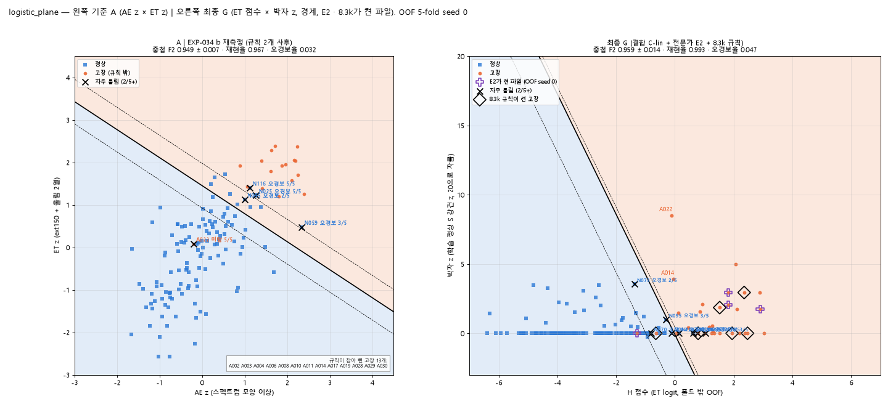
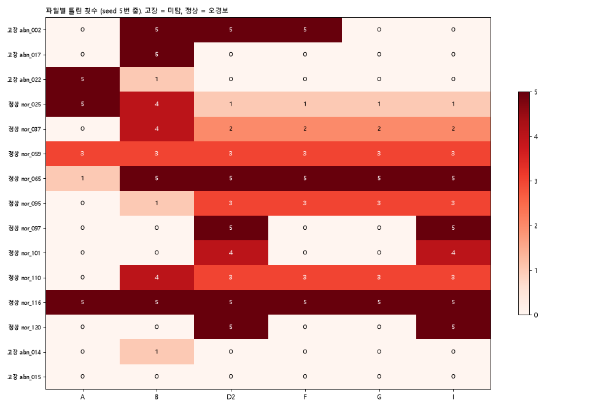
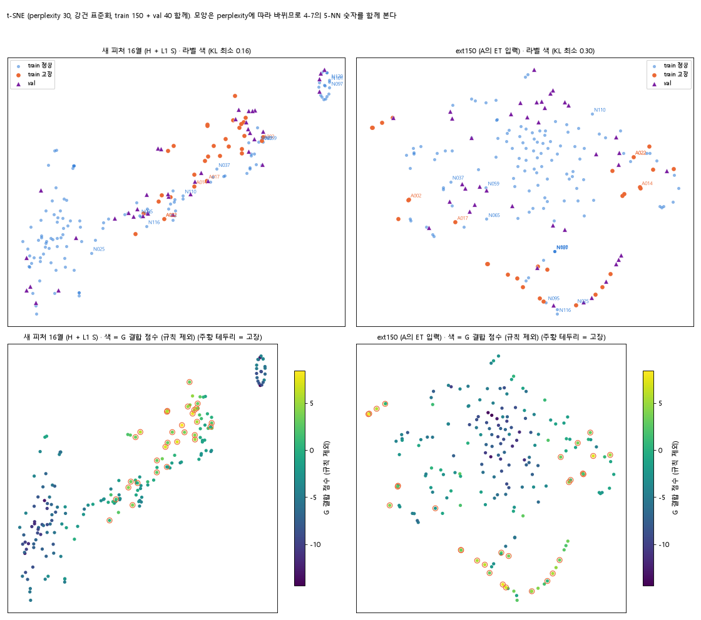
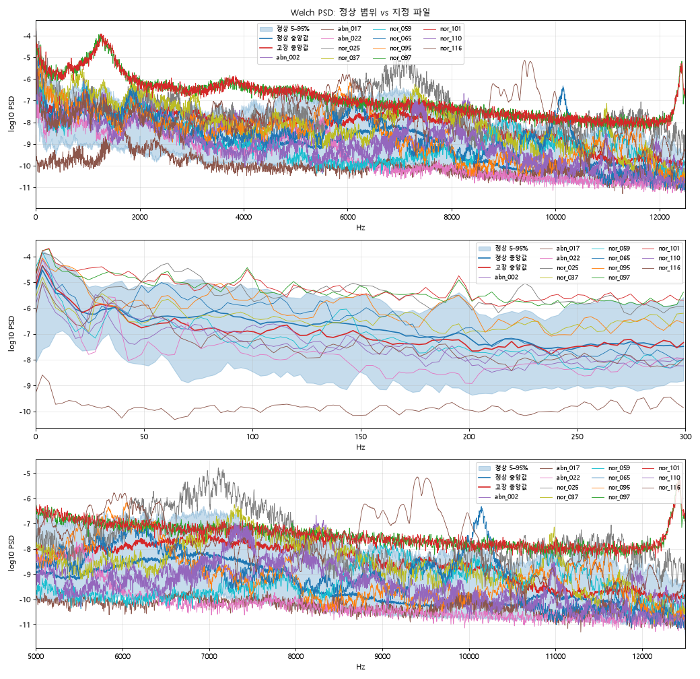

# EXP-043 E1 폐기 + 8.3k 규칙 — W OR E2 OR 8.3k

노션 카드 (실험 DB에 그대로 옮긴다)

| 팀원 | 모델 | F2 점수 | 변경 사항 | 메모 |
|---|---|---|---|---|
| 이동훈 | W(C-lin: ET + 박자 z → 로지스틱) OR E2(하중 대비 덜컥 H18 & 충격 ≥ 1) OR 8.3k 규칙(스펙트럼 OR 공진) | 0.959 ± 0.014 | E1 폐기(사용자 결정), 8.3k 규칙(src/final.py 정의) OR로 추가. 문턱은 EXP-042와 같음 (E2 = fit 정상 99 %) (H2, H3, H1) |  |

- 가설: H2, H3, H1 ([물리가설](../../../1_기준·기록/물리가설.md))
- 실행: 2026-11-22 · git `bfc87b8+수정중` · 코드 [run.py](run.py)
- 평가: 중첩 CV (바깥 5 × 안쪽 4, seed 5개). 자주 놓침 = seed 5번 중 3번 이상

## 결과

| 구성 | F2 | 재현율 | 오경보율 | 정밀도 | F2 (고장 10%·40%) | 자주 놓침 | 오경보 3회+ |
|---|---|---|---|---|---|---|---|
| 중첩: A \| EXP-034 b (EXP-040 값) | 0.949 ± 0.007 | 0.967 | 0.032 | 0.885 | 0.920 · 0.964 | 022 | 3 |
| 중첩: B \| ET 하나 (EXP-040 값) | 0.890 ± 0.024 | 0.913 | 0.055 | 0.808 | 0.844 · 0.914 | 002 017 | 6 |
| 중첩: W \| 2단계 승자 C-lin (EXP-041 값) | 0.907 ± 0.009 | 0.927 | 0.045 | 0.839 | 0.869 · 0.928 | 002 017 | 6 |
| 중첩: D2 \| W + E1 + E2 (EXP-042 값) | 0.916 ± 0.015 | 0.960 | 0.070 | 0.776 | 0.859 · 0.948 | 002 | 8 |
| 중첩: F \| W + E2 (규칙 없음) | 0.933 ± 0.014 | 0.960 | 0.047 | 0.838 | 0.892 · 0.954 | 002 | 5 |
| 중첩: G \| W + E2 + 8.3k (최종) | 0.959 ± 0.014 | 0.993 | 0.047 | 0.843 | 0.917 · 0.981 | — | 5 |
| 중첩: H \| W + 8.3k (E2 없음) | 0.935 ± 0.010 | 0.953 | 0.037 | 0.868 | 0.902 · 0.952 | 017 | 4 |
| 중첩: I \| W + E1 + E2 + 8.3k (E1 폐기 전) | 0.942 ± 0.015 | 0.993 | 0.070 | 0.781 | 0.883 · 0.974 | — | 8 |

## 해석

**E1을 빼고 8.3k 규칙을 붙인 G(W OR E2 OR 8.3k)가 중첩 F2 0.959 ± 0.014 · 재현율 0.993 · 오경보율 0.047로 지금까지 가장 높다.** A(EXP-034 b 0.949 ± 0.007)보다 +0.010이지만 G의 sd(0.014) 안이라 "비슷하거나 약간 높다" 이상은 말하지 않는다. 8.3k 문턱이 라벨을 본 뒤 정한 사후 값이라 이 점수는 낙관적이고(A도 사후 규칙 2개를 쓴다), 같은 틀의 A와 짝 비교한 값이 아니다.

<!-- key-figs: 자동 (save_fig key=True) -->

*logistic_plane* — A와 최종 G의 평면. E2(보라 +)와 8.3k 규칙(검은 ◆)이 켠 파일, 자주 틀린 파일(×)

<!-- /key-figs -->

### 읽는 법과 상세 (손으로 씀)
**그림 읽는 법.** 가로 = ET 점수(폴드 밖 logit), 세로 = 박자 z(20으로 자름). 실선이 W의 결합 경계이고 오른쪽 위가 고장. 보라 +가 E2가 켠 파일(고장 4개, 정상 0), 검은 ◆가 8.3k 규칙이 켠 고장(002 003 006 010 029 030), × 가 자주 틀린 파일. 정상 점이 박자 z = 0 줄에 몰려 있어 라벨이 겹친다(오경보 파일 목록은 아래 표).

**결과 비교 (같은 중첩 CV, 같은 실행)**
| 비교 | F2 차 | 읽기 |
|---|---|---|
| G − F (8.3k 규칙 추가) | +0.026 | 재현율 0.960 → 0.993. 002를 규칙이 잡는다. 오경보는 그대로(0.047) |
| G − I (E1 폐기) | +0.017 | 오경보율 0.070 → 0.047. E1이 켜던 평균 −1 g 정상 097 · 101 · 120이 사라지고, 070 · 073 오경보 횟수는 같다 |
| G − H (E2 추가) | +0.024 | E2가 없으면 017이 5/5 미탐. E2는 017형 4개를 잡고 정상 0 |
| G − D2 (EXP-042) | +0.043 | E1 폐기 + 8.3k의 합 |

- 8.3k 규칙이 켜진 train 파일은 고장 002 003 006 010 029 030, 정상 0개. 문턱은 사후 값이고 학습이 없어 폴드에 따라 바뀌지 않는다.
- G의 3회+ 미탐은 없다(009 1/5만 놓침). 022(박자 z 8.5)와 014는 박자 z로 잡힌다.
- G의 오경보(3회+)는 065 5/5 · 116 5/5 · 059 3/5 · 095 3/5 · 110 3/5. 모두 "고장처럼 생긴 정상"으로 EXP-034에서도 남던 파일이고, 이번에는 결합 경계 근처(ET −0.3–1.0)에 있다. 이 5개가 A(오경보율 0.032)와의 남은 차이다.

**오류 분석** (최종 G 기준 피처 백분위. E2 켜짐 = 위 분할의 5회 중 횟수)

| 파일 | 구분 | ET logit | 박자 z | E2 켜짐 | 8.3k 규칙 | 정상 95% 위 피처 | 5% 아래 피처 |
|---|---|---|---|---|---|---|---|
| nor_065 | 정상 | 0.63 | 0.00 | 0/5 | — | H10 H15 H16 | — |
| nor_095 | 정상 | -0.30 | 1.00 | 0/5 | — | — | — |
| nor_110 | 정상 | 0.13 | 0.00 | 0/5 | — | — | — |
| nor_116 | 정상 | 0.76 | 0.00 | 0/5 | — | H10 H15 H16 | H12 H13 |
| nor_059 | 정상 | 1.04 | 0.00 | 0/5 | — | H10 | H14 |
| abn_002 | 고장 | -0.65 | 0.00 | 0/5 | 켜짐 | H10 | — |
| abn_017 | 고장 | -1.29 | 0.00 | 5/5 | — | H3 H18 | H16 |
| abn_022 | 고장 | -0.12 | 8.52 | 0/5 | — | H13 L1 | — |

**val 채점 (제출 파일 없음).** train 150 전체로 학습한 G → val 40: **11개** 판정 (001 004 013 016 017 024 025 027 031 035 039). 결합 블록 10개(EXP-042 D2와 같은 10개), E2는 val에서 켜진 파일 없음, 8.3k 규칙은 **001 하나**를 켠다(EXP-042 D2에는 없던 판정). 신효섭 RF의 val 14개와 겹치는 것은 7개(001 004 016 027 031 035 039). 파일별 표 [val_판정.csv](val_판정.csv). val을 보고 구성을 바꾸지 않는다.

**판단 필요.** ① 8.3k를 규칙으로 쓰는 것은 EXP-034 c까지의 방식과 같은 사후 문턱이다. 이 구성을 최종으로 쓰려면 규칙 문턱을 흔드는 감사(EXP-030 방식)와 학습 파일을 바꿔 보는 감사를 한 번 더 한다. ② 유격 반복 규칙 · 본체 모드 내림은 이번 구성에 없다(E1 · E2로 대신하려던 몫). 이 둘을 더하면 오경보가 줄 수 있는지는 아직 안 쟀다. ③ 구성 비교 4개(F · G · H · I)는 실행 전에 고정한 것이다.

**구현 메모.** `src/exp2util.py`의 `rule83_flags`(8.3k 스펙트럼 · 공진 규칙, `src/final.py` 문턱을 그대로 씀)와 `Add83`(마지막 열 = 규칙 켜짐, 판정 = Two 판정 OR 규칙)을 추가했다. 규칙은 학습이 없어서 행마다 한 번 계산해 열로 붙였다.

## 그림

### hard_files
어느 파일이 A · B · D2 · F · G · I에서 맞고 틀리는가

### tsne
새 피처 공간과 ext150 공간에서 고장이 따로 모이는가 · 색 = 결합 점수

### psd_missed
자주 틀린 파일의 PSD가 정상 5–95% 범위 밖으로 나가는 주파수

