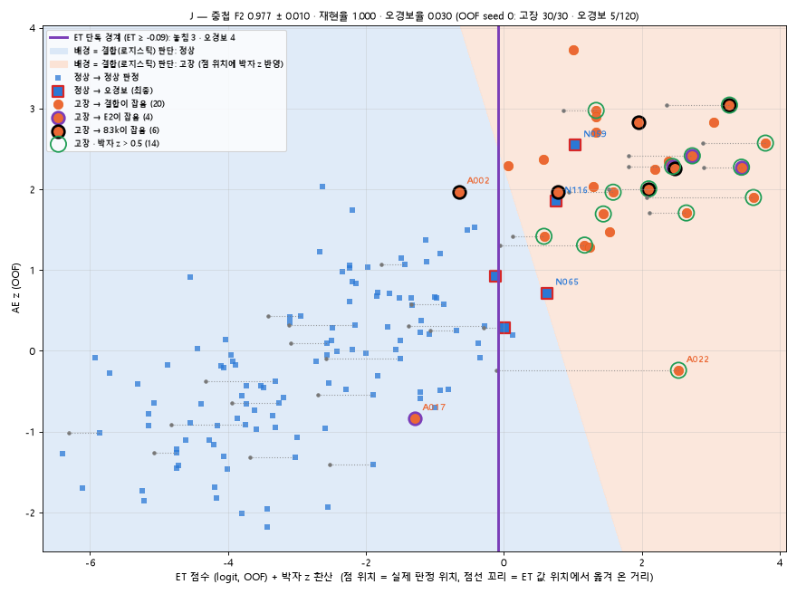
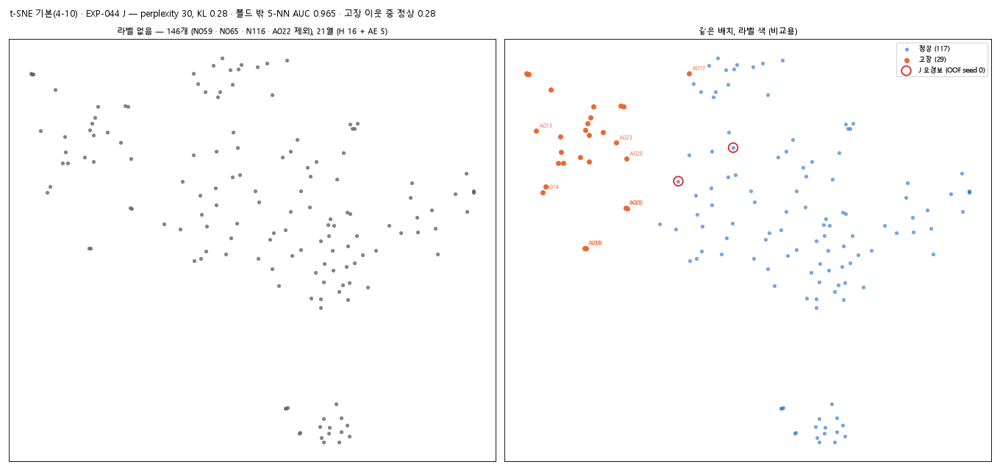
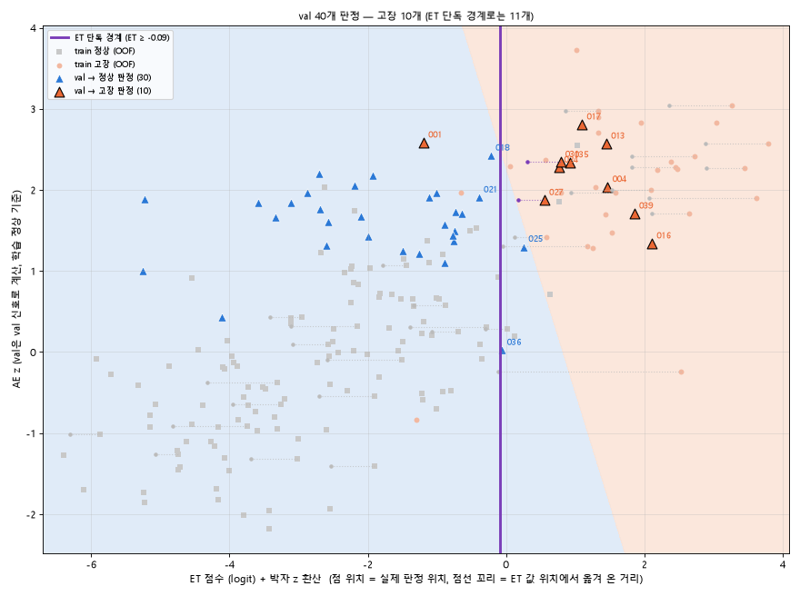
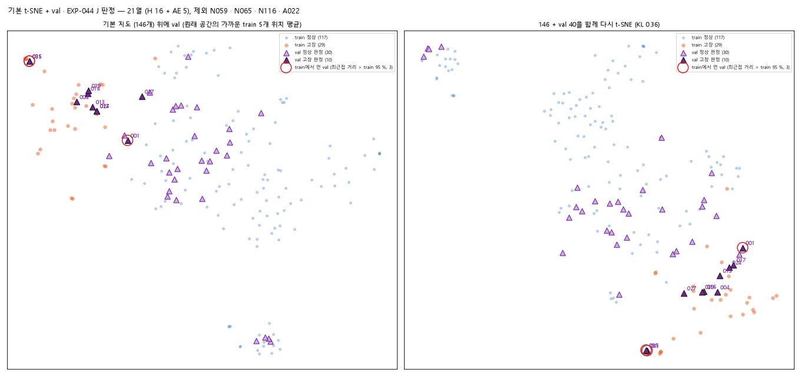

# EXP-044 G + 스펙트럼 AE (세 번째 결합 입력)

노션 카드 (실험 DB에 그대로 옮긴다)

| 팀원 | 모델 | F2 점수 | 변경 사항 | 메모 |
|---|---|---|---|---|
| 이동훈 | ET OOF logit + 박자 z + AE z → 로지스틱 OR E2 OR 8.3k 규칙 | 0.977 ± 0.010 | G(EXP-043)에 AE z를 결합 입력으로 추가 (src.models2.TwoAE) (H3, H2, H1) | **J(ET + 박자 z + AE → 로지스틱 OR E2 OR 8.3k): 중첩 F2 0.977 ± 0.010 · 재현율 1.000 · 오경보율 0.030.** G(AE 없음)보다 +0.018 (오경보율 0.047 → 0.030). |

## 주요 변경점 (기준 실험 대비)

- G(EXP-043)에 스펙트럼 AE z를 세 번째 결합 입력으로 추가
- 문턱 · E2 · 8.3k 규칙은 EXP-043과 같음

- 가설: H3, H2, H1 ([물리가설](../../1_기준·기록/물리가설.md))
- 실행: 2026-11-22 · git `fdfe336+수정중` · 코드 [run.py](run.py)
- 평가: 중첩 CV (바깥 5 × 안쪽 4, seed 5개). 자주 놓침 = seed 5번 중 3번 이상

## 결과

| 구성 | F2 | 재현율 | 오경보율 | 정밀도 | F2 (고장 10%·40%) | 자주 놓침 | 오경보 3회+ |
|---|---|---|---|---|---|---|---|
| 중첩: J \| W + AE + E2 + 8.3k (최종 후보) | 0.977 ± 0.010 | 1.000 | 0.030 | 0.895 | 0.949 · 0.991 | — | 3 |

## 해석

**J(ET + 박자 z + AE → 로지스틱 OR E2 OR 8.3k): 중첩 F2 0.977 ± 0.010 · 재현율 1.000 · 오경보율 0.030.** G(AE 없음)보다 +0.018 (오경보율 0.047 → 0.030).

<!-- key-figs: 자동 (save_fig key=True) -->

*logistic_plane* — 점 위치 = ET + 박자 z 환산(점선 꼬리 = ET 값 위치). ET × AE 평면 (OOF seed 0). 배경 = 결합(로지스틱) 판단, 보라 세로선 = ET 단독 판단 경계, 색 테두리 = 고장을 잡은 부품

*tsne_라벨* — 기본 t-SNE(4-10): 왼쪽 라벨 없음, 오른쪽 라벨 색. 빨간 원 = J 오경보. 폴드 밖 5-NN AUC 0.965

<!-- /key-figs -->

- 남은 오경보: 116 · 065 · 059 ([오류분석_표.md](오류분석_표.md)). val 판정: [val_판정.md](val_판정.md) · [README2.md](README2.md)
- 주의: val의 AE z가 +1.7 이동(95 %가 ≥ 1.0), AE 계수 0.553 → 확정 전 처리 필요. 8.3k 문턱은 사후 값
- 보조 분석(큐브 경계 · 비선형 결합 · 10 kHz 가정): [분석/](분석/)

## 그림

### val_판정
점 위치 = ET + 박자 z 환산(점선 꼬리 = ET 값 위치). val 40개를 train OOF 위에 겹침. 배경 = 결합(로지스틱) 판단, 보라 세로선 = ET 단독 판단 경계

### tsne_val포함
기본 t-SNE + val 40개 (보라 ▲ = J 판정, 진한 = 고장). 빨간 원 = train에서 먼 val (가장 가까운 train 거리가 train끼리 거리의 95 % 위)

## 중간 단계 결과 (비교 · 절제 · 이전 실험 값)

| 구성 | F2 | 재현율 | 오경보율 | 정밀도 | F2 (고장 10%·40%) | 자주 놓침 | 오경보 3회+ |
|---|---|---|---|---|---|---|---|
| 중첩: W \| 2단계 승자 C-lin (EXP-041 값) | 0.907 ± 0.009 | 0.927 | 0.045 | 0.839 | 0.869 · 0.928 | 002 017 | 6 |
| 중첩: G \| W + E2 + 8.3k (EXP-043 값) | 0.959 ± 0.014 | 0.993 | 0.047 | 0.843 | 0.917 · 0.981 | — | 5 |
| 중첩: I \| W + E1 + E2 + 8.3k (E1 폐기 전) | 0.942 ± 0.015 | 0.993 | 0.070 | 0.781 | 0.883 · 0.974 | — | 8 |
| 중첩: K \| W + AE (전문가 · 규칙 없음) | 0.916 ± 0.015 | 0.927 | 0.033 | 0.877 | 0.886 · 0.931 | 002 017 | 4 |
| 중첩: L \| W + AE + E2 (8.3k 없음) | 0.950 ± 0.009 | 0.967 | 0.030 | 0.892 | 0.923 · 0.964 | 002 | 3 |