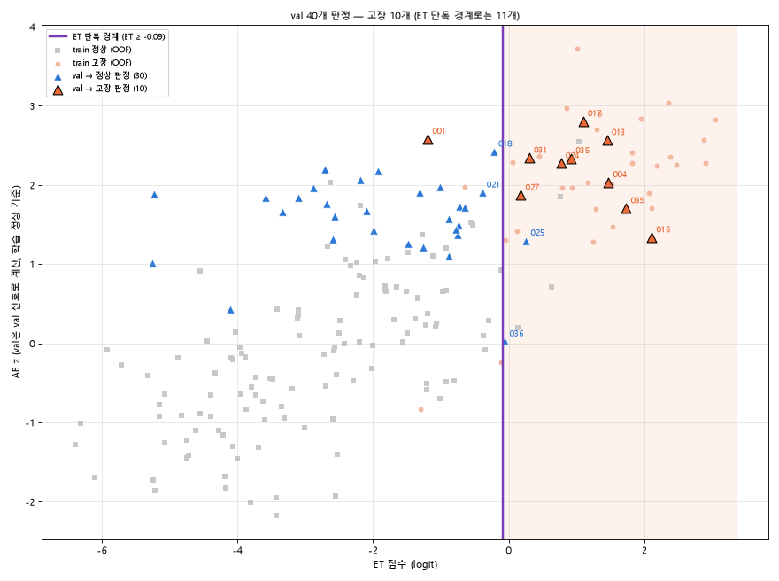

# EXP-044 val 판정 (train 150 전체 학습, 제출 파일 아님)

고장 판정 10개: 001 004 013 016 017 024 027 031 035 039

| 파일 | 판정 | ET | ET단독 | AE_z | 박자z | 켠부품 |
|---|---|---|---|---|---|---|
| 001 | 고장 | -1.19 | 정상 | 2.58 | 0.0 | 8.3k |
| 002 | 정상 | -0.74 | 정상 | 1.49 | 0.0 | — |
| 003 | 정상 | -4.11 | 정상 | 0.43 | 0.0 | — |
| 004 | 고장 | 1.47 | 고장 | 2.04 | 0.0 | 결합 |
| 005 | 정상 | -3.59 | 정상 | 1.84 | 0.0 | — |
| 006 | 정상 | -0.89 | 정상 | 1.1 | 0.0 | — |
| 007 | 정상 | -5.25 | 정상 | 1.01 | 0.0 | — |
| 008 | 정상 | -2.1 | 정상 | 1.68 | 0.0 | — |
| 009 | 정상 | -0.73 | 정상 | 1.73 | -0.0 | — |
| 010 | 정상 | -0.75 | 정상 | 1.37 | 0.0 | — |
| 011 | 정상 | -2.6 | 정상 | 1.32 | 0.0 | — |
| 012 | 정상 | -0.64 | 정상 | 1.71 | 0.0 | — |
| 013 | 고장 | 1.45 | 고장 | 2.57 | 0.0 | 결합 |
| 014 | 정상 | -3.34 | 정상 | 1.67 | 0.0 | — |
| 015 | 정상 | -2.88 | 정상 | 1.97 | 0.0 | — |
| 016 | 고장 | 2.11 | 고장 | 1.34 | 0.0 | 결합 |
| 017 | 고장 | 1.1 | 고장 | 2.81 | 0.0 | 결합 |
| 018 | 정상 | -0.22 | 정상 | 2.42 | 0.0 | — |
| 019 | 정상 | -2.69 | 정상 | 1.76 | 0.0 | — |
| 020 | 정상 | -5.22 | 정상 | 1.89 | 0.0 | — |
| 021 | 정상 | -0.39 | 정상 | 1.91 | 0.0 | — |
| 022 | 정상 | -1.31 | 정상 | 1.91 | 0.6 | — |
| 023 | 정상 | -1.93 | 정상 | 2.18 | 0.0 | — |
| 024 | 고장 | 0.77 | 고장 | 2.28 | 0.0 | 결합 |
| 025 | 정상 | 0.25 | 고장 | 1.3 | 0.0 | — |
| 026 | 정상 | -2.57 | 정상 | 1.6 | 0.0 | — |
| 027 | 고장 | 0.18 | 고장 | 1.87 | 1.2 | 결합 |
| 028 | 정상 | -2.7 | 정상 | 2.2 | 0.0 | — |
| 029 | 정상 | -1.99 | 정상 | 1.43 | 0.0 | — |
| 030 | 정상 | -3.11 | 정상 | 1.84 | 0.0 | — |
| 031 | 고장 | 0.3 | 고장 | 2.34 | 1.6 | 결합 |
| 032 | 정상 | -0.89 | 정상 | 1.58 | 0.0 | — |
| 033 | 정상 | -0.77 | 정상 | 1.44 | 0.0 | — |
| 034 | 정상 | -2.19 | 정상 | 2.06 | 0.0 | — |
| 035 | 고장 | 0.92 | 고장 | 2.34 | 0.0 | 결합 |
| 036 | 정상 | -0.06 | 고장 | 0.02 | 0.0 | — |
| 037 | 정상 | -1.01 | 정상 | 1.97 | 0.0 | — |
| 038 | 정상 | -1.26 | 정상 | 1.21 | 0.0 | — |
| 039 | 고장 | 1.73 | 고장 | 1.71 | 0.4 | 결합 |
| 040 | 정상 | -1.49 | 정상 | 1.25 | 0.0 | — |
