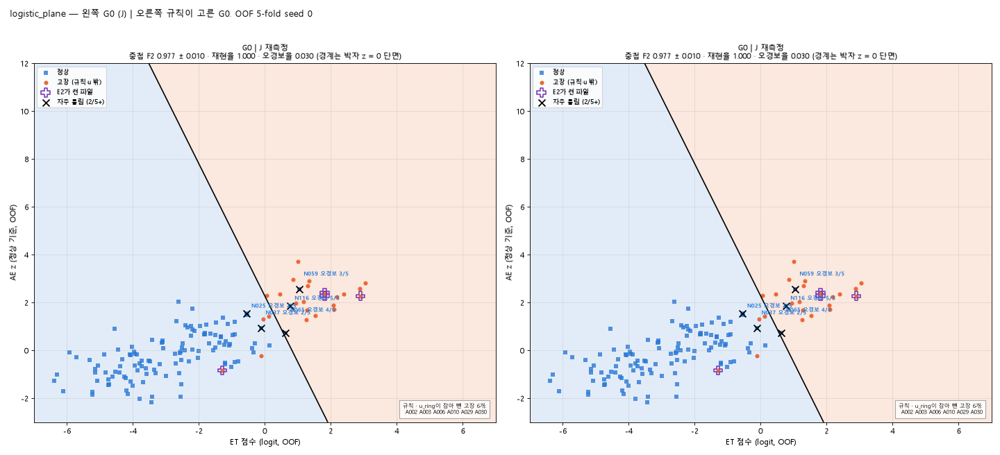
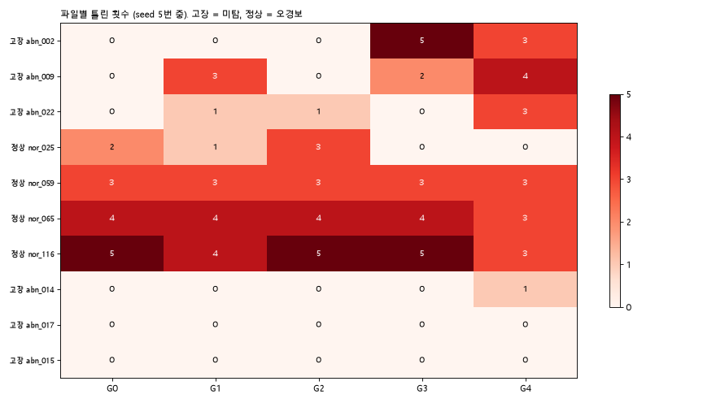
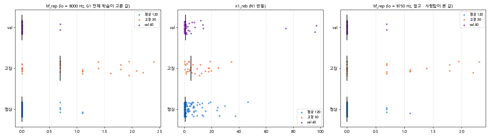
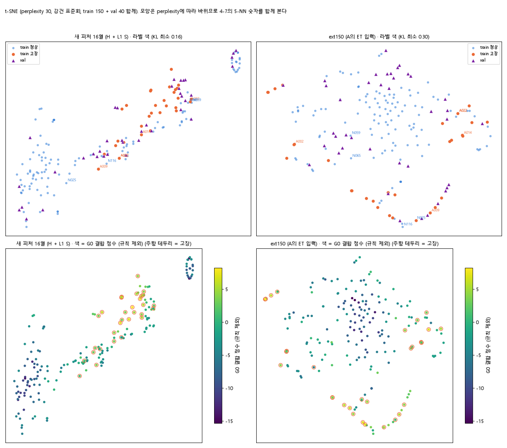
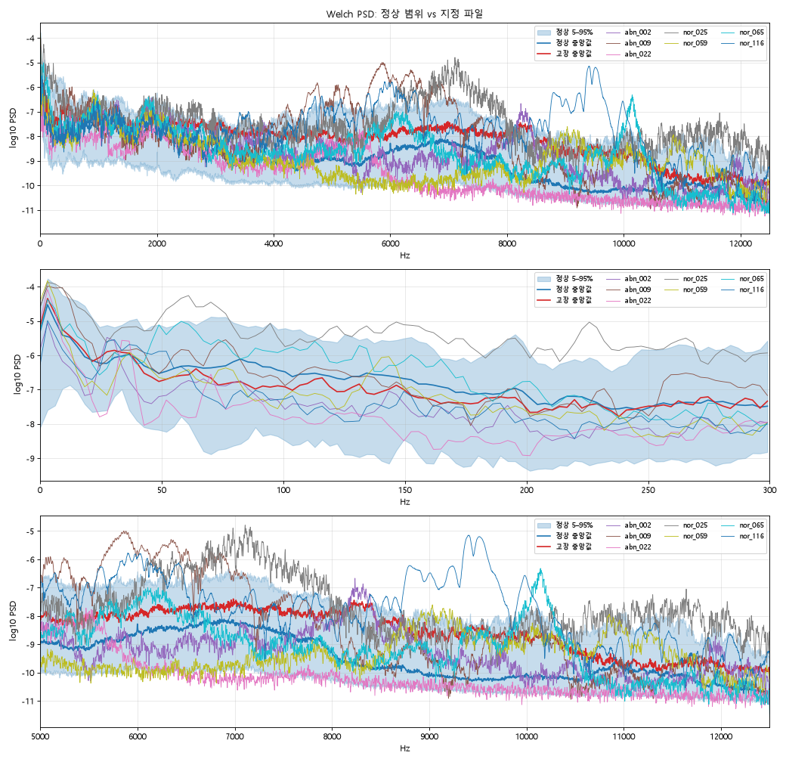

# EXP-046 J 위 세 가지 (hf_rep · n1_reb · u_ring)

노션 카드 (실험 DB에 그대로 옮긴다)

| 팀원 | 모델 | F2 점수 | 변경 사항 | 메모 |
|---|---|---|---|---|
| 이동훈 | J = ET OOF logit + 박자 z + AE z → 로지스틱 OR E2 OR 8.3k (G0), 세 가지 변형 G1–G4 | 0.977 ± 0.010 | J에 hf_rep 열(G1) · n1_reb 열(G2) · 8.3k OR 대신 u_ring 4번째 입력(G3) · 셋 모두(G4). 사전등록_046 (H1, H2, H3) | **사전등록_046의 선택 규칙을 글자 그대로 적용하면 채택이 0건이고, 최종은 G0(J, 0.977 ± 0.010) 그대로다.** G1(hf_rep 열) 0.956 ± 0.017은 G0보다 0.021 낮고(G0 sd 0.010의 두 배), G2(n1_reb 열) 0.968 ± 0.018은 −0.009라 sd 안이지만 오르지 않아 둘 다 보류. G3(8.3k OR → u_ring 4번째 입력) 0.936 ± 0.021은 채택 문턱 F2 ≥ 0.967에 못 미쳐 불채택(오경보율 0.020 ≤ 0.040 조건은 통과, 키 일치율 80 %라 "참고" 격하는 아님). G4 0.922 ± 0.014는 1·2에서 채택된 것이 없어 최종 후보가 아니라 보고만. 오경보는 줄지만(G1 0.022, G3 0.020, G4 0.017) 재현율이 0.92–0.97로 떨어져 F2가 내려간 것이다. |

- 가설: H1, H2, H3 ([물리가설](../../1_기준·기록/물리가설.md))
- 실행: 2026-11-22 · git `bfc87b8+수정중` · 코드 [run.py](run.py)
- 평가: 중첩 CV (바깥 5 × 안쪽 4, seed 5개). 자주 놓침 = seed 5번 중 3번 이상

## 결과

| 구성 | F2 | 재현율 | 오경보율 | 정밀도 | F2 (고장 10%·40%) | 자주 놓침 | 오경보 3회+ |
|---|---|---|---|---|---|---|---|
| 중첩: G0 \| J 재측정 | 0.977 ± 0.010 | 1.000 | 0.030 | 0.895 | 0.949 · 0.991 | — | 3 |
| 중첩: G1 \| J + hf_rep | 0.956 ± 0.017 | 0.967 | 0.022 | 0.918 | 0.936 · 0.967 | 009 | 3 |
| 중첩: G2 \| J + n1_reb | 0.968 ± 0.018 | 0.993 | 0.035 | 0.878 | 0.936 · 0.984 | — | 4 |
| 중첩: G3 \| J − 8.3k + u_ring | 0.936 ± 0.021 | 0.940 | 0.020 | 0.922 | 0.918 · 0.946 | 002 | 3 |
| 중첩: G4 \| G3 + hf_rep + n1_reb | 0.922 ± 0.014 | 0.920 | 0.017 | 0.933 | 0.907 · 0.930 | 002 009 022 | 3 |

## 해석

**사전등록_046의 선택 규칙을 글자 그대로 적용하면 채택이 0건이고, 최종은 G0(J, 0.977 ± 0.010) 그대로다.** G1(hf_rep 열) 0.956 ± 0.017은 G0보다 0.021 낮고(G0 sd 0.010의 두 배), G2(n1_reb 열) 0.968 ± 0.018은 −0.009라 sd 안이지만 오르지 않아 둘 다 보류. G3(8.3k OR → u_ring 4번째 입력) 0.936 ± 0.021은 채택 문턱 F2 ≥ 0.967에 못 미쳐 불채택(오경보율 0.020 ≤ 0.040 조건은 통과, 키 일치율 80 %라 "참고" 격하는 아님). G4 0.922 ± 0.014는 1·2에서 채택된 것이 없어 최종 후보가 아니라 보고만. 오경보는 줄지만(G1 0.022, G3 0.020, G4 0.017) 재현율이 0.92–0.97로 떨어져 F2가 내려간 것이다.

<!-- key-figs: 자동 (save_fig key=True) -->

*logistic_plane* — G0(J)와 선택 규칙이 고른 구성의 평면. 8.3k·u_ring이 잡은 고장은 평면에서 빼고 상자에 목록, E2(보라 +), 자주 틀린 파일(×)

<!-- /key-figs -->

## 해석 (자세히)

**규칙 적용 표** (G0 sd = 0.0096)

| 구성 | G0 대비 F2 | 규칙 | 결과 |
|---|---|---|---|
| G1 hf_rep | −0.021 | 열 추가는 G0 + sd를 넘게 올라야 채택 | 보류 |
| G2 n1_reb | −0.009 | 위와 같음 | 보류 |
| G3 u_ring | −0.041 (문턱 ≥ −0.0096 아님) · 오경보율 −0.010 | F2 ≥ G0 − sd 그리고 오경보율 ≤ G0 + 0.010 | 불채택 (F2에서 탈락) |
| G4 | −0.054 | 채택된 것이 모두 포함될 때만 최종 후보 | 보고만 (조합 "G0"은 실행한 구성과 같아 새 후보 없음) |

최종 조합 = G0 (G3 불채택 + 채택된 열 없음). "조합이 G4와 다르면 다음 후보"에 해당하는 새 조합은 나오지 않았다.

**어느 파일이 바뀌었나 (G0 대비 중첩 CV 틀린 횟수, seed 5번 중)**
- G1: 미탐 009 0→3, 016 0→1, 022 0→1. 오경보는 116 5→4, 037 2→1, 025 2→1, 106 · 095 1→0. 009는 8.3k 울림 대역에 fit이 없는 고장이라, 새 열이 ET 분할을 바꾼 부작용으로 보이며 원인은 확인하지 않았다.
- G2: 미탐 022 0→1, 오경보 073 · 110 0→1, 025 2→3. 정상 탐색에서 남은 후보라는 가설은 이 표에서는 확인되지 않았다.
- G3: 미탐 002 0→5(전 seed), 009 0→2, 028 0→2. 오경보는 037 2→0, 025 2→0, 106 · 095 1→0으로 줄어든다(8.3k OR가 켜던 정상은 없었으므로 이는 8.3k OR 제거와 무관하게 결합이 바뀐 효과로 보이며, 원인은 확인하지 않았다).
- G4: G3의 미탐 + 014 · 016 · 022 일부, 오경보 116 5→3, 065 4→3, 019 0→1.

**u_ring이 8.3k OR를 대신하지 못한 이유 (확인한 것)**: 전체 train 학습에서 u_ring은 사전등록 키 (8250, 8750, 0.01), t = 0.665로 002 003 006 010 013 029를 모두 켜고(u 1.11–1.30, 정상 0) R의 기록과 같다. 그러나 로지스틱 계수는 u에 약 1.37(ET 1.65 · 박자 0.52 · AE 0.37)이라 u = 1.2가 더하는 점수는 약 +1.7이고, OOF에서 002는 ET logit이 −0.65라 결합 점수 0.32가 문턱 1.13을 못 넘는다. 즉 부드러운 입력은 OR 규칙처럼 "켜지면 무조건 고장"이 되지 못한다. 009 · 028은 해당 울림이 없는 고장(u = 0)이라 ET · AE만으로 결합 문턱(해당 폴드 1.47)을 넘어야 하는데 OOF 점수 0.67 · 1.42로 못 넘는다. G0에서는 이 둘이 잡혔는데(미탐 0) 무엇이 달랐는지(8.3k OR 유무 · 결합 계수 · 문턱)는 분리해 확인하지 않았다.

**fit 안 선택의 안정성** (바깥 학습 전체 fit 25번 = seed 5 × 5겹)
- hf_rep lo: G1 8000 Hz 20번 · 8250 Hz 5번 (G4도 같다). 전체 train 단변량 AUC: 7750 0.809 · **8000 0.817** · 8250 0.801 · 8500 0.721 · 8750 0.704 · 9000 0.704. 사령탑이 본 8750 Hz는 격자에서 AUC가 낮아 고르지 않았다. 동률은 한 번도 없었다.
- u_ring 키: (8250, 8750, 0.01) 20번(80 %), (8250, 8750, 0.04) 2 · (8000, 8450, 0.04) 2 · (7750, 9000, 0.02) 1. G4도 80 %. t = 0.665 20번 · 0.525 4번 · 0.5 1번.
- u 계수 부호: G3 25번 모두 양(+) (중앙값 0.89), G4 24/25 양(+) (중앙값 0.51). 기전과 같은 방향.

**val 40 판정 (train 150 전체 학습, AE 점수는 val 신호로 계산, 임계 0.5)**

| 구성 | 판정 수 | G0과 겹침 | G0에 없는 파일 | G0에만 있는 파일 | 경계 밀집 (\|점수−τ\| < 0.5·SD) |
|---|---|---|---|---|---|
| G0 | 10 (001 004 013 016 017 024 027 031 035 039) | 10 | — | — | 23 (SD 5.14, τ 1.074) |
| G1 | 13 | 10 | 018 021 025 | — | 26 |
| G2 | 10 | 10 | — | — | 22 |
| G3 | 10 | 9 | 025 | 001 | 21 |
| G4 | 9 | 9 | — | 001 | 21 |

val에서 u_ring이 켜진 파일은 0개(해당 울림 fit 최대 0)이고, G3·G4가 G0에서 빠뜨린 001은 8.3k 규칙이 켜던 파일이다 → 8.3k 규칙이 val에서 하던 일을 u_ring이 못 한다. 경계 밀집이 21–26개로 모든 구성에서 40개의 절반 이상인 것은 OOF 결합 점수의 SD(5.1–5.4)가 커서 ±2.6 폭 안에 많이 들어오기 때문이다(이 지표는 구성 간 차이가 작아 판별력이 낮다).

**주의 (한계)**
- hf_rep의 lo · u_ring의 키와 t는 `fit` 전체 행에서 한 번 고르므로, `fit` 내부의 안쪽 4겹 OOF 점수에서는 그 선택에 안쪽 시험 행의 라벨이 섞인다(바깥 시험 폴드는 영향 없음). u는 학습 행에서 계산한 값이라 학습 때는 낙관적이다. 사전등록 설계 그대로이며 바깥 중첩 CV 결과에는 누수가 없다.
- G0 재측정은 EXP-044 J와 같은 0.977 ± 0.010 · 재현율 1.000 · 오경보율 0.030으로 재현됐다. 충격 수 합(정상 854 · val 247 · 고장 402), n1_reb ↔ normal_feats(최대 오차 2e-15), 전체 train u_ring 선택(키 (8250, 8750, 0.01) · 켜진 고장 002 003 006 010 013 029 · 정상 0)을 먼저 확인했다.
- 오경보 116 5/5 · 065 · 059는 어느 구성에서도 사라지지 않았다.

**그림 읽는 법**: logistic_plane은 박자 z = 0(G3·G4는 u = 0)의 단면이라 오른쪽 패널은 규칙이 G0을 골랐으므로 왼쪽과 같다. 8.3k 규칙이 켠 고장(002 003 006 010 029 030)은 평면에서 빼고 t-SNE에 남겼다. dist_hf_n1: hf_rep(lo = 8000)은 정상의 95 %가 0, 고장의 67 %가 > 0이고 val은 95 %가 0(정상과 비슷), n1_reb는 정상 중앙 0.74 · 고장 4.95 · val 0.79로 val이 정상 쪽이다. 고장 쪽 신호는 train에서 뚜렷하나(AUC 0.82 · 0.75) 그것이 J의 결합 점수 위에서 추가 정보가 되지는 않았다.

## 그림

### hard_files
어느 파일이 G0–G4에서 맞고 틀리는가

### dist_hf_n1
새 열의 분포. 굵은 검은 막대 = 중앙값. 고장이 정상과 갈라지는가, val은 어디에 놓이는가

### tsne
새 피처 공간과 ext150 공간에서 고장이 따로 모이는가 · 색 = G0 결합 점수

### psd_missed
자주 틀린 파일의 PSD가 정상 5–95% 범위 밖으로 나가는 주파수

