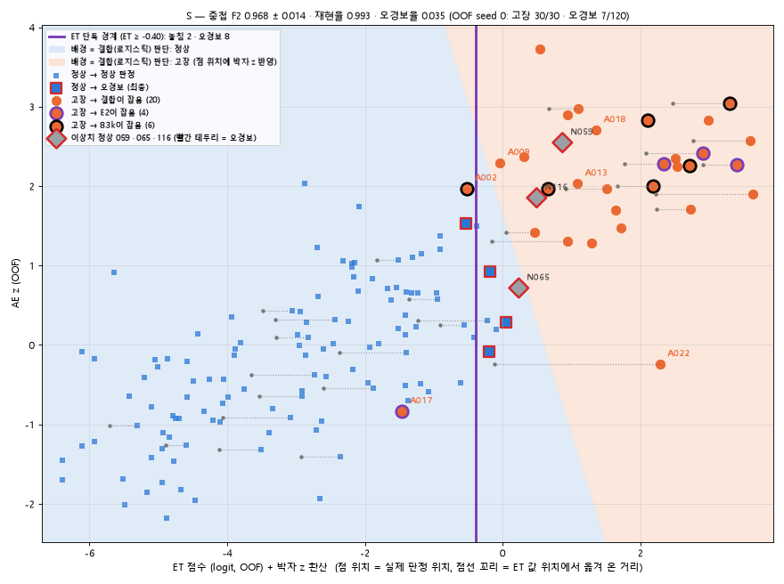
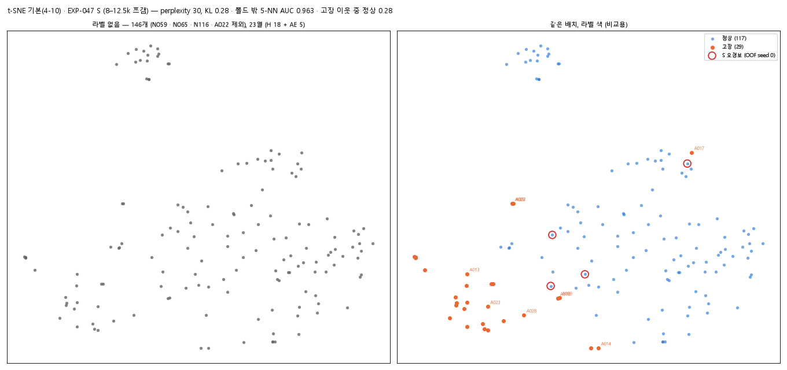
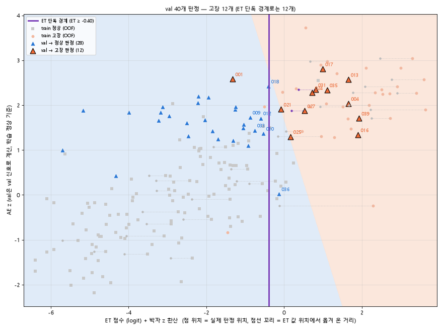
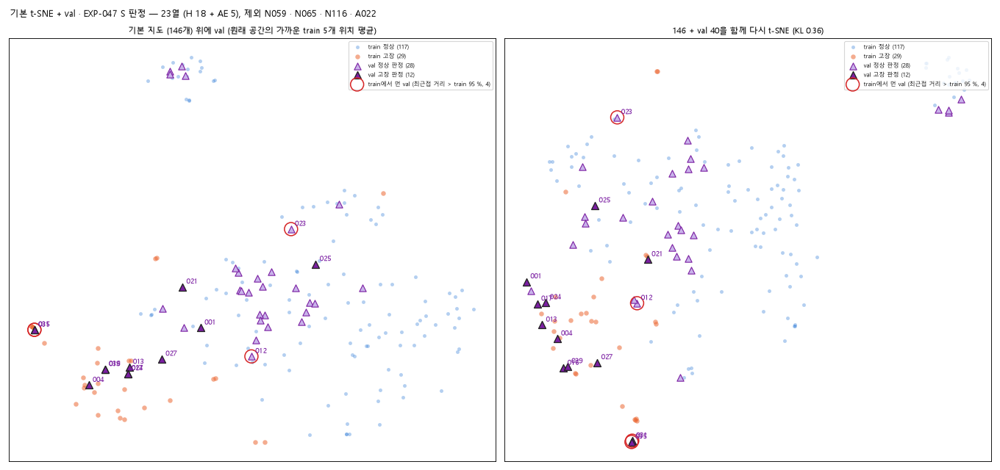

# EXP-047 8–12.5 kHz 옥타브를 8–10 · 10–12.5 kHz로 쪼갬

노션 카드 (실험 DB에 그대로 옮긴다)

| 팀원 | 모델 | F2 점수 | 변경 사항 | 메모 |
|---|---|---|---|---|
| 이동훈 | ET(H10 · H15 → 8–10 · 10–12.5k 4열) + 박자 z + AE z → 로지스틱 OR E2 OR 8.3k | 0.968 ± 0.014 | J(EXP-044)의 ET 입력에서 H10 · H15를 8–10 · 10–12.5 kHz 울림 비율 · 파워 몫 4열로 교체 (H2, H3, H1) | **중요 실험 (사용자 11-22).** F2 0.968 ± 0.014로 J 0.977보다 낮지만, 기본 t-SNE(4-10)에서 정상 무리 경계에 놓인 고장 2개만 처리하면 정상과 고장이 J보다 더 잘 갈려 보인다. 쪼갠 4열의 단변량 판별력은 원래 2열보다 낮다(AUC 0.83 → 0.78 · 0.68, 0.81 → 0.79 · 0.64). 025 오경보 4/5, 022 1/5 미탐. |

## 주요 변경점 (기준 실험 대비)

- ET 입력 H10(울림 8–12.5k) · H15(몫 8–12.5k) → H10a/H10b(울림 8–10k / 10–12.5k) · H15a/H15b(몫 8–10k / 10–12.5k)
- 경계 10 kHz는 실행 전 고정
- 나머지는 J와 같음 (이상치 포함 학습)

- 가설: H2, H3, H1 ([물리가설](../../1_기준·기록/물리가설.md))
- 실행: 2026-11-22 · git `fdfe336+수정중` · 코드 [run.py](run.py)
- 평가: 중첩 CV (바깥 5 × 안쪽 4, seed 5개). 자주 놓침 = seed 5번 중 3번 이상

## 결과

| 구성 | F2 | 재현율 | 오경보율 | 정밀도 | F2 (고장 10%·40%) | 자주 놓침 | 오경보 3회+ |
|---|---|---|---|---|---|---|---|
| 중첩: S \| J에서 H10 · H15 → 8–10 · 10–12.5k 4열 (이상치 포함 학습) | 0.968 ± 0.014 | 0.993 | 0.035 | 0.878 | 0.936 · 0.984 | — | 3 |

## 해석

**중요 실험 (사용자 11-22).** F2 0.968 ± 0.014로 J 0.977보다 낮지만, 기본 t-SNE(4-10)에서 정상 무리 경계에 놓인 고장 2개만 처리하면 정상과 고장이 J보다 더 잘 갈려 보인다. 쪼갠 4열의 단변량 판별력은 원래 2열보다 낮다(AUC 0.83 → 0.78 · 0.68, 0.81 → 0.79 · 0.64). 025 오경보 4/5, 022 1/5 미탐.

<!-- key-figs: 자동 (save_fig key=True) -->

*logistic_plane* — 점 위치 = ET + 박자 z 환산(점선 꼬리 = ET 값 위치). ET × AE 평면 (OOF seed 0). 배경 = 결합(로지스틱) 판단, 보라 세로선 = ET 단독 판단 경계, ◆ = 이상치 정상 3개

*tsne_라벨* — 기본 t-SNE(4-10): 왼쪽 라벨 없음, 오른쪽 라벨 색. 빨간 원 = S 오경보. 폴드 밖 5-NN AUC 0.963

<!-- /key-figs -->

- 읽는 법: J의 평면 그림과 같다. 009 · 018 · 013(이번에 겨냥한 고장)은 오른쪽 위 고장 판정 쪽에 있다. 쪼개기 전(J)에도 결합이 5/5로 잡던 파일이다.
- **점수가 J보다 낮은 이유**: 4-10 진단의 "8–9 kHz ↑ · 11–12.5 kHz ↓" 대비는 섞인 고장 무리(P1)와 그 옆 정상 사이에서만 보인 차이였다. 고장 30개 전체로 보면 8–12.5 kHz 옥타브를 합친 쪽이 더 잘 가른다. 10–12.5 kHz 칸만 떼면 판별력이 낮다(울림 0.68, 몫 0.64). 그리고 t-SNE에서 "섞인" 고장은 J가 AE로 이미 잡고 있었다. 지도의 섞임이 곧 모델의 오류는 아니다.
- 폴드 안 안정성(단변량 AUC, 학습 폴드 25개): 새 4열 모두 방향은 바뀌지 않았다(최소 0.56 이상). 정보가 약할 뿐 불안정하지는 않다. [피처점검.md](피처점검.md)
- 이상치 3개를 학습에서 빼면(S-x) 0.952로 더 낮다. EXP-046(J-x 0.961)과 같은 방향이다.
- val: 고장 판정 12개. J와 다른 파일은 021 · 025 두 개(둘 다 경계 바로 아래에 있던 파일, [질문답](../EXP-044_1122_AE추가/분석/질문답_val이동_민감도.md)).
- **기본 t-SNE + val** (아래 `tsne_val포함`, 23열 공간). 고장 판정 12개는 가까운 train 5개 중 고장이 평균 3.8개, 정상 판정 28개는 0.18개다.
  - J와 다른 두 파일은 성격이 다르다. **021은 이웃 고장 3/5**로 지도에서도 고장 쪽에 가깝다. **025는 이웃 고장 0/5**로 정상 무리 안에 있다. 즉 025의 고장 판정은 이웃 근거가 없다.
  - train에서 먼 val: 031 · 035(H17 봉우리 폭 z 21), 012 · 023(백분위 95). 023은 10–12.5 kHz 몫이 매우 낮다(z −4.4).
  - 수치는 [val_판정.md](val_판정.md)의 이웃고장(5) · 최근접거리_백분위 · 최대z 열.

## 그림

### val_판정
점 위치 = ET + 박자 z 환산(점선 꼬리 = ET 값 위치). val 40개를 train OOF 위에 겹침. 배경 = 결합(로지스틱) 판단, 보라 세로선 = ET 단독 판단 경계

### tsne_val포함
기본 t-SNE + val 40개 (보라 ▲ = S 판정, 진한 = 고장). 빨간 원 = train에서 먼 val (가장 가까운 train 거리가 train끼리 거리의 95 % 위)

## 중간 단계 결과 (비교 · 절제 · 이전 실험 값)

| 구성 | F2 | 재현율 | 오경보율 | 정밀도 | F2 (고장 10%·40%) | 자주 놓침 | 오경보 3회+ |
|---|---|---|---|---|---|---|---|
| 중첩: J \| EXP-044 값 (기준, 이상치 포함 학습) | 0.977 ± 0.010 | 1.000 | 0.030 | 0.895 | 0.949 · 0.991 | — | 3 |
| 중첩: J-x \| EXP-046 값 (이상치 3개 학습 제외) | 0.961 ± 0.016 | 0.987 | 0.037 | 0.871 | 0.928 · 0.979 | — | 3 |
| 중첩: S-x \| S, 이상치 3개 학습 제외 (150개 평가) | 0.952 ± 0.019 | 0.973 | 0.035 | 0.875 | 0.920 · 0.968 | — | 3 |