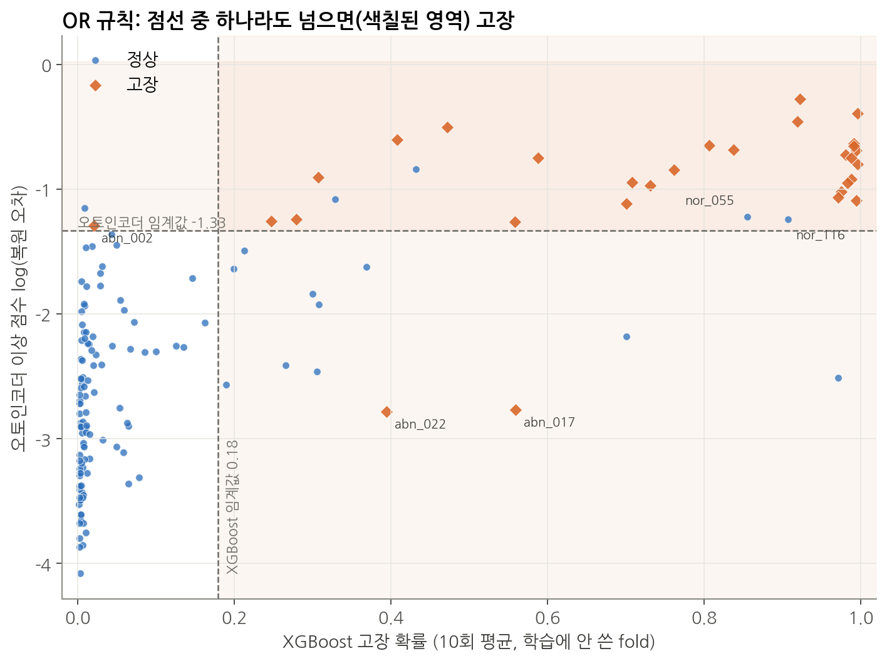
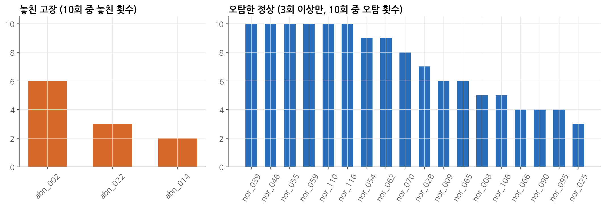
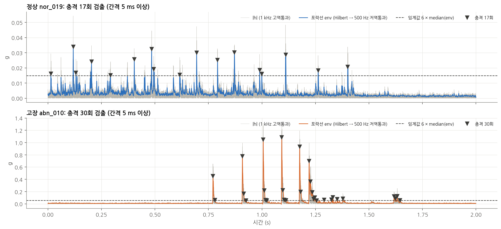
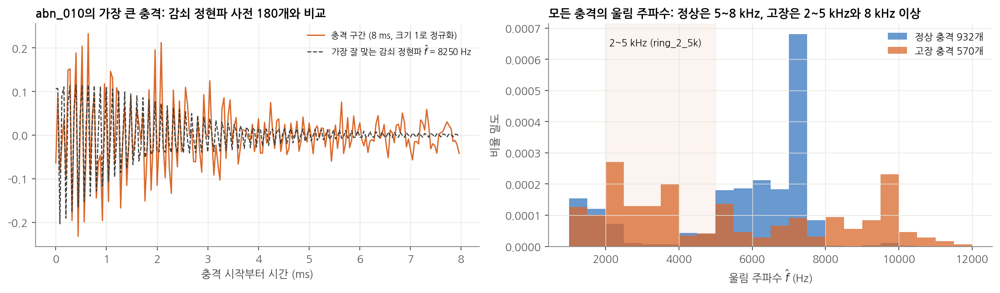

# 팀원 모델 검토 — 우리 모델에 가져올 점 (2026-11-16)

읽은 자료: 11-16에 받은 팀원 1차 공유 중 **권소린 · 신효섭 · 한동훈** (박나영 제외). PDF는 pdftotext로 md로 바꿔 읽었다.
- 권소린: [요약 변환본](../../../%EC%B0%B8%EA%B3%A0%EC%9E%90%EB%A3%8C/%ED%8C%80%EC%9B%90%20%EA%B3%B5%EC%9C%A0%20%EC%A0%95%EB%B3%B4/%EA%B6%8C%EC%86%8C%EB%A6%B0/1116_1%EC%B0%A8/%EB%82%B4_%EB%AA%A8%EB%8D%B8_%ED%8C%80_%EA%B3%B5%EC%9C%A0_%EC%9A%94%EC%95%BD_%EB%B3%80%ED%99%98.md) · 노션 md
- 신효섭: [방법론 보고서 변환본](../../../%EC%B0%B8%EA%B3%A0%EC%9E%90%EB%A3%8C/%ED%8C%80%EC%9B%90%20%EA%B3%B5%EC%9C%A0%20%EC%A0%95%EB%B3%B4/%EC%8B%A0%ED%9A%A8%EC%84%AD/1116_1%EC%B0%A8/%ED%85%90%EC%85%98%EC%95%94_%EC%9D%B4%EC%83%81%EA%B0%90%EC%A7%80_%EB%B0%A9%EB%B2%95%EB%A1%A0_%EB%B3%B4%EA%B3%A0%EC%84%9C_%EB%B3%80%ED%99%98.md) · 노션 md
- 한동훈: [V5C 보고서 변환본](../../../%EC%B0%B8%EA%B3%A0%EC%9E%90%EB%A3%8C/%ED%8C%80%EC%9B%90%20%EA%B3%B5%EC%9C%A0%20%EC%A0%95%EB%B3%B4/%ED%95%9C%EB%8F%99%ED%9B%88/1116_1%EC%B0%A8/V5C_Extra_Trees_%EB%B0%A9%EB%B2%95%EB%A1%A0_%EB%B3%B4%EA%B3%A0%EC%84%9C_%EB%B3%80%ED%99%98.md) · 노션 md
- 팀원 자료 전체 목록: [1116_1차 README](../../../%EC%B0%B8%EA%B3%A0%EC%9E%90%EB%A3%8C/%ED%8C%80%EC%9B%90%20%EA%B3%B5%EC%9C%A0%20%EC%A0%95%EB%B3%B4/README_1116_1%EC%B0%A8.md) (`참고자료/`는 git 제외)

## 결론 먼저

1. **가장 가져올 만한 것은 "충격이 울리는 주파수" 축이다.** 권소린·신효섭이 서로 독립적으로 찾았다. 정상 충격은 5–8 kHz(특히 7 kHz 부근)에서 좁게 울리고, 고장 충격은 2–5 kHz와 8 kHz 이상으로 넓게 울린다. 신효섭의 `ring_2_5k`(2–5 kHz로 울리는 충격의 비율)는 피처 59개 중 단변량 AUC 1위(0.893)이고, 권소린은 이 묶음으로 오탐을 9.7개에서 7.2개로 줄였다. 우리에게 남은 오경보 대부분은 **"큰 타격이 한 번 있는 정상"**(025 · 116 · 055)이고, 이 축은 그 유형을 겨냥한다. 다만 기대치는 낮춰야 한다. 이 피처를 쓴 신효섭 모델도 055 · 116은 10번 모두 오탐했다(그림 10). 현실적인 목표는 **우리만 틀리는 025**다. 우리 2-15(사건 주파수 중심 FC)는 실패했는데, 팀원들은 측정 방식이 다르다. 그래서 새 EXP로 다시 볼 가치가 있다(아래 A1)
2. **임계값을 "F2 곡선 평탄 구간의 가운데"로 정하는 방식은 새 피처 없이 바로 시험할 수 있다.** 권소린은 이 방식으로 0.918 → 0.930을 얻었고 10번 중 10번 이겼으며 흔들림도 가장 작았다. 우리 임계값은 seed에 따라 0.89–1.35로 크게 흔들린다(EXP-030). val 전에 바꿔도 되는 범위인지는 사용자 결정이다(아래 A3)
3. **발표용 검증을 보강할 수 있다.** 라벨 섞기 검사, 고장 유형 하나를 통째로 빼고 학습하기, 40개 세트 부트스트랩 F2 분포는 팀원 두 명이 이미 했다. 우리는 아직 하지 않았다. 모델을 바꾸지 않아 val 전에 해도 안전하다(아래 B절)

**팀원 점수와 우리 점수는 직접 비교하지 않는다.** 평가 방식이 다르다.
- 권소린: 반복 CV 10회. 최종 임계값은 150개 전체 CV의 F2 곡선에서 골랐다
- 신효섭: 반복 CV 10회
- 한동훈: 중첩 CV, 분할 1개(seed 42). 추가 분할 4개의 평균은 0.797이다
- 우리: 중첩 CV(바깥 5 × 안쪽 4), seed 5개. 사후 문턱 규칙을 포함한다

---

## 1. 세 사람의 모델 한눈에

| | 권소린 | 신효섭 | 한동훈 | 우리 (EXP-025) |
|---|---|---|---|---|
| 모델 | Random Forest, 피처 10개 | XGBoost(57개) OR 오토인코더(스펙트럼 1,025칸) | Extra Trees, 피처 38개 | AE + ET → 로지스틱 + 규칙 2개 |
| 전처리 | 평균 제거, 신호 4벌(10 Hz HP · 2.5–5 kHz BP · AR(40) 백색화 · 비교 대역), 앞뒤 0.02초 제거 | 평균 제거, 200 Hz로 저·고주파 분리, AR(40) 백색화, 포락선 충격 검출, 웨이블릿 잡음 제거 | 평균 제거, 30–6,000 Hz 대역통과 | 평균 제거, 200 Hz 고역통과 |
| F2 (본인 기재) | 0.930 ± 0.022 | 0.883 ± 0.017 | 0.849 (분할 4개 평균 0.797 ± 0.033) | 0.942 ± 0.012 (사후 문턱) |
| 재현율 · 오탐 | 0.957 · 5.7개/120 | 0.963 · 14.7개/120 | 0.90 · 12개/120 | 0.960 · 오경보율 0.033(약 4개/120) |
| 자주 놓친 고장 | 002 | 002 6/10 · 022 3/10 · 014 2/10 | 002 · 021 · 029 | 022 |
| 자주 낸 오탐 | 073 (나머지는 경계) | **10/10: 039 046 055 059 110 116**, 9/10: 054 062, … 025 3/10 | 009 022 027 046 050 054 055 060 070 073 095 116 | 025 · 116 · 055 · 059 |

- **002는 우리만 확실히 잡는다.** 8.3 kHz 규칙 덕분이고 발표에서 우리 강점이다. 반대로 **022는 신효섭 모델(7/10)과 한동훈 v5-C가 잡았다.** 신효섭 그림 8을 보면 022·017은 AE 점수가 낮고 XGBoost만 잡는다. 우리는 주기 잠금 규칙을 빼서 022를 놓친다. 일반 피처로 022를 잡을 실마리가 있다는 뜻이다(A5)
- **우리 오경보 055 · 059 · 116은 신효섭 모델에서도 10번 중 10번 오탐이다.** 한동훈도 055 · 116을 오탐했다. 서로 다른 피처·모델이 모두 틀리는 "원래 고장처럼 생긴 정상"이다(6-1 N-A, EXP-028 결론과 같다). 이 셋을 억지로 내리려 하지 않는다
- **025는 다르다.** 신효섭 3/10, 한동훈·권소린은 오탐하지 않았다. 우리만 고질적으로 틀리는 파일이라 팀원 피처 중 무엇이 025를 내리는지 보면 A1의 근거가 된다

### 신효섭 그림으로 보기
그림은 신효섭 방법론 보고서(11-13)에서 꺼냈다. 원본 PDF의 그림 번호를 그대로 쓴다. 파일 위치는 [figs/신효섭/1116_1차/](../figs/신효섭/1116_1차)이다.

**그림 8 — XGBoost 확률 × 오토인코더 점수 평면 (OR 판정)**: 우리 `logistic_plane`과 같은 종류의 그림이다. 오른쪽 위 고장 영역에 정상 055 · 116이 고장들과 섞여 있다. 022 · 017은 AE 점수가 낮아(아래쪽) XGBoost 축만으로 잡힌다. 002는 AE 임계값 바로 근처에 있다

**그림 10 — 10회 반복 중 파일별 오판정 횟수**: 왼쪽은 놓친 고장, 오른쪽은 3회 이상 오탐한 정상이다

## 2. 네 사람이 독립적으로 같은 결론에 도달한 것 — 발표 근거

| 결론 | 권소린 | 신효섭 | 한동훈 | 박나영 (노션) | 우리 |
|---|---|---|---|---|---|
| 진동 **크기**(RMS)로는 못 가른다 | — | RMS + LR 0.521 (전부 고장 0.556보다 낮음) | 시간 특징만으로 한계 | — | RMS 관리도 0.080 |
| 고장 충격은 **약 1–5 kHz** 대역 | 2.5–5 kHz | 2–5 kHz 울림, 200 Hz–3 kHz 스펙트럼 첨도 | (6 kHz 위를 깎자 오탐 26 → 12) | 1–4 kHz 노킹 대역 | P02 1.25–3.75 kHz (4-1, EXP-027) |
| 정상 충격은 **더 높은 주파수**(5–8 kHz) | 5–8 kHz | 5–8 kHz (7 kHz 부근) | 6 kHz 위를 깎으면 오탐 감소 | 약 7 kHz | (2-15에서 일부 관찰, 효과 없음) |
| 평균 제거 필수, 이동평균 쓰지 않음 | ○ | ○ | ○ | ○ (중앙값) | ○ (3-1) |
| 피처를 많이 넣는다고 좋아지지 않음 | 12개 → 10개 | LR까지 OR하면 하락 | 76개 결합 시 하락 | VIF로 3개 | EXP-007·011·027 |
| 반복 충격을 **연속 피처**로 넣으면 효과 없음 | 반복성 4개 효과 없음 | 사전등록 실험 +0.003 기각 | — | — | 유격은 **AND 규칙**으로만 효과 (EXP-025), 연속 축은 015·017 손실 (EXP-026) |

- 발표 "02 정상·고장 비교"에서 **"팀원 4명이 서로 다른 방법으로 같은 1–5 kHz 충격 대역에 도달했다"**고 말할 수 있다. 사후 선택 의심을 줄이는 근거가 된다
- 마지막 줄은 우리 방식의 정당화다. 같은 "반복 충격" 정보도 연속 피처로 넣으면 효과가 없고, 도메인 규칙(AND)으로 넣어야 효과가 났다

**신효섭 그림 2 — 포락선 충격 검출 (정상 019 vs 고장 010)**: 정상 019는 작은 충격(0.03 g 안팎)이 2초 내내 고르게 흩어져 있다. 고장 010은 바탕이 조용하다가 0.77–1.25초에 정상의 약 30배(최대 1 g)인 큰 타격이 **비슷한 크기로 여러 번 반복**된다. 우리 H1′("고장은 큰 타격이 반복된다", 2-14)과 유격 반복 규칙(2-12)을 발표에서 설명할 때 그대로 쓸 수 있는 예시다

---

## A. 모델에 적용해 볼 후보 (우선순위 순)

새 실험은 EXP-034부터 `스크리닝/`에서 `quick_cv`로 시작한다. 결정.md "최종 구성 고정"을 바꾸는 것은 사용자 결정이다. val(11/19) 전에 최종 구성을 바꿀지도 함께 정해야 한다.

### A1. 충격 울림 주파수 피처 → ET 입력 (H1 + H2, 최우선)
- **개념**: 충격 하나는 부딪친 구조물의 고유진동수로 울리다가 지수적으로 줄어든다(감쇠진동). 어느 주파수로 울리는지를 보면 **무엇이 어디를 쳤는지**를 알 수 있다. 노면 충격은 암 전체를 7 kHz 부근으로 울리고, 연결부 유격 충격은 2–5 kHz와 고주파로 퍼진다는 것이 팀원들의 관찰이다
- **팀원 방법**
  - 신효섭: 1 kHz 고역통과 → 힐베르트 포락선 → 중앙값의 6배 넘는 봉우리를 충격으로 본다(간격 5 ms 이상). 충격 직후 구간을 감쇠정현파 사전(1–12 kHz, 250 Hz 간격 × 감쇠비 4개)과 대조해 울림 주파수를 고른다. 이를 `ring_2_5k`(2–5 kHz 비율, AUC 0.893) · `ring_ge8k` · `ring_f_iqr`(울림 주파수의 퍼짐: 정상 중앙 250 Hz, 고장 2,125 Hz)로 요약한다
  - 권소린: 큰 충격 20개의 직후 12 ms에서 대역 RMS 비율(2–5k ÷ 5–8k, 8–11k ÷ 5–8k)과 "2–5 kHz로 울린 충격 비율"을 계산한다. 중요도 상위 5개 중 3개가 이 묶음이다
- **신효섭 그림 3**
  - 왼쪽: 고장 010의 가장 큰 충격에 감쇠정현파를 맞춘 결과로, 울림 주파수는 8,250 Hz다
  - 오른쪽: 충격 1,502개(정상 932 · 고장 570)의 울림 주파수 분포다. 정상은 7–7.5 kHz에 한 봉우리로 몰린다. 고장은 2–4 kHz와 8–12 kHz 두 곳으로 퍼진다

  

  - **우리 8.3 kHz 규칙과 겹칠 수 있다.** 010은 우리 8.3 kHz 규칙이 잡는 고장 5개 중 하나다. 이 파일의 대표 울림이 8,250 Hz라는 것은, "고장은 8 kHz 이상으로 울린다"는 관찰의 일부가 우리 H2′(8.3 kHz 모드가 넓게 들뜸)와 같은 현상일 수 있다는 뜻이다. A1을 시험할 때는 `ring_ge8k`(8 kHz 이상)보다 **`ring_2_5k`(2–5 kHz)를 주 후보**로 둔다. 8.3 kHz 규칙이 켜진 파일과 겹치는지도 따로 센다
- **우리 2-15와 다른 점**: 2-15는 사건마다 주파수 **중심(FC) 하나**를 재고 문턱 여유가 0.1 kHz뿐이었다. 팀원 방식은 ① 충격 **여러 개에 대한 비율·퍼짐**이고 ② 대역 **비율**이라 게인에 둔감하다
- **확인 순서**
  1. 오경보 025 · 116 · 055와 미탐 022, 경계 005에서 이 피처가 정상 분포의 어디에 있는지 본다 (EDA 조각 2-16)
  2. ET 입력에 4–5열을 추가해 `quick_cv`로 본다
  3. 통과하면 중첩 CV를 돌린다
- **위험**
  - 권소린이 25년 데이터(다른 차종)에 적용했을 때 울림 피처의 AUC는 0.53–0.62로 무너졌다. 측정 조건이 바뀌면 가장 먼저 깨지는 피처다
  - 한 파일 안에서 고르는 대역 경계(2/5/8 kHz)는 팀원들이 데이터를 보고 정한 값이다. 우리 기준으로는 "사후"로 표시해야 한다

### A2. 고주파(8 kHz 이상) 충격 피처 빼기 · 비율로만 쓰기 (H1, 진단)
- 권소린: 8–11 kHz를 충격 피처(첨도 등)로 넣으면 정상 충격 파일이 고장처럼 보여 오탐이 약 6개 늘었다. 5–8 kHz와의 **비율**로만 넣으면 0.826 → 0.854로 올랐다
- 한동훈: 6 kHz 위를 깎는 대역통과만으로 오탐이 26개에서 12개로 줄었다
- **우리 확인**: ext150의 P02 대역 첨도·Peak 중 고주파 칸이 오경보 정상(025 · 116 · 055)을 올리고 있는지 본다. 비용이 작은 ablation이다. ET 입력에서 8 kHz 이상 충격 열을 빼고 `quick_cv`를 돌리면 된다
- 주의: 우리 AE와 8.3 kHz 규칙은 고주파 **스펙트럼 모양**을 쓴다. 빼는 대상은 ET의 고주파 **충격** 열만이다

### A3. 임계값 = 안쪽 CV F2 곡선의 평탄 구간 가운데 (평가, 새 피처 없음)
- **개념**: F2가 최대인 점 하나 대신, 최대에서 0.02 이내인 구간의 가운데를 고른다. 최대점은 경계 근처 파일 한두 개에 따라 크게 움직이지만, 구간 가운데는 덜 움직인다
- 권소린: 최대점 0.918, seed 3개 중앙값 0.919, 평탄 구간 가운데 0.930. 10번 중 10번 이겼고 흔들림이 가장 작았다
- 우리: 최대점(고장 최저점 위치) seed 3개 중앙값 → 0.938 ± 0.014. 같은 학습 파일에서도 seed 사이 임계값이 0.89–1.35로 움직인다(EXP-030 해석 6). 위치를 간격 중간·하단으로 옮기는 것은 이미 시험했다(0.933–0.945). 평탄 구간 정의는 시험하지 않았다
- **방법**: EXP-030 OOF로 중첩 CV를 다시 계산한다. 모델은 그대로라 비용이 작다
- 바꾸면 결정.md "최종 임계값" 줄을 고쳐야 하므로 사용자 결정 사항이다

### A4. AR(40) 백색화 잔차 → ET 입력 (H3 · 정상 이탈, 낮은 우선순위)
- **개념**: 학습 fold의 정상 파일로 AR 모델(과거 40점으로 다음 값을 예측하는 선형 모델)을 맞춘다. 모든 파일을 이 예측오차 필터에 통과시키면 정상에서 예측 가능한 공진은 지워지고 예측할 수 없는 충격만 남는다
- 신효섭: 잔차 에너지 비는 AUC 0.833이지만 8–11 kHz 에너지와 상관이 0.86이다. 권소린: "정상 AR 잔차"를 최종 10개에 넣었다
- 우리 AE(정상 스펙트럼과의 차이)와 정보가 겹칠 가능성이 크다. A1 · A2 뒤에 여유가 있을 때 본다

### A5. 022를 일반 피처로 잡을 실마리 (H4, 조사)
- 우리는 022만 겨냥한 주기 잠금 규칙을 뺐다(C2 미달). 그런데 신효섭 XGB는 022를 10번 중 7번, 한동훈 v5-C(30–6,000 Hz)는 022를 잡았다(대가로 오탐이 많다)
- 팀원 피처 중 무엇이 022를 올리는지 본다(예: `seg_kurt_mean` 0.2초 구간 첨도, `SK_200_3k` 스펙트럼 첨도). 우리 ET에 같은 정보가 있는지 확인한다. 규칙이 아닌 피처라면 "022 하나만 겨냥"한다는 문제가 없다

---

## B. 검증 · 발표 보강 (모델 변경 없음, val 전에 해도 안전)

| 항목 | 팀원 결과 | 우리에게 주는 것 | 방법 |
|---|---|---|---|
| **라벨 섞기 검사** | 권소린 F2 0.52, 신효섭 0.543 · 0.526 (전부 고장 0.556 수준) | 우리 절차에 누수가 없다는 직접 증거. 사후 문턱이 섞여 있어 특히 필요하다 | 라벨을 섞어 중첩 CV를 10회 이상 반복한다. 규칙은 고정 문턱 그대로 둔다 |
| **고장 유형 하나 빼고 학습** | 권소린: 처음 보는 약한 고장 유형 재현율 RF 37%, 보험 모델(OR 오토인코더) 47% | 발표 "05 한계"의 정량 근거. 우리는 2-0에서 L1–L4 분류를 이미 해 두었다 | L 유형마다 그 유형 고장을 학습에서 빼고 그 유형의 재현율을 잰다. AE(정상만 학습)가 얼마나 받쳐 주는지도 본다 |
| **40개 세트 부트스트랩** | 신효섭: 40개(고장 8)를 20,000번 뽑으면 F2 평균 0.884, 90% 구간 0.778–0.952 | val 점수를 해석할 기준 구간. 결정.md "val 점수"(sd 약 0.09)를 우리 OOF로 갱신한다 | EXP-030 OOF 판정에서 40개를 복원 없이 뽑아 반복한다 |
| **잡음 피처 추가 검사** | 권소린: 잡음 피처 25세트를 넣어도 점수가 한 번도 오르지 않음 | 피처 추가로 얻은 개선이 운이 아니라는 근거 | ET 입력에 무작위 열을 더해 `quick_cv`를 돌린다 |
| **다른 차종(25년) 적용** | 권소린: 같은 절차 0.893. 학습된 모델은 차를 못 넘는다(오탐 34개). 울림 피처는 차마다 다르다 | 우리 "방법"의 일반화 근거. `참고자료/25년3조_비교/`에 25년 데이터 로더가 있다 | 25년 데이터에 우리 절차를 처음부터 돌린다(8.3 kHz 규칙은 차종 고유라 빼야 할 수 있음) |
| **승패 횟수 보고** | 권소린: "10회 중 몇 번 이겼나". 신효섭: 사전등록 기준(+0.02 & 8/10 승) | 우리 "차이 < sd면 같은 수준" 기준에 같은 분할 짝 비교를 더하면 판정이 더 명확하다 | `nested_cv` 결과에 seed별 짝 승패를 한 열 추가한다 |

---

## C. 가져오지 않을 것 (이유)

| 팀원 방식 | 이유 |
|---|---|
| OR 결합 (신효섭: XGB OR AE) | 우리는 로지스틱으로 두 점수를 합치고 규칙만 OR로 붙인다. 신효섭 표에서도 OR을 하나 더하면(LR 추가) 오탐 +5.4로 하락했다. 지금 구조가 같은 효과를 더 적은 오탐으로 낸다 |
| 상관 0.85 · VIF 10 · AUC 상위 k로 피처 선택 | EXP-007 · 027: 트리 모델에서 VIF로 거르면 중심 피처가 빠져 하락했다. 우리 정보는 두 덩어리에 나뉘어 있어 상위 k만 남기면 하락한다 |
| 다른 차종(25년) 데이터를 학습에 추가 | 권소린: 0.926 → 0.843, 오탐이 두 배로 늘었다 |
| 30–6,000 Hz 대역통과로 전 신호를 자르기 (한동훈) | 우리 8.3 kHz 규칙과 AE가 6 kHz 위 정보를 쓴다. 필요한 부분(고주파 충격 열)만 A2로 따로 본다 |
| 반복 충격을 연속 피처로 추가 | 신효섭 사전등록 실험 +0.003으로 기각, 우리 EXP-026에서도 손실. 이미 유격 규칙(AND)으로 반영했다 |

## 확인 필요
- 신효섭은 "정상 33개가 교체된 새 train"에서 **교체된 정상의 오탐률이 17.3%로 기존 정상(10.3%)보다 높다**고 썼다. 권소린은 고질 오탐 073이 "11/12 교체 파일"이라고 썼다. 우리 데이터 폴더에는 예전 train이 없어 어떤 파일이 교체됐는지 알 수 없다. 팀원에게 교체 파일 목록을 받으면 우리 오경보(025 · 116 · 055 · 059)가 교체 파일에 몰리는지 볼 수 있다. 몰려 있다면 6-1의 N-E "측정 조건이 다른 정상"에 해당한다
- 데이터 동일성: 한동훈 문서의 `TeamProject_train_CHANGED.zip` SHA256(36609509…b0b8d)이 우리 `data/TeamProject_train_변경.zip`과 **일치한다** (11-16 확인). 같은 학습 데이터다
