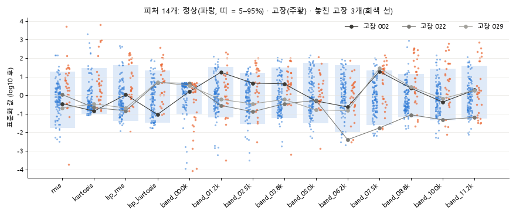
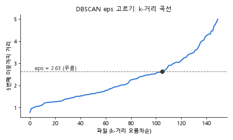
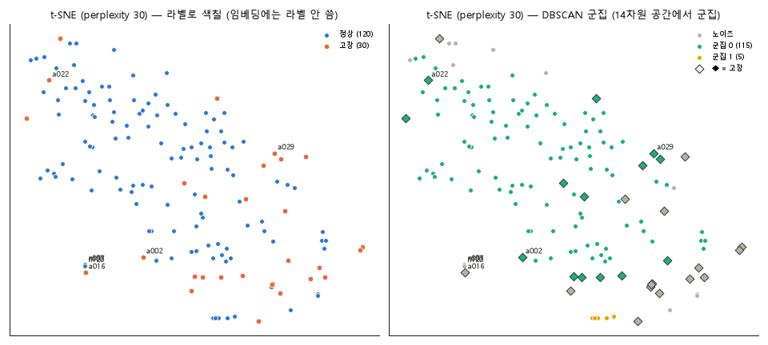

# EXP-009 기본 피처 임베딩·군집 (t-SNE·UMAP·DBSCAN)

노션 카드 (실험 DB에 그대로 옮긴다)

| 팀원 | 모델 | F2 점수 | 변경 사항 | 메모 |
|---|---|---|---|---|
| 이동훈 | ExtraTrees (참고) · DBSCAN | 0.755 ± 0.028 | 피처 14개(RMS·첨도·HP 1 kHz RMS·첨도·대역 에너지 비율 10)로 t-SNE·UMAP·DBSCAN (H1, H3) |  |

- 가설: H1, H3 ([물리가설](../../../notes/물리가설.md))
- 실행: 2026-11-13 · git `1771fbd+수정중` · 코드 [run.py](run.py)
- 평가: 중첩 CV (바깥 5 × 안쪽 4, seed 5개). 자주 놓침 = seed 5번 중 3번 이상

## 결과

| 구성 | F2 | 재현율 | 오경보율 | 정밀도 | F2 (고장 10%·40%) | 자주 놓침 | 오경보 3회+ |
|---|---|---|---|---|---|---|---|
| 기본 14개 + ET | 0.755 ± 0.028 | 0.847 | 0.192 | 0.528 | 0.644 · 0.825 | 002 015 022 025 | 22 |

## 그림

### psd_focus
놓친 고장의 PSD가 정상 범위(파란 띠) 밖으로 나가는 주파수가 있는가


### feature_focus
피처 14개에서 정상 띠 밖으로 나가는 고장이 어느 피처인가. 놓친 고장 002·022·029는 띠 안에 있는가



### dbscan_kdist
k-거리가 급히 커지기 시작하는 무릎 = 밀집 영역의 경계. 그 거리를 eps로 쓴다



### tsne
고장이 정상과 다른 곳에 모이는가, 놓친 고장(a002·a022·a029)과 평균 −1 g 파일은 어디 있는가. t-SNE는 가까운 이웃만 보존 → 덩어리 사이 거리·크기는 해석하지 않는다



## DBSCAN 결과

```
eps 2.631 · min_samples 5 · 군집 2개 · 노이즈 30개

라벨          고장   정상
군집(−1=노이즈)         
-1          16   14
 0          14  101
 1           0    5

노이즈 = 고장으로 볼 때 (사후 집계, 전체 150개 그대로 · 중첩 CV 아님): 재현율 0.533 · 오경보율 0.117 · F2 0.533
노이즈 고장: abn_003 abn_004 abn_008 abn_009 abn_011 abn_012 abn_015 abn_016 abn_017 abn_018 abn_019 abn_021 abn_023 abn_024 abn_027 abn_030
노이즈 정상: nor_014 nor_030 nor_045 nor_053 nor_054 nor_055 nor_059 nor_062 nor_073 nor_090 nor_097 nor_101 nor_116 nor_120
관심 파일 군집: {'abn_002': 0, 'abn_022': 0, 'abn_029': 0, 'nor_097': -1, 'nor_101': -1, 'nor_120': -1, 'abn_016': -1}
```

## 메모
- 비지도(라벨 없는) 구조로는 고장이 따로 모이지 않는다. t-SNE에서 고장은 오른쪽 아래에 몰리는 경향이 있지만 정상과 섞여 있고, DBSCAN은 큰 군집 1개(정상 101·고장 14) + 작은 군집 1개(정상 5) + 노이즈 30개(고장 16·정상 14)
- DBSCAN 노이즈 = 고장으로 보면 재현율 0.53·오경보율 0.12 (사후 집계, 중첩 CV 아님). 노이즈 정상 14개에 평균 −1 g 파일 nor_097·101·120이 모두 포함 → 기준선 이상도 "이상"으로 잡힌다
- 놓친 고장 002·022·029는 모두 큰 정상 군집 안. 정상 대비 백분위로 보면 022는 band_06.2k–11.2k가 2–8 백분위로 낮고(고주파가 조용한 고장, H3), 002·029는 band_07.5k만 94·95 백분위(띠 위쪽 끝, EXP-005의 8.2–8.4 kHz 피크와 같은 대역, H2)이고 나머지 13개는 정상 띠 안
- 같은 14개로 ET 중첩 CV 0.755 ± 0.028 (ext150 0.827보다 낮음, 오경보율 0.19) → 기본 피처만으로는 부족, 대역 필터 후 국소 충격 피처(P02·S01)가 더 필요
- UMAP: umap-learn 미설치로 아직 없음 (설치 승인 후 같은 run.py 재실행)
