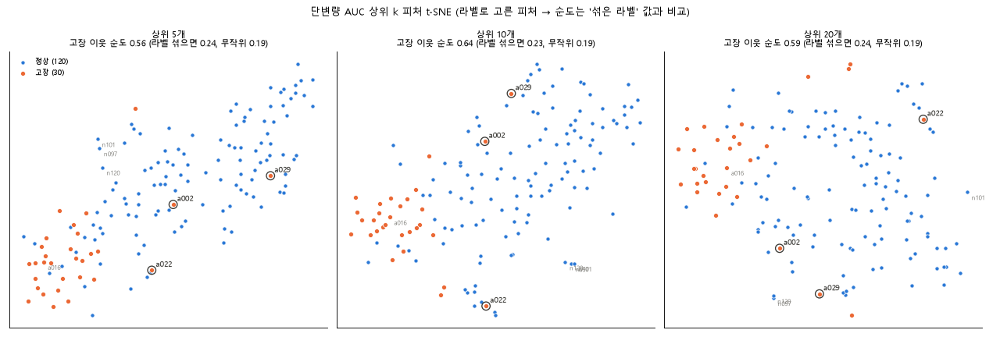
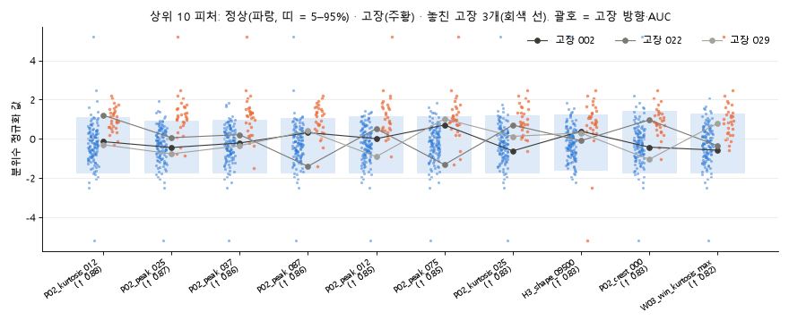

# EXP-011 상위 피처 몇 개로 t-SNE

노션 카드 (실험 DB에 그대로 옮긴다)

| 팀원 | 모델 | F2 점수 | 변경 사항 | 메모 |
|---|---|---|---|---|
| 이동훈 | ExtraTrees (폴드 안 상위 k 선택) | 0.762 ± 0.037 | 도메인 피처 217개 중 단변량 AUC 상위 k개(5·10·20, 중복 제거)만으로 t-SNE·중첩 CV (H1, H2, H3) |  |

- 가설: H1, H2, H3 ([물리가설](../../../notes/물리가설.md))
- 실행: 2026-11-13 · git `1771fbd+수정중` · 코드 [run.py](run.py)
- 평가: 중첩 CV (바깥 5 × 안쪽 4, seed 5개). 자주 놓침 = seed 5번 중 3번 이상

## 결과

| 구성 | F2 | 재현율 | 오경보율 | 정밀도 | F2 (고장 10%·40%) | 자주 놓침 | 오경보 3회+ |
|---|---|---|---|---|---|---|---|
| 상위 5개 (폴드 안 선택) + ET | 0.746 ± 0.021 | 0.847 | 0.207 | 0.508 | 0.631 · 0.821 | 002 017 022 029 | 23 |
| 상위 10개 (폴드 안 선택) + ET | 0.762 ± 0.037 | 0.853 | 0.187 | 0.534 | 0.653 · 0.831 | 002 017 022 029 | 21 |
| 상위 20개 (폴드 안 선택) + ET | 0.786 ± 0.019 | 0.873 | 0.170 | 0.565 | 0.682 · 0.851 | 002 017 021 022 | 19 |

## 그림

### psd_focus
놓친 고장의 PSD가 정상 범위(파란 띠) 밖으로 나가는 주파수가 있는가


### tsne_topk
상위 피처 몇 개만 쓰면 고장이 모이는가. 그 정도가 라벨을 섞어도 생기는 정도보다 큰가



### top10_focus
상위 피처에서 놓친 고장 002·022·029가 고장 쪽으로 가는가, 정상 띠 안에 남는가



## 상위 20 피처 (단변량 AUC, 순위상관 0.9 초과 중복 제거)

```
 순위                   피처   AUC  방향
  1     P02_kurtosis_012 0.878 고장↑
  2         P02_peak_025 0.868 고장↑
  3         P02_peak_037 0.856 고장↑
  4         P02_peak_087 0.855 고장↑
  5         P02_peak_012 0.854 고장↑
  6         P02_peak_075 0.847 고장↑
  7     P02_kurtosis_025 0.832 고장↑
  8       H3_shape_09500 0.831 고장↑
  9        P02_crest_000 0.827 고장↑
 10 W03_win_kurtosis_max 0.825 고장↑
 11         T16_tkeo_max 0.813 고장↑
 12        T12_clearance 0.801 고장↑
 13       H3_shape_08250 0.797 고장↑
 14          B05_abs_mid 0.797 고장↑
 15      B04_ratio_08125 0.778 고장↑
 16         P02_peak_100 0.775 고장↑
 17       H3_shape_09750 0.774 고장↑
 18     P02_kurtosis_037 0.764 고장↑
 19       H3_shape_01250 0.240 고장↓
 20       H3_shape_08750 0.755 고장↑
```

## 이웃 순도 (고장 파일의 5 이웃 중 고장 비율, 라벨 섞기 20회)

```
 k    순도  섞은라벨_평균  섞은라벨_최대  a002  a022  a029
 5 0.560    0.242    0.300   0.0   0.0   0.0
10 0.640    0.227    0.307   0.0   0.0   0.0
20 0.593    0.239    0.300   0.0   0.0   0.2
```

## 메모
- 상위 몇 개만 쓰면 t-SNE에서 고장 다수가 한쪽에 모인다. 고장 이웃 순도 0.56–0.64로 라벨을 섞어 같은 절차를 돌린 값(평균 0.23–0.24, 최대 0.31)보다 확실히 큼 → 선택 과정의 착시만은 아니다
- 그러나 놓친 고장 002·022·029는 k = 5·10·20 모두 이웃 5개가 거의 다 정상(029만 k=20에서 0.2). top10_focus 그림에서도 세 파일은 10개 피처 모두 정상 띠 안
- 상위 20개 중 19개가 '고장에서 큼' 방향이고 대부분 P02(대역 필터 후 Peak·첨도, H1) 충격 피처. 단변량 AUC는 '크고 시끄러운 고장'을 잘 잡는 피처만 고른다
- 그래서 점수는 오히려 하락: 폴드 안 선택 중첩 CV F2 5개 0.746 · 10개 0.762 · 20개 0.786 (ext150 전체 0.827). 오경보율 0.17–0.21로 커짐. 새로 017을 자주 놓침 — 017은 RMS·저역 비율 등이 정상보다 낮은 쪽 극단(EXP-010 백분위 0이 24개)이라 '고장↑' 피처만으로는 안 잡힌다
- 결론: 소수 피처로 줄이려면 단변량 AUC 순위가 아니라 고장 유형별(충격형 H1 · 조용한 고장 H3 · 8.25 kHz 협대역 H2)로 대표 피처를 하나씩 고르는 방식이 맞다
