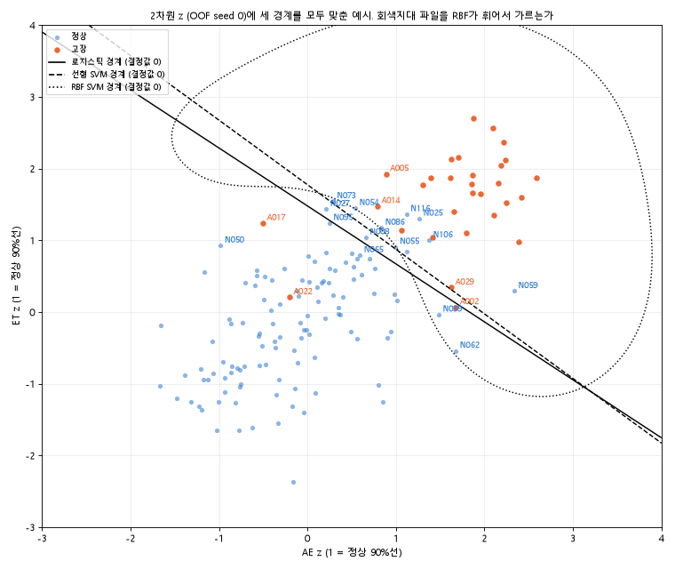
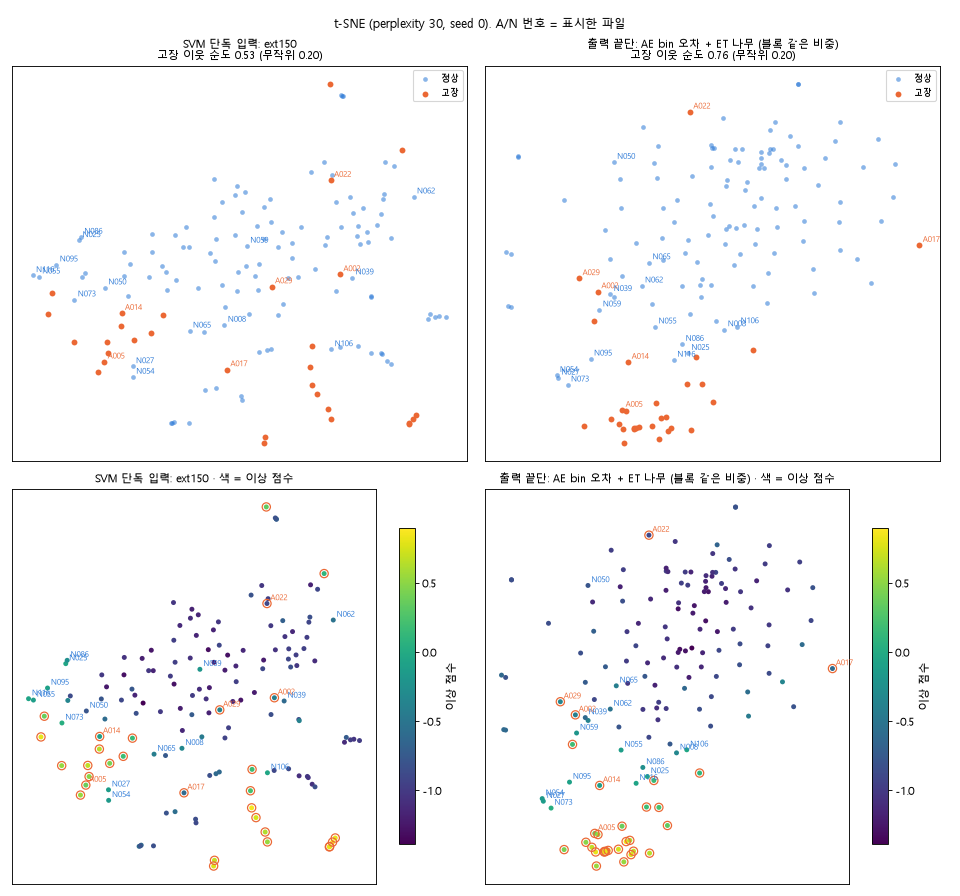
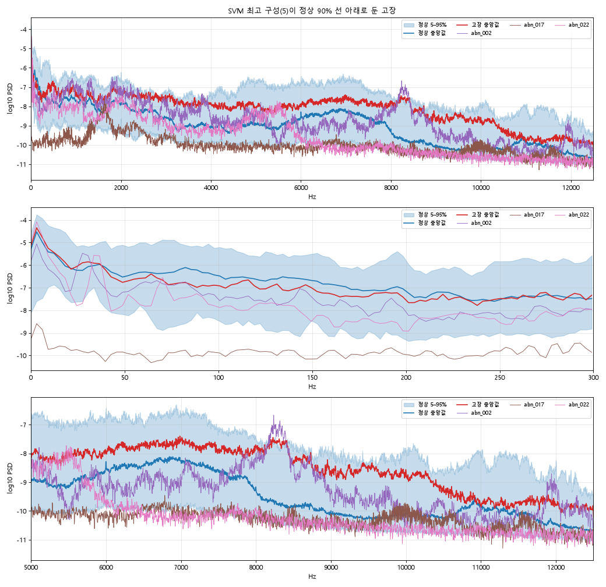

# EXP-015 SVM 확인 — SVM 단독(25년 방식) · 결합 경계 SVM · 출력 끝단 SVM

노션 카드 (실험 DB에 그대로 옮긴다)

| 팀원 | 모델 | F2 점수 | 변경 사항 | 메모 |
|---|---|---|---|---|
| 이동훈 | SVM (RBF·선형, C=1 고정) |  | EXP-014 결합의 경계·입력을 SVM으로 바꿔 비교 (모델만 바꿈) (H1, H2, H3) |  |

- 가설: H1, H2, H3 ([물리가설](../../../notes/물리가설.md))
- 실행: 2026-11-14 · git `1771fbd+수정중` · 코드 [run.py](run.py)

## 그림

### boundary_svm
RBF SVM 경계가 직선과 다르게 휘는 곳이 회색지대(A002·A029 ↔ N059·N062, A017, A022)를 가르는가, 아니면 점 몇 개를 둘러싸는가(과적합)



### tsne
SVM이 보는 공간에서 고장이 모이는가. 2행 색 = 구성 5(출력 끝단 RBF SVM)의 OOF 점수(seed 0)



### psd_missed
놓친 고장의 PSD가 정상 범위(파란 띠) 밖으로 나가는 주파수가 있는가



## quick_cv 결과 (5-fold × seed 3, 임계값 없음)

```
0 기준: 로지스틱 결합 z(AE, ET) (EXP-014)            PR-AUC 0.929 ± 0.000 · ROC-AUC 0.960 ± 0.001
1 SVM 단독: ext150 → RBF (25년 방식)              PR-AUC 0.870 ± 0.007 · ROC-AUC 0.954 ± 0.003
2 SVM 단독: ext150 → 선형                        PR-AUC 0.811 ± 0.000 · ROC-AUC 0.884 ± 0.011
3 결합 경계: z(AE, ET) → 선형 SVM                  PR-AUC 0.927 ± 0.003 · ROC-AUC 0.960 ± 0.001
4 결합 경계: z(AE, ET) → RBF SVM                 PR-AUC 0.917 ± 0.004 · ROC-AUC 0.931 ± 0.001
5 출력 끝단: AE bin 오차 + ET 나무 → RBF SVM         PR-AUC 0.936 ± 0.004 · ROC-AUC 0.966 ± 0.005
6 출력 끝단: AE bin 오차 + ET 나무 → 선형 SVM          PR-AUC 0.933 ± 0.011 · ROC-AUC 0.957 ± 0.012
```

## 어려운 파일의 정상 중 순위 (고장은 1에 가까울수록, 정상은 0에 가까울수록 좋음)

```
파일        0 기준:  | 1 SVM  | 2 SVM  | 3 결합 경 | 4 결합 경 | 5 출력 끝 | 6 출력 끝
abn_002       0.87 |   0.64 |   0.94 |   0.88 |   0.92 |   0.88 |   0.96
abn_005       0.99 |   1.00 |   0.98 |   0.98 |   0.98 |   1.00 |   1.00
abn_014       0.95 |   0.98 |   0.97 |   0.95 |   0.96 |   0.96 |   0.97
abn_017       0.63 |   0.95 |   0.74 |   0.63 |   0.06 |   0.77 |   0.59
abn_022       0.41 |   0.64 |   0.66 |   0.44 |   0.12 |   0.46 |   0.30
abn_029       0.97 |   0.81 |   0.95 |   0.96 |   0.93 |   0.92 |   0.93
nor_008       0.89 |   0.91 |   0.92 |   0.89 |   0.84 |   0.91 |   0.86
nor_025       0.99 |   0.92 |   0.35 |   0.98 |   0.99 |   0.99 |   0.96
nor_027       0.91 |   0.99 |   0.96 |   0.90 |   0.89 |   0.96 |   0.90
nor_039       0.88 |   0.73 |   0.95 |   0.88 |   0.93 |   0.86 |   0.84
nor_050       0.52 |   0.93 |   0.79 |   0.54 |   0.36 |   0.75 |   0.51
nor_054       0.90 |   0.97 |   0.99 |   0.88 |   0.91 |   0.95 |   0.96
nor_055       0.96 |   0.95 |   0.81 |   0.97 |   0.96 |   0.94 |   0.92
nor_059       0.97 |   0.42 |   0.59 |   0.98 |   0.98 |   0.92 |   0.89
nor_062       0.91 |   0.20 |   0.25 |   0.92 |   0.94 |   0.84 |   0.88
nor_065       0.91 |   0.90 |   0.07 |   0.91 |   0.90 |   0.86 |   0.83
nor_073       0.92 |   0.98 |   0.97 |   0.92 |   0.92 |   0.97 |   0.97
nor_086       0.92 |   0.63 |   0.16 |   0.91 |   0.91 |   0.93 |   0.91
nor_095       0.88 |   0.96 |   0.97 |   0.89 |   0.83 |   0.96 |   0.94
nor_106       0.96 |   0.84 |   0.63 |   0.95 |   0.94 |   0.94 |   0.94
nor_116       0.97 |   0.96 |   0.94 |   0.97 |   0.98 |   0.97 |   0.92
```

## 0 정상 90% 선 아래 고장 · 정상 상위 5%

```
고장: 002 017 022
정상: 025 055 059 106 116
```

## 1 정상 90% 선 아래 고장 · 정상 상위 5%

```
고장: 002 022 029
정상: 027 054 055 073 095 116
```

## 2 정상 90% 선 아래 고장 · 정상 상위 5%

```
고장: 009 015 017 021 022 025
정상: 027 039 054 073 095
```

## 3 정상 90% 선 아래 고장 · 정상 상위 5%

```
고장: 002 017 022
정상: 025 055 059 106 116
```

## 4 정상 90% 선 아래 고장 · 정상 상위 5%

```
고장: 017 022
정상: 025 055 059 116
```

## 5 정상 90% 선 아래 고장 · 정상 상위 5%

```
고장: 002 017 022
정상: 025 027 073 095 116
```

## 6 정상 90% 선 아래 고장 · 정상 상위 5%

```
고장: 017 022
정상: 025 054 073
```

## 메모
SVM으로는 회색지대가 풀리지 않는다. SVM 단독(25년 방식) 0.870은 ET 단독과 같은 수준이고 같은 고장(002 022 029)을 놓친다. 결합 경계를 RBF로 휘면 0.917로 오히려 떨어진다. 출력 끝단 SVM 0.933–0.936은 기준 0.929와 sd 안이다

### 평가 방식
quick_cv(5-fold × seed 3, PR-AUC). 미리 정한 규칙은 "기준보다 sd 넘게 좋은 구성만 중첩 CV"였다. 해당 구성이 없어 중첩 CV는 하지 않았다.

### 해석
1. **SVM 단독 (25년 3조 방식, 우리 피처 ext150)**
   - RBF 0.870 ± 0.007은 ET 단독(0.861)과 같은 수준이다
   - 놓치는 고장도 002 022 029로 ET와 같다. 같은 입력이면 분류기를 바꿔도 같은 파일을 놓친다
   - 대신 AE 쪽 오경보(059 0.42, 062 0.20)는 낮다
   - 선형은 0.811로 나쁘다. 25년 3조 피처+SVM은 EXP-003에서 0.538이었다
2. **결합 경계를 SVM으로 (boundary_svm)**
   - 선형 SVM 0.927은 로지스틱과 같은 직선 경계이고 점수도 같다
   - RBF는 0.917로 떨어진다. 그림에서 RBF 경계는 회색지대를 가르지 못한다. 대신 정상 일부와 017을 함께 감싸는 닫힌 곡선이 된다
   - 그 결과 017의 순위가 0.63에서 0.06으로 무너진다(022도 0.12). **경계를 휘면 점 몇 개에 맞춰 과적합한다는 것을 보여준다**
3. **출력 끝단 위 SVM**
   - RBF 0.936 ± 0.004, 선형 0.933 ± 0.011로 기준 0.929와 sd 안이다
   - 파일별로는 서로 맞바꾸는 모습이다. 017(0.77)과 AE 오경보(059·062)는 나아지지만 ET 오경보(027 073 095)가 올라온다
   - 022는 여전히 정상 무리 안(0.30–0.46)에 있다
4. **결론**: 회색지대는 경계 모양이 아니라 정보가 없어서 생긴다. 실행 전 예상과 같다. EXP-014의 로지스틱 결합(직선, 파라미터 3개)을 그대로 두고, 새 정보 축(EXP-016)으로 간다

### 25년 3조와의 관계 (발표용)
25년 데이터에서 SVM 단독이 잘 된 것은 그 데이터의 고장이 크고 시끄러웠기 때문이다(첨도 중앙값 정상 30 → 고장 444, EXP-003). 우리 데이터에는 조용한 고장(002 022 029)이 있어 입력 정보가 먼저다.
