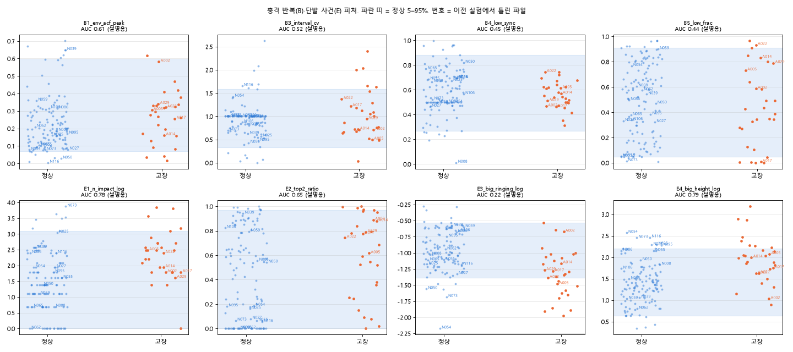
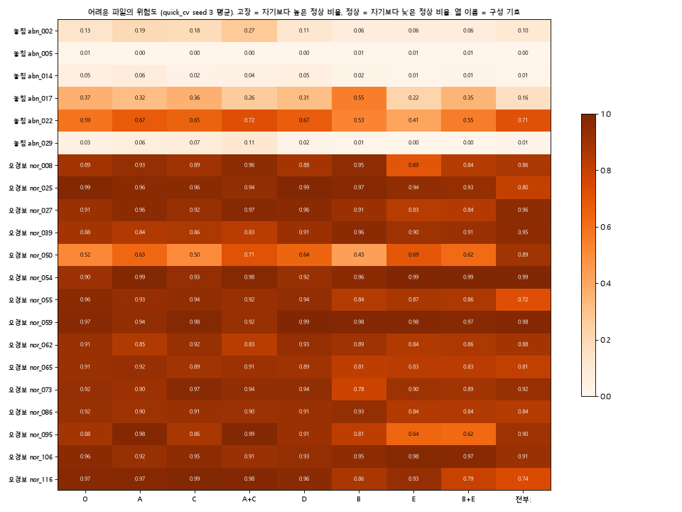
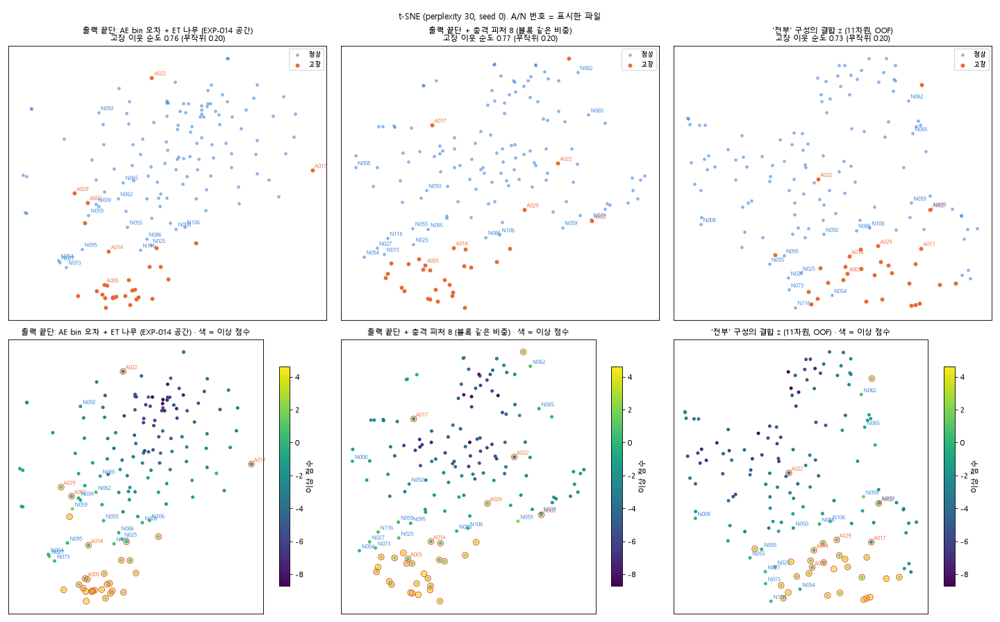
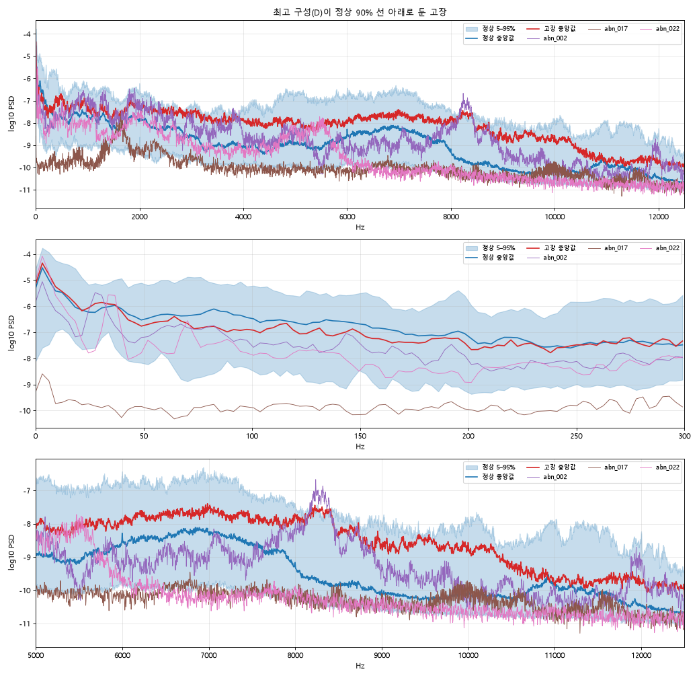

# EXP-016 회색지대용 새 정보 축 — AE 변형 · 비대칭 결합 · 충격 주기성 · 단발 사건

노션 카드 (실험 DB에 그대로 옮긴다)

| 팀원 | 모델 | F2 점수 | 변경 사항 | 메모 |
|---|---|---|---|---|
| 이동훈 | ET + AE 변형 + 충격 피처 → 정상 기준 z → L2 로지스틱 |  | EXP-014 결합의 입력에 AE 집계·모양 변형, max 열, 충격 주기성(B)·단발 사건(E) 피처를 하나씩 추가 (H1, H2, H3, H4, H5) |  |

- 가설: H1, H2, H3, H4, H5 ([물리가설](../../../notes/물리가설.md))
- 실행: 2026-11-14 · git `1771fbd+수정중` · 코드 [run.py](run.py)

## 그림

### impact_features
놓친 고장(A002·005·014·017·022·029)이 띠 밖으로 나가는 피처가 있는가, 오경보 정상(N025·055·116·086 …)이 반대쪽으로 갈리는 피처가 있는가



### hard_files
처방별로 겨냥한 파일이 옅어지는가 (A: 014·017, C: 002·029·059·062, D: 017, B: 022·005, E: 025·055·116·086), 다른 파일이 진해지지는 않는가



### tsne
충격 피처를 더하면 놓친 고장이 고장 무리로 옮겨 가는가. 2행 색 = PR-AUC 최고 구성(D)의 OOF 점수(seed 0)



### psd_missed
놓친 고장의 PSD가 정상 범위(파란 띠) 밖으로 나가는 주파수가 있는가



## quick_cv 결과 (5-fold × seed 3, 임계값 없음)

```
0 기준: z(AE 평균, ET) (EXP-014)               PR-AUC 0.929 ± 0.000 · ROC-AUC 0.960 ± 0.001
A AE 구간 최댓값                                PR-AUC 0.917 ± 0.006 · ROC-AUC 0.954 ± 0.003
C 모양 AE (게인 제거)                            PR-AUC 0.929 ± 0.002 · ROC-AUC 0.957 ± 0.004
A+C 모양 AE 구간 최댓값                           PR-AUC 0.906 ± 0.002 · ROC-AUC 0.949 ± 0.002
D 기준 + max(z) 열 (비대칭)                      PR-AUC 0.930 ± 0.003 · ROC-AUC 0.960 ± 0.002
B 기준 + 충격 주기성 4                            PR-AUC 0.928 ± 0.010 · ROC-AUC 0.957 ± 0.003
E 기준 + 단발 사건 4                             PR-AUC 0.929 ± 0.009 · ROC-AUC 0.962 ± 0.003
B+E 기준 + 충격 8                              PR-AUC 0.915 ± 0.004 · ROC-AUC 0.947 ± 0.001
전부: 모양 AE 최댓값 + ET + 충격 8 + max(z)         PR-AUC 0.888 ± 0.006 · ROC-AUC 0.937 ± 0.003
```

## 0 정상 90% 선 아래 고장 · 정상 상위 5%

```
고장: 002 017 022
정상: 025 055 059 106 116
```

## A 정상 90% 선 아래 고장 · 정상 상위 5%

```
고장: 002 017 022
정상: 025 027 054 095 116
```

## C 정상 90% 선 아래 고장 · 정상 상위 5%

```
고장: 002 017 022
정상: 025 059 073 116
```

## A+C 정상 90% 선 아래 고장 · 정상 상위 5%

```
고장: 002 017 022 029
정상: 008 027 054 095 116
```

## D 정상 90% 선 아래 고장 · 정상 상위 5%

```
고장: 002 017 022
정상: 025 027 059 116
```

## B 정상 90% 선 아래 고장 · 정상 상위 5%

```
고장: 017 022
정상: 025 039 054 059 106
```

## E 정상 90% 선 아래 고장 · 정상 상위 5%

```
고장: 015 017 022
정상: 054 059 069 106
```

## B+E 정상 90% 선 아래 고장 · 정상 상위 5%

```
고장: 015 017 022
정상: 054 059 069 106
```

## 전부: 정상 90% 선 아래 고장 · 정상 상위 5%

```
고장: 002 015 017 022
정상: 027 039 054 059 069
```

## 메모
새 축 5가지(A·C·D·B·E) 모두 기준(0.929)보다 sd 넘게 좋지 않다. 놓친 고장은 새 충격 피처 8개에서도 정상 5–95% 띠 안에 있다. 입력을 많이 넣을수록(B+E 0.915, 전부 0.888) 오히려 떨어진다 → 지금 정보로는 EXP-014 로지스틱 결합이 한계이고, 회색지대를 더 맞추려 하면 과적합이다

### 평가 방식
quick_cv(5-fold × seed 3, PR-AUC). 미리 정한 규칙은 "기준보다 sd 넘게 좋은 구성만 중첩 CV"였다. 해당 구성이 없어 중첩 CV는 하지 않았다.

### 해석
1. **충격 피처 분포 (impact_features)**
   - B 주기성 계열의 설명용 AUC는 0.45–0.61로 거의 무작위다
   - 놓친 고장 A002·005·014·017·022·029는 8개 피처 모두에서 정상 띠 안에 있다
   - **022의 "약 1초 간격 충격"(3-1 관찰)은 간격 변동계수에 잡히지 않았다(1.4).** 8σ 기준으로 세면 눈에 띈 3개 말고 작은 사건이 더 잡혀 간격이 불규칙해진다
   - 저주파 동기(B4)도 022가 0.73으로 정상 띠 안이다 → **이 정의로는 H4 미지지**
2. **E 단발 사건**
   - 사건 수·최대 높이(AUC 0.78·0.79)는 ET가 이미 쓰는 정보다
   - 잔향 비(AUC 0.22)는 고장이 짧다는 방향(2-6)과 맞다. 다만 오경보 정상 N025·055·116은 띠 가운데에 있어 갈리지 않는다
   - 위험도 표에서 E는 017(0.37 → 0.22)·022(0.59 → 0.41)·008·095를 조금 낫게 한다. 하지만 054·059·106이 그대로라 전체 PR-AUC는 같다(0.929 ± 0.009)
3. **A 구간 최댓값 0.917**: 014·017이 거의 안 바뀐다(017 0.37 → 0.32). 구간이 1초로 길고 서로 겹쳐서 최댓값과 평균의 차이가 작고, 대신 정상 쪽 산포만 커진 것으로 보인다
4. **C 모양 AE 0.929**: 기준과 같다. 059·062 오경보가 줄지 않았다(059 0.98) → "059·062는 스펙트럼 전체 높이가 높아서 오경보"라는 2-7 기반 예상은 지지되지 않는다. 모양 자체가 다르다
5. **D max 열 0.930**: 같다. 017은 0.37 → 0.31로 조금 나아질 뿐이다
6. **입력을 늘리면 떨어진다**: B+E 0.915, 전부(11개 입력) 0.888. 파일 120개에 정보 없는 입력이 늘면 로지스틱 경계가 노이즈에 맞춰진다. 사용자 목표(과적합 없이)에 비추어 **입력은 작게 유지해야 한다는 근거**다

### 결론
- 놓친 고장 002·017·022는 지금까지 본 모든 축(ext150, 스펙트럼 AE·모양 AE, 충격 반복·단발, 저주파)에서 정상 분포 안에 있다. 결정 "고장 비율"(학습할 수 없는 고장까지 맞추려 과적합하지 않는다)에 따라 이 파일들은 **현재 정보로는 구분 불가**로 기록한다
- 최종 후보는 EXP-014 로지스틱 결합 z(AE, ET) 그대로 둔다 (중첩 F2 0.857 ± 0.031, 재현율 0.880, 오경보율 0.063)
