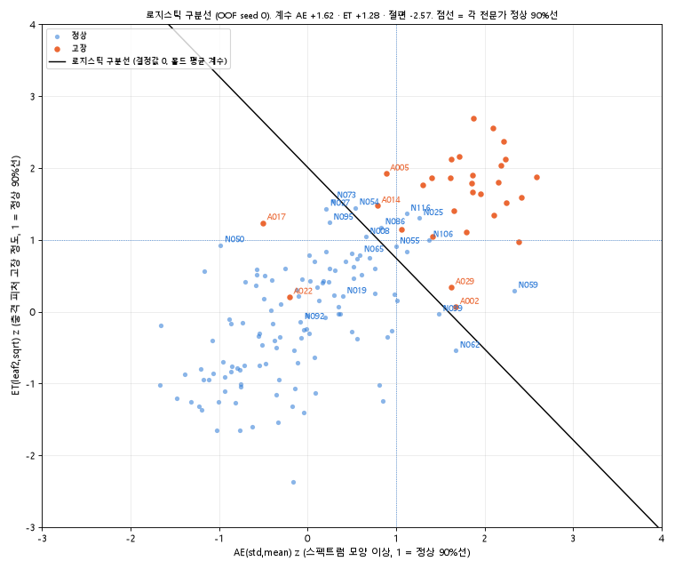
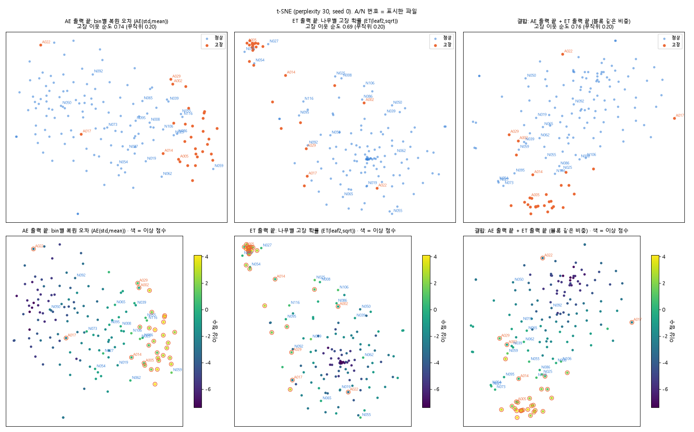
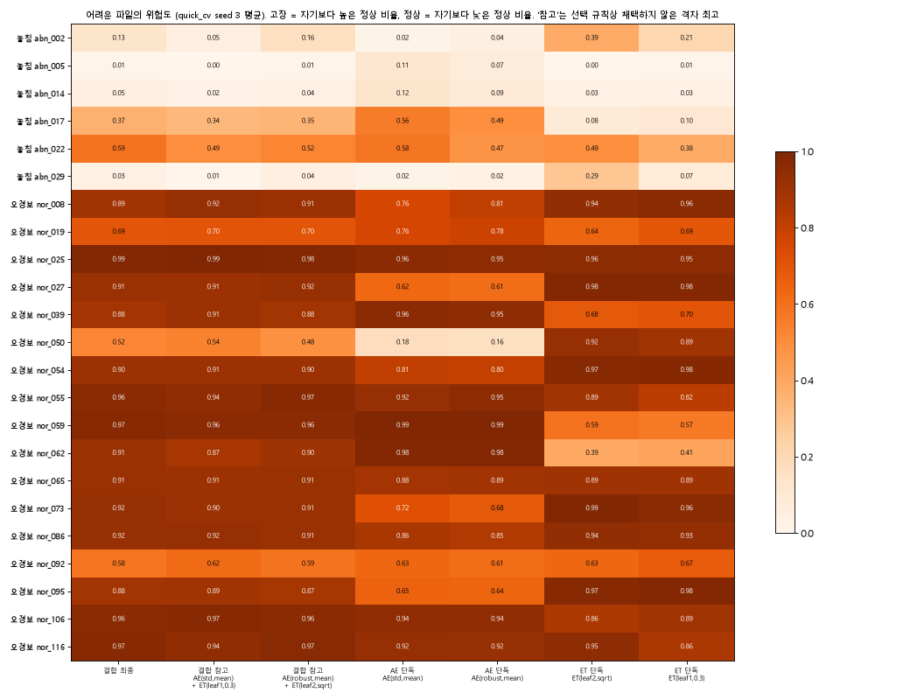
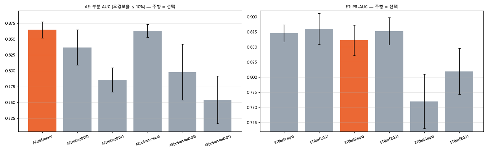
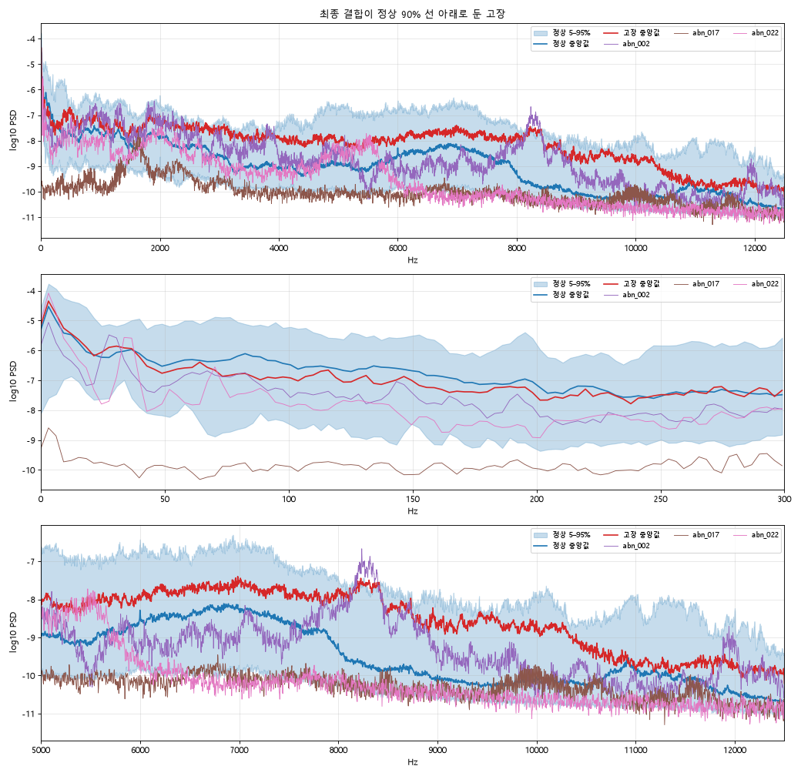

# EXP-018 두 전문가 역할별 최적화 (AE 특이성 · ET 재현율) → 로지스틱 결합

노션 카드 (실험 DB에 그대로 옮긴다)

| 팀원 | 모델 | F2 점수 | 변경 사항 | 메모 |
|---|---|---|---|---|
| 이동훈 | ET + 스펙트럼 AE (각각 최적화) → 정상 기준 z → L2 로지스틱 |  | AE 표준화·오차 집계를 부분 AUC로, ET 잎 크기·분할 피처 수를 PR-AUC로 각각 고른 뒤 EXP-014 결합 (H1, H2, H3) | 두 전문가 모두 기본값이 각자 역할 지표에서 최선이거나 sd 안이다. AE는 표준화·집계를 바꿔도 나아지지 않았다(상위 bin 집계는 오히려 하락). ET는 잎 1·분할 피처 0.3이 +0.019지만 sd(0.026) 안이라 기본값 유지 → 결합은 EXP-014와 같다(중첩 F2 0.857) |

- 가설: H1, H2, H3 ([물리가설](../../../notes/물리가설.md))
- 실행: 2026-11-14 · git `1771fbd+수정중` · 코드 [run.py](run.py)

## 그림

### boundary_lr
로지스틱 구분선 근처(회색지대)에 어떤 파일이 있는가. 번호 = 이전 실험에서 틀린 파일



### tsne
각 전문가의 출력 끝단과 결합에서 고장이 모이는가, 회색지대 파일은 어디에 있는가. 2행 색 = 최종 결합 OOF 점수



### hard_files
AE와 ET가 서로 다른 파일을 틀리는가(보완성), 격자 최고 설정이 기본값과 어떤 파일에서 다른가



### expert_grid
(보조) 각 전문가의 설정이 자기 역할 지표를 sd 넘게 바꾸는가 (막대 = seed 3 평균 ± sd)



### psd_missed
(보조) 놓친 고장의 PSD가 정상 범위(파란 띠) 밖으로 나가는 주파수가 있는가



## 전문가별 단독 성능 (quick_cv 5-fold × seed 3)

```
AE (목표: 부분 AUC@오경보율 10%)
  AE(std,mean)           부분AUC 0.865 ± 0.013 · PR-AUC 0.852 ± 0.027
  AE(std,top0.05)        부분AUC 0.837 ± 0.028 · PR-AUC 0.832 ± 0.024
  AE(std,top0.01)        부분AUC 0.786 ± 0.019 · PR-AUC 0.761 ± 0.065
  AE(robust,mean)        부분AUC 0.863 ± 0.010 · PR-AUC 0.859 ± 0.020
  AE(robust,top0.05)     부분AUC 0.798 ± 0.044 · PR-AUC 0.799 ± 0.045
  AE(robust,top0.01)     부분AUC 0.754 ± 0.038 · PR-AUC 0.727 ± 0.067
ET (목표: PR-AUC)
  ET(leaf1,sqrt)         PR-AUC 0.873 ± 0.014 · 부분AUC 0.867 ± 0.017
  ET(leaf1,0.3)          PR-AUC 0.880 ± 0.026 · 부분AUC 0.860 ± 0.025
  ET(leaf2,sqrt)         PR-AUC 0.861 ± 0.025 · 부분AUC 0.854 ± 0.023
  ET(leaf2,0.3)          PR-AUC 0.876 ± 0.023 · 부분AUC 0.857 ± 0.024
  ET(leaf5,sqrt)         PR-AUC 0.760 ± 0.045 · 부분AUC 0.769 ± 0.034
  ET(leaf5,0.3)          PR-AUC 0.810 ± 0.038 · 부분AUC 0.804 ± 0.033

선택: AE = AE(std,mean) (격자 최고와 기본값 차 +0.000) · ET = ET(leaf2,sqrt) (차 +0.019)
```

## AE 설정별 정상 중 순위 (고장은 높을수록, 정상은 낮을수록 좋음)

```
AE 설정           A002   A029   A005   A014   N059   N062   N039   N106   N025   N116
AE(std,mean)      0.98   0.98   0.89   0.88   0.99   0.98   0.96   0.94   0.96   0.92
AE(std,top0.05)   0.97   0.99   0.85   0.88   0.98   0.97   0.95   0.93   0.91   0.90
AE(std,top0.01)   0.96   0.97   0.78   0.85   0.96   0.95   0.90   0.86   0.88   0.84
AE(robust,mean)   0.96   0.98   0.93   0.91   0.99   0.98   0.95   0.94   0.95   0.92
AE(robust,top0.05)  0.97   0.98   0.84   0.92   0.97   0.97   0.94   0.89   0.91   0.90
AE(robust,top0.01)  0.98   0.98   0.78   0.90   0.96   0.96   0.90   0.82   0.86   0.88
```

## 결합 quick_cv (로지스틱)

```
최종: AE(std,mean) + ET(leaf2,sqrt) (= EXP-014)        PR-AUC 0.929 ± 0.000 · 부분AUC 0.926 ± 0.002
참고(채택 안 함): AE(std,mean) + ET(leaf1,0.3)             PR-AUC 0.947 ± 0.002 · 부분AUC 0.949 ± 0.002
참고(채택 안 함): AE(robust,mean) + ET(leaf2,sqrt)         PR-AUC 0.930 ± 0.003 · 부분AUC 0.927 ± 0.005
```

## 최종 결합: 정상 90% 선 아래 고장 · 정상 상위 5%

```
고장: 002 017 022
정상: 025 055 059 106 116
```

## 중첩 CV

```
선택 규칙상 두 전문가 모두 기본값 유지 → 최종 결합은 EXP-014와 같음 (중첩 F2 0.857 ± 0.031)
```

## 메모
사전 규칙상 두 전문가 모두 기본값을 유지했고, 그래서 결합은 EXP-014와 같다(중첩 F2 0.857). AE는 표준화·집계를 바꿔도 나아지지 않았다. 채택하지 않은 ET(잎 1, 0.3)를 결합하면 quick_cv 0.947 ± 0.002(+0.018)로 일관되게 오르지만 사후 관찰이라, 안쪽 CV 선택으로 확인이 필요하다

### 해석
1. **AE: 2-10 가설("059·062 오경보는 표준화·평균 집계 탓")은 지지되지 않는다**
   - 로버스트 표준화: 부분 AUC 0.863으로 기본(0.865)과 같다
   - 상위 bin 집계: 5%는 0.837, 1%는 0.786으로 오히려 떨어진다. 005·014(넓은 대역에서 조금씩 오차)가 내려가기 때문이다
   - N059·N062는 **모든 AE 설정에서 정상 중 0.95–0.99**다 → 이 두 파일의 이상은 계산 방식의 착시가 아니라 스펙트럼이 실제로 다른 것이다(EXP-013 결론과 같다)
   - 오차가 "어디서" 나는지(002·029는 8.25 kHz)로 가르려면 주파수 위치 정보가 필요하다. 정직하게 위치를 고르는 방법은 EXP-017에서 불안정했다
2. **ET: 잎이 작을수록 좋다**
   - 잎 5는 0.760–0.810으로 크게 떨어지고, 잎 1·2는 0.861–0.880이다
   - ET는 고장 몇 개를 작은 잎으로 따로 떼어 내는 방식으로 동작한다 → 고장 유형마다 몇 개뿐인 데이터에 맞는 동작이지만, 경계 근처 판단이 그 몇 개에 좌우된다는 뜻이기도 하다
   - 잎 1·0.3의 +0.019는 sd 안이고 격자 6개 중 최고라 선택 편향이 있다 → 규칙대로 채택하지 않음
3. **그림 구성 변경 (11-14, 사용자)**: 기본 그림 = ① 로지스틱 구분선(boundary_lr) ② t-SNE(AE·ET·결합 출력 끝) ③ hard_files. 격자·놓친 고장 PSD는 보조
   - 첫 실행의 hard_files에서 "결합 0–3", "AE 기본·최적", "ET 기본·최적"이 소수점까지 같았다. 선택 규칙상 둘 다 기본값이 뽑혀 **같은 모델을 이름만 바꿔 여러 번 그렸기 때문**이다(같은 모델·같은 분할·같은 캐시 → 같은 값). 지금은 겹치지 않는 열(최종, 채택 안 한 격자 최고)만 둔다
4. **boundary_lr**
   - 계수는 AE +1.62, ET +1.28로 EXP-014와 같다
   - 구분선 근처에 오경보 정상 N008·055·065·086·106·116과 고장 A014·A005가 한 줄로 붙어 있다
   - A002·A029는 오른쪽 아래에서 N059·N062와 같은 높이에 있다
   - A017은 왼쪽 위, A022는 정상 무리 안에 있다
5. **hard_files: 두 전문가는 서로 다른 파일을 틀린다**
   - nor_050: AE 0.18 / ET 0.92
   - nor_062: 0.98 / 0.39
   - nor_059: 0.99 / 0.59
   - abn_017: 0.56 / 0.08
   - abn_029: 0.02 / 0.29
   - 이 보완성 때문에 결합이 각각보다 좋다. 둘 다 틀리는 025·055·116·022는 결합해도 남는다
6. **참고(채택 안 함) — ET(잎 1, 0.3)를 결합하면 PR-AUC 0.947 ± 0.002**
   - 기준 0.929 ± 0.000보다 +0.018이고, seed 간 sd보다 훨씬 크다
   - ET 단독에서는 +0.019가 sd 0.026 안이었지만, 결합에서는 일관되게 오른다
   - 파일별로는 002(위험 0.13 → 0.05)·029·022(0.59 → 0.49)·062(0.91 → 0.87)가 나아지고, 나빠진 파일은 거의 없다(039 0.88 → 0.91)
   - **다만 격자 6개 중 최고를 고른 값이고, 결합 결과는 실행 후에 본 것이다** → 사전 규칙대로 채택하지 않는다
   - 정직하게 확인하려면 ET 설정을 **중첩 CV의 안쪽에서 고르게** 해야 한다. 바깥 fold마다 안쪽 CV로 잎·분할 피처를 고르고, 바깥 fold로 F2를 낸다
   - 로버스트 AE를 결합한 경우는 0.930으로 같다

### 결론
- AE는 설정을 바꿔도 나아지지 않는다. 059·062는 실제로 스펙트럼이 다른 정상이다
- ET는 잎을 작게, 분할 피처를 많이(0.3) 쓰는 쪽이 결합에서 일관되게 낫다(+0.018, 사후 관찰). 경계 파일 002·029·022에서 이득이 난다
- 다음: **ET 설정을 안쪽 CV에서 고르는 중첩 CV**로 이 이득이 선택 편향인지 확인한다. 비용은 ET만 다시 학습하면 되고 AE는 캐시를 쓴다
