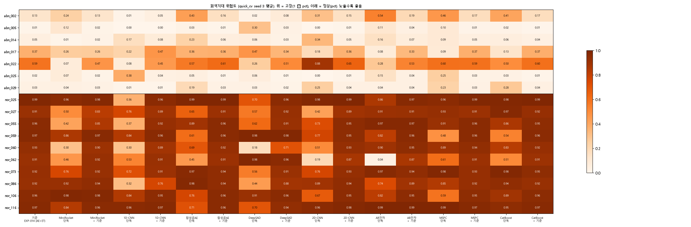

# EXP-019 후보 모델 1회 스크리닝 (회색지대 정보)

노션 카드 (실험 DB에 그대로 옮긴다)

| 팀원 | 모델 | F2 점수 | 변경 사항 | 메모 |
|---|---|---|---|---|
| 이동훈 | 스크리닝: MiniRocket … |  | EXP-014 결합에 후보 모델 점수를 한 열 더해 보완성·회색지대 순위 확인 (H1, H2, H3) | MiniRocket 탈락(기준 통과 못 함). 단독은 약하지만(0.740) 기준이 못 보던 022를 0.93으로 올리고 N-A 정상(027 055 060 062)을 0.30–0.50으로 내림 → 다른 정보를 보지만 로지스틱 3열 결합에선 희석됨 |

- 가설: H1, H2, H3 ([물리가설](../../../../notes/물리가설.md))
- 실행: 2026-11-14 · git `1771fbd+수정중` · 코드 [run.py](run.py)

## 그림

### gray_ranks
후보 모델이 기준(EXP-014)이 헷갈리던 파일을 다르게 보는가. 같은 열의 고장은 낮게, 정상도 낮게 나와야 한다



## 스크리닝: MiniRocket

```
MiniRocket: 단독 0.740 ± 0.043 · +기준 0.929 ± 0.006 (기준 0.929, ① 선 0.930) · 올라온 회색 고장 없음 · 회색 정상 평균 pct -0.020 → 탈락 (1초)
  교체: AE + MiniRocket (ET 자리) 0.895 ± 0.009 · ET + MiniRocket (AE 자리) 0.870 ± 0.024

파일      기준   단독   +기준
abn_002   0.87   0.76   0.87
abn_005   0.99   0.88   0.98
abn_014   0.95   0.99   0.98
abn_017   0.63   0.74   0.74
abn_022   0.41   0.93   0.53
abn_025   0.98   0.93   0.98
abn_029   0.97   0.96   0.97
nor_025   0.99   0.96   0.98
nor_027   0.91   0.50   0.83
nor_055   0.96   0.42   0.85
nor_059   0.97   0.86   0.97
nor_060   0.93   0.30   0.90
nor_062   0.91   0.46   0.92
nor_073   0.92   0.76   0.92
nor_086   0.92   0.92   0.94
nor_106   0.96   0.98   0.98
nor_116   0.97   0.84   0.96
```

## 스크리닝: 1D-CNN

```
1D-CNN: 단독 0.865 ± 0.017 · +기준 0.903 ± 0.019 (기준 0.929, ① 선 0.930) · 올라온 회색 고장 abn_002 · 회색 정상 평균 pct -0.033 → 탈락 (1초)
  교체: AE + 1D-CNN (ET 자리) 0.891 ± 0.022 · ET + 1D-CNN (AE 자리) 0.873 ± 0.008

파일      기준   단독   +기준
abn_002   0.87   0.99   0.95
abn_005   0.99   1.00   1.00
abn_014   0.95   0.83   0.92
abn_017   0.63   0.78   0.53
abn_022   0.41   0.92   0.55
abn_025   0.98   0.62   0.96
abn_029   0.97   0.99   0.99
nor_025   0.99   0.36   0.96
nor_027   0.91   0.76   0.89
nor_055   0.96   0.37   0.92
nor_059   0.97   0.84   0.96
nor_060   0.93   0.30   0.89
nor_062   0.91   0.53   0.91
nor_073   0.92   0.72   0.91
nor_086   0.92   0.32   0.76
nor_106   0.96   0.84   0.95
nor_116   0.97   0.96   0.97
```

## 스크리닝: 합성곱AE

```
합성곱AE: 단독 0.696 ± 0.033 · +기준 0.920 ± 0.008 (기준 0.929, ① 선 0.930) · 올라온 회색 고장 없음 · 회색 정상 평균 pct +0.001 → 탈락 (1초)
  교체: AE + 합성곱AE (ET 자리) 0.887 ± 0.003 · ET + 합성곱AE (AE 자리) 0.834 ± 0.009

파일      기준   단독   +기준
abn_002   0.87   0.57   0.84
abn_005   0.99   0.97   0.99
abn_014   0.95   0.77   0.94
abn_017   0.63   0.64   0.64
abn_022   0.41   0.43   0.39
abn_025   0.98   0.95   0.99
abn_029   0.97   0.81   0.97
nor_025   0.99   0.99   0.99
nor_027   0.91   0.65   0.91
nor_055   0.96   0.89   0.96
nor_059   0.97   0.61   0.96
nor_060   0.93   0.69   0.92
nor_062   0.91   0.45   0.91
nor_073   0.92   0.97   0.94
nor_086   0.92   0.98   0.94
nor_106   0.96   0.76   0.96
nor_116   0.97   0.71   0.96
```

## 스크리닝: DeepSAD

```
DeepSAD: 단독 0.721 ± 0.034 · +기준 0.922 ± 0.009 (기준 0.929, ① 선 0.930) · 올라온 회색 고장 abn_002 · 회색 정상 평균 pct -0.032 → 탈락 (1초)
  교체: AE + DeepSAD (ET 자리) 0.837 ± 0.033 · ET + DeepSAD (AE 자리) 0.915 ± 0.012

파일      기준   단독   +기준
abn_002   0.87   0.98   0.92
abn_005   0.99   0.70   0.97
abn_014   0.95   0.94   0.97
abn_017   0.63   0.53   0.66
abn_022   0.41   0.74   0.49
abn_025   0.98   0.94   0.99
abn_029   0.97   0.97   0.98
nor_025   0.99   0.70   0.96
nor_027   0.91   0.57   0.92
nor_055   0.96   0.62   0.91
nor_059   0.97   0.98   0.98
nor_060   0.93   0.18   0.71
nor_062   0.91   0.98   0.96
nor_073   0.92   0.56   0.91
nor_086   0.92   0.44   0.88
nor_106   0.96   0.91   0.96
nor_116   0.97   0.70   0.94
```

## 스크리닝: 2D-CNN

```
2D-CNN: 단독 0.726 ± 0.006 · +기준 0.924 ± 0.005 (기준 0.929, ① 선 0.930) · 올라온 회색 고장 없음 · 회색 정상 평균 pct -0.008 → 탈락 (1초)
  교체: AE + 2D-CNN (ET 자리) 0.894 ± 0.012 · ET + 2D-CNN (AE 자리) 0.862 ± 0.001

파일      기준   단독   +기준
abn_002   0.87   0.69   0.85
abn_005   0.99   1.00   0.99
abn_014   0.95   0.66   0.95
abn_017   0.63   0.82   0.64
abn_022   0.41   0.12   0.35
abn_025   0.98   1.00   0.99
abn_029   0.97   0.75   0.96
nor_025   0.99   0.98   0.99
nor_027   0.91   0.42   0.89
nor_055   0.96   0.73   0.95
nor_059   0.97   0.77   0.95
nor_060   0.93   0.51   0.93
nor_062   0.91   0.19   0.87
nor_073   0.92   0.76   0.93
nor_086   0.92   0.89   0.94
nor_106   0.96   0.67   0.95
nor_116   0.97   0.96   0.98
```

## 스크리닝: AR잔차

```
AR잔차: 단독 0.608 ± 0.014 · +기준 0.907 ± 0.016 (기준 0.929, ① 선 0.930) · 올라온 회색 고장 없음 · 회색 정상 평균 pct -0.004 → 탈락 (1초)
  교체: AE + AR잔차 (ET 자리) 0.874 ± 0.009 · ET + AR잔차 (AE 자리) 0.829 ± 0.012

파일      기준   단독   +기준
abn_002   0.87   0.46   0.81
abn_005   0.99   0.89   0.96
abn_014   0.95   0.84   0.93
abn_017   0.63   0.92   0.67
abn_022   0.41   0.72   0.47
abn_025   0.98   0.85   0.96
abn_029   0.97   0.96   0.96
nor_025   0.99   0.86   0.97
nor_027   0.91   0.91   0.91
nor_055   0.96   0.97   0.97
nor_059   0.97   0.82   0.96
nor_060   0.93   0.90   0.95
nor_062   0.91   0.04   0.87
nor_073   0.92   0.97   0.94
nor_086   0.92   0.74   0.89
nor_106   0.96   0.82   0.95
nor_116   0.97   0.99   0.99
```

## 스크리닝: TabPFN

```
제외: 가중치 다운로드에 외부 라이선스 동의·API 키 필요 → 사용하지 않음 (사용자 결정 11-14)
```

## 스크리닝: MSPC

```
MSPC: 단독 0.728 ± 0.014 · +기준 0.924 ± 0.004 (기준 0.929, ① 선 0.930) · 올라온 회색 고장 없음 · 회색 정상 평균 pct -0.002 → 탈락 (1초)
  교체: AE + MSPC (ET 자리) 0.894 ± 0.009 · ET + MSPC (AE 자리) 0.850 ± 0.016

파일      기준   단독   +기준
abn_002   0.87   0.54   0.83
abn_005   0.99   0.90   0.99
abn_014   0.95   0.91   0.95
abn_017   0.63   0.91   0.63
abn_022   0.41   0.40   0.41
abn_025   0.98   0.75   0.97
abn_029   0.97   0.77   0.97
nor_025   0.99   0.96   0.99
nor_027   0.91   0.93   0.91
nor_055   0.96   0.91   0.96
nor_059   0.97   0.48   0.96
nor_060   0.93   0.89   0.94
nor_062   0.91   0.61   0.91
nor_073   0.92   0.98   0.93
nor_086   0.92   0.85   0.92
nor_106   0.96   0.59   0.95
nor_116   0.97   0.99   0.97
```

## 스크리닝: CatBoost

```
CatBoost: 단독 0.849 ± 0.029 · +기준 0.931 ± 0.003 (기준 0.929, ① 선 0.930) · 올라온 회색 고장 없음 · 회색 정상 평균 pct -0.002 → 통과 (1초)
  교체: AE + CatBoost (ET 자리) 0.928 ± 0.003 · ET + CatBoost (AE 자리) 0.864 ± 0.015

파일      기준   단독   +기준
abn_002   0.87   0.59   0.83
abn_005   0.99   0.98   0.99
abn_014   0.95   0.94   0.96
abn_017   0.63   0.87   0.63
abn_022   0.41   0.50   0.40
abn_025   0.98   0.97   0.99
abn_029   0.97   0.72   0.96
nor_025   0.99   0.98   0.99
nor_027   0.91   0.97   0.92
nor_055   0.96   0.86   0.95
nor_059   0.97   0.54   0.96
nor_060   0.93   0.83   0.92
nor_062   0.91   0.51   0.91
nor_073   0.92   0.98   0.95
nor_086   0.92   0.94   0.92
nor_106   0.96   0.89   0.96
nor_116   0.97   0.95   0.97
```

## 요약 (quick_cv PR-AUC, seed 3)

```
후보         단독          +기준(추가)    AE+후보(ET교체)  ET+후보(AE교체)  올라온 회색 고장       정상Δ   판정
기준          —             0.929 ± 0.000  (AE 단독 0.852 · ET 단독 0.861)
MiniRocket  0.740 ± 0.043  0.929 ± 0.006  0.895 ± 0.009    0.870 ± 0.024    —                     -0.020  탈락
1D-CNN      0.865 ± 0.017  0.903 ± 0.019  0.891 ± 0.022    0.873 ± 0.008    002                   -0.033  탈락
합성곱AE       0.696 ± 0.033  0.920 ± 0.008  0.887 ± 0.003    0.834 ± 0.009    —                     +0.001  탈락
DeepSAD     0.721 ± 0.034  0.922 ± 0.009  0.837 ± 0.033    0.915 ± 0.012    002                   -0.032  탈락
2D-CNN      0.726 ± 0.006  0.924 ± 0.005  0.894 ± 0.012    0.862 ± 0.001    —                     -0.008  탈락
AR잔차        0.608 ± 0.014  0.907 ± 0.016  0.874 ± 0.009    0.829 ± 0.012    —                     -0.004  탈락
MSPC        0.728 ± 0.014  0.924 ± 0.004  0.894 ± 0.009    0.850 ± 0.016    —                     -0.002  탈락
CatBoost    0.849 ± 0.029  0.931 ± 0.003  0.928 ± 0.003    0.864 ± 0.015    —                     -0.002  통과
```

## 분리 판정 (OOF, seed 3 모두)

```
구성                     확실한 고장/30  확실한 정상/120  회색(고장+정상)  여유   고장 회색 (기준 대비 +새로 들어감 −빠짐)
기준 EXP-014 (AE+ET)       21              37               9+ 83       -1.19  002 005 014 017 020 022 025 028 029  [같음]
MiniRocket 단독             0              56              30+ 64       -1.96  001 002 003 004 005 006 007 008 009 010 011 012 013 014 015 016 017 018 019 020 021 022 023 024 025 026 027 028 029 030  [+001 +003 +004 +006 +007 +008 +009 +010 +011 +012 +013 +015 +016 +018 +019 +021 +023 +024 +026 +027 +030]
MiniRocket + 기준          15              42              15+ 78       -1.24  001 002 003 005 014 015 016 017 020 022 023 025 027 028 029  [+001 +003 +015 +016 +023 +027]
1D-CNN 단독                 4              17              26+103       -4.23  001 002 003 004 005 006 007 008 009 011 013 014 015 016 017 018 019 020 021 022 023 024 025 027 028 029  [+001 +003 +004 +006 +007 +008 +009 +011 +013 +015 +016 +018 +019 +021 +023 +024 +027]
1D-CNN + 기준               4              42              26+ 78       -1.52  001 002 003 004 005 006 007 009 011 013 014 015 016 017 018 019 020 021 022 023 024 025 026 027 028 029  [+001 +003 +004 +006 +007 +009 +011 +013 +015 +016 +018 +019 +021 +023 +024 +026 +027]
합성곱AE 단독                  1              44              29+ 76       -2.70  001 002 003 005 006 007 008 009 010 011 012 013 014 015 016 017 018 019 020 021 022 023 024 025 026 027 028 029 030  [+001 +003 +006 +007 +008 +009 +010 +011 +012 +013 +015 +016 +018 +019 +021 +023 +024 +026 +027 +030]
합성곱AE + 기준               14              35              16+ 85       -1.23  001 002 003 005 009 013 014 015 017 020 021 022 025 027 028 029  [+001 +003 +009 +013 +015 +021 +027]
DeepSAD 단독                0              30              30+ 90       -2.72  001 002 003 004 005 006 007 008 009 010 011 012 013 014 015 016 017 018 019 020 021 022 023 024 025 026 027 028 029 030  [+001 +003 +004 +006 +007 +008 +009 +010 +011 +012 +013 +015 +016 +018 +019 +021 +023 +024 +026 +027 +030]
DeepSAD + 기준             14              47              16+ 73       -1.27  002 003 005 009 012 013 014 015 017 020 022 023 025 027 028 029  [+003 +009 +012 +013 +015 +023 +027]
2D-CNN 단독                 7               1              23+119       -3.80  001 002 003 006 007 008 009 012 013 014 015 017 018 020 021 022 023 024 026 027 028 029 030  [+001 +003 +006 +007 +008 +009 +012 +013 +015 +018 +021 +023 +024 +026 +027 +030 −005 −025]
2D-CNN + 기준              18              34              12+ 86       -1.40  002 005 014 015 017 020 021 022 025 027 028 029  [+015 +021 +027]
AR잔차 단독                   0               6              30+114       -2.42  001 002 003 004 005 006 007 008 009 010 011 012 013 014 015 016 017 018 019 020 021 022 023 024 025 026 027 028 029 030  [+001 +003 +004 +006 +007 +008 +009 +010 +011 +012 +013 +015 +016 +018 +019 +021 +023 +024 +026 +027 +030]
AR잔차 + 기준                15              45              15+ 75       -1.39  002 003 005 009 014 015 016 017 020 022 023 025 027 028 029  [+003 +009 +015 +016 +023 +027]
MSPC 단독                   4              40              26+ 80       -2.94  001 002 003 004 005 006 007 008 009 010 011 012 013 014 016 017 019 020 021 022 023 025 026 027 028 029  [+001 +003 +004 +006 +007 +008 +009 +010 +011 +012 +013 +016 +019 +021 +023 +026 +027]
MSPC + 기준                19              38              11+ 82       -1.25  002 005 014 015 017 018 020 022 025 028 029  [+015 +018]
CatBoost 단독               8              48              22+ 72       -1.93  002 003 004 005 006 007 009 013 014 015 016 017 018 020 021 022 023 024 025 026 027 029  [+003 +004 +006 +007 +009 +013 +015 +016 +018 +021 +023 +024 +026 +027 −028]
CatBoost + 기준            22              35               8+ 85       -1.31  002 005 014 017 022 025 028 029  [−020]
```

## 메모
후보 8개 모두 EXP-014를 교체·보완하지 못함. 분리 판정(OOF)에서도 기준이 가장 잘 가름(확실한 고장 21/30, 여유 −1.19). 단, 원신호 모델 2개(MiniRocket·1D-CNN)가 독립적으로 022를 정상 중 0.92–0.93으로 올림 → 022 정보는 원신호 파형에 있고 스펙트럼(PSD·STFT)에는 없다
- 교체: 어떤 후보도 AE나 ET 자리를 대신하지 못함(AE+CatBoost 0.928이 유일하게 ET와 같은 수준). 1D-CNN 단독 0.865는 ET 단독 0.861·AE 단독 0.852와 같은 수준의 첫 새 모델
- CatBoost +기준 0.931은 ① 선(기준 seed sd가 약 0.0005라 사실상 +0.001)을 넘었지만 차이 0.002, 회색에서 020 하나만 빠짐 → 채택 안 함
- 통과 기준 ①은 너무 엄격했고 PR-AUC는 회색 파일 순위만 반영 → 11-14부터 **분리 판정**(확실한 고장·확실한 정상·회색지대, OOF seed 3 모두)을 주 판단으로 씀 (사용자)
- "확실한 정상" 수는 가장 약한 고장(022·017) 하나에 끌려 작게 나온다. 회색 정상 83개 중 대부분은 022 하나 때문
- 파일별 단서 (단독 모델, 정상 중 백분위)
  - 022: MiniRocket 0.93 · 1D-CNN 0.92 · DeepSAD 0.74 / 합성곱AE 0.43 · 2D-CNN 0.12 (스펙트로그램 입력은 못 봄)
  - 017: AR잔차 0.92 · MSPC 0.91 · CatBoost 0.87 · 2D-CNN 0.82 (기준 0.63)
  - 002: 1D-CNN 0.99 · DeepSAD 0.98
  - N-A 정상(025 055 060 086)을 1D-CNN이 0.30–0.37로 내림 → 단발 사건과 반복 충격을 원신호에서 구분하는 듯
- 해석: 결합에서 효과가 사라지는 이유는 단독 성능이 낮거나(새 오경보) 폴드마다 점수가 흔들려서(1D-CNN은 확실한 고장 4개). 새 모델을 결합기에 넣기보다, **이 모델들이 022·017에서 무엇을 보는지 찾아 설명 가능한 피처로 옮기는 것**이 사용자 목표(과적합 논란 없는 분리)에 맞다
