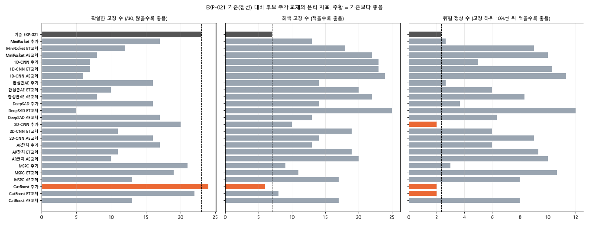
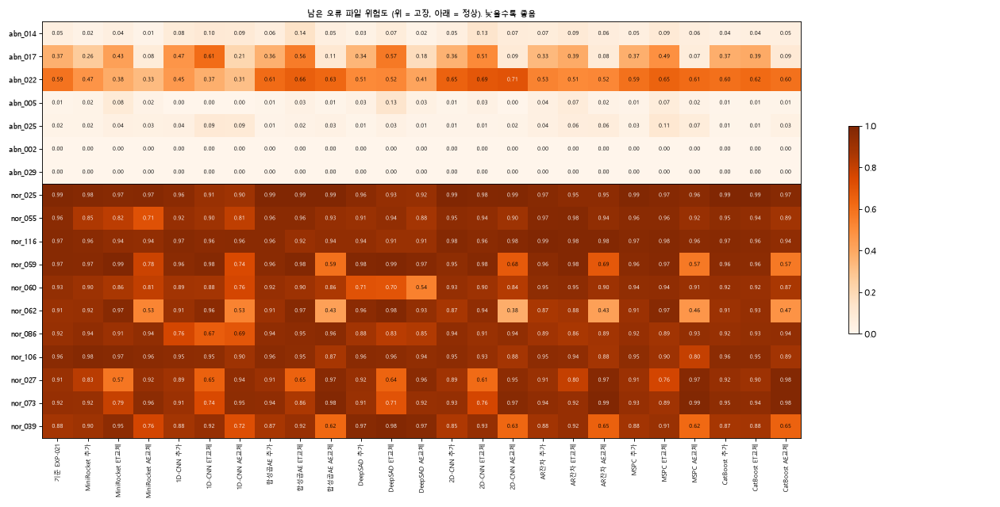

# EXP-022 EXP-021 기준으로 후보 모델 재검토 (추가·교체, 분리 판정)

노션 카드 (실험 DB에 그대로 옮긴다)

| 팀원 | 모델 | F2 점수 | 변경 사항 | 메모 |
|---|---|---|---|---|
| 이동훈 | EXP-021(AE + ET → 로지스틱 + 8.3k 규칙) + 후보 8종 추가·교체 | 0.898 ± 0.013 | EXP-021 주 구성을 기준으로 EXP-019 후보를 추가·AE/ET 교체하고 OOF 분리 판정으로 비교 (H1, H2, H3) |  |

- 가설: H1, H2, H3 ([물리가설](../../../../notes/물리가설.md))
- 실행: 2026-11-14 · git `1771fbd+수정중` · 코드 [run.py](run.py)
- 평가: 중첩 CV (바깥 5 × 안쪽 4, seed 5개). 자주 놓침 = seed 5번 중 3번 이상

## 결과

| 구성 | F2 | 재현율 | 오경보율 | 정밀도 | F2 (고장 10%·40%) | 자주 놓침 | 오경보 3회+ |
|---|---|---|---|---|---|---|---|
| 중첩: CatBoost 추가 | 0.898 ± 0.013 | 0.913 | 0.043 | 0.843 | 0.861 · 0.917 | 014 017 022 | 5 |

## 해석

EXP-021을 대신하거나 보완할 모델은 없다. 통과한 유일한 구성(CatBoost 추가)도 중첩 F2 0.898 ± 0.013으로 기준 0.892 ± 0.015와 sd 안이고, 놓침(014 017 022)·오경보율(0.043)이 같다 → 기각, 최종 후보는 EXP-021 유지

1. **분리 판정 (quick_cv OOF, seed 3 모두)**: 기준 확실한 고장 23/30 · 회색 고장 7(005 014 017 020 022 025 028) · 위험 정상 2.3
   - 추가: CatBoost 24·6·2.0(020만 빠짐, 통과) · 2D-CNN 20 · MSPC 21. 나머지는 확실한 고장이 7–17로 줄고 회색이 늘어남(새 열이 폴드마다 흔들려 다른 고장 점수를 흐림)
   - ET 교체: CatBoost 22(ET와 같은 수준, 같은 ext150 트리 계열이라 새 정보 없음). 나머지는 5–19로 하락
   - AE 교체: 모두 6–17로 하락. AE가 고장 본진을 확실하게 만드는 축이라 대신할 모델이 없다
2. **남은 오류 파일 (위험도, 낮을수록 좋음)**
   - **017**: 기준 0.37 → **AE를 빼면** 0.07–0.21(어떤 후보와 짝이어도). 017을 낮추는 것은 AE다. 017은 "AE가 정상으로 보는 고장"이라 AE 오차와 반대 방향의 정보가 필요하다
   - 같은 AE 교체에서 N-B 정상 059 0.97→0.57–0.78 · 062 0.91→0.38–0.53으로 내려감 → 059·062 오경보도 AE 때문(2-11과 같음). 다만 AE를 빼면 고장 본진이 회색으로 들어와 전체가 나빠진다
   - **022**: 기준 0.59, 가장 좋은 것이 1D-CNN AE교체 0.31 · MiniRocket AE교체 0.33. 원신호 모델만 조금 내림(EXP-019와 같은 단서), 확실한 분리는 없음
   - **014**: 기준 0.05로 이미 낮다(임계값 근처라 중첩에서 4/5 놓침). 후보로 바뀌지 않음
   - **N-A 정상 025·116**: 모든 구성에서 0.90+. 어떤 모델도 "큰 사건 한 번"을 정상으로 내리지 못함. 055만 MiniRocket AE교체 0.71
3. **결론: 남은 오류는 모델 문제가 아니다**
   - 017·059·062 = AE 축 하나의 한계(서로 반대 방향). AE를 대체할 게 아니라 AE가 틀리는 이유(2-10·2-11: 6–8 kHz 모양)를 피처로 보정할 문제
   - 025·055·116 = 단발 큰 사건. 2-11 제안 "가장 큰 사건을 가린 Peak·파고율" 같은 **피처**가 필요
   - 022 = 원신호 파형에만 약한 단서. 1D-CNN·MiniRocket이 본 창을 찾아 피처로 옮기는 것이 다음 길

### separation_bars
어떤 후보·넣는 방식이 확실한 고장을 늘리면서 회색 고장·위험 정상을 늘리지 않는가

### hard_files
EXP-021이 놓친 014·017·022와 오경보 N-A(025·055·116)·059를 후보가 다르게 보는가

