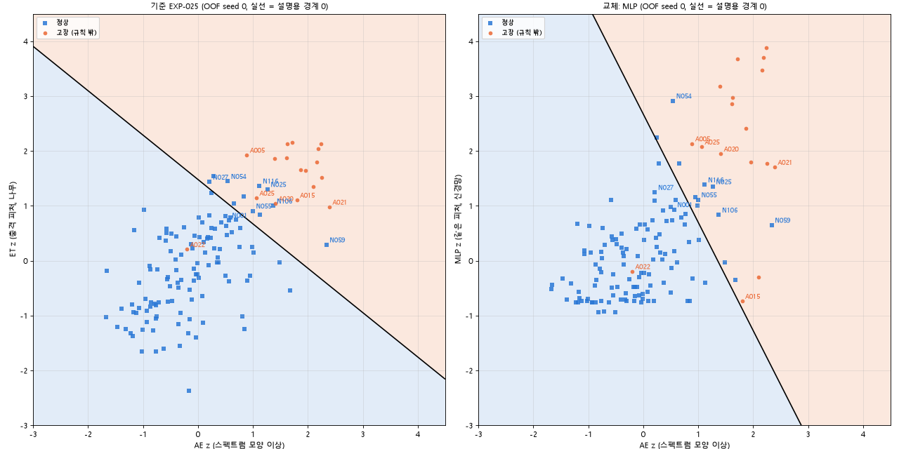
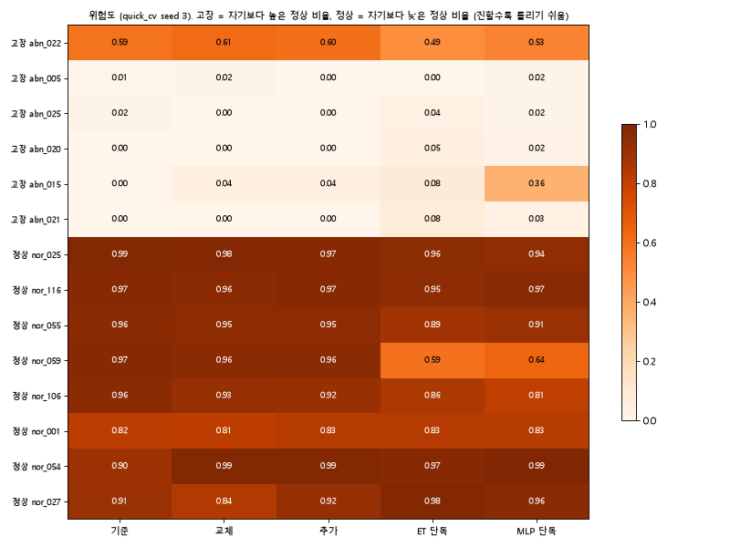
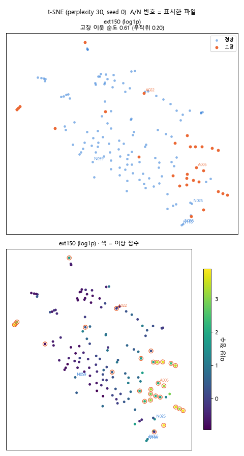
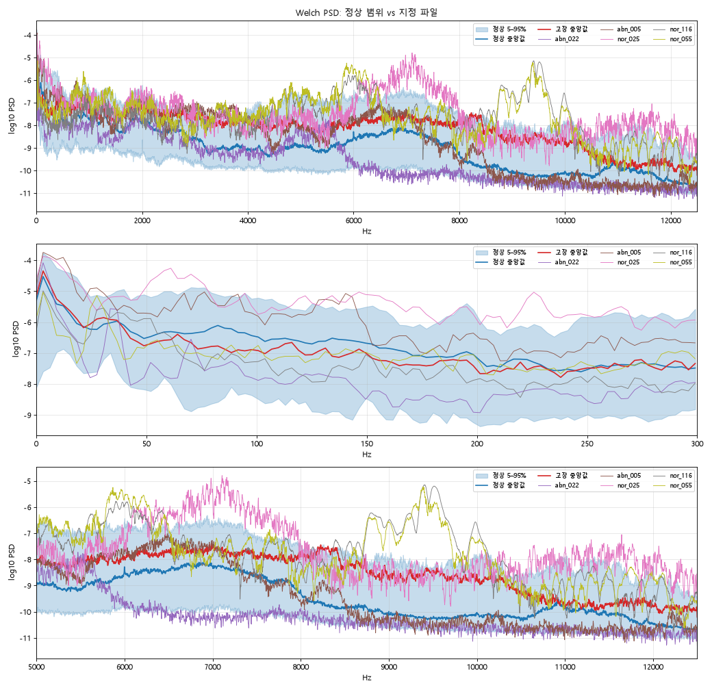

# EXP-031 피처 입력 신경망(MLP) 스크리닝 — ET 교체·추가

노션 카드 (실험 DB에 그대로 옮긴다)

| 팀원 | 모델 | F2 점수 | 변경 사항 | 메모 |
|---|---|---|---|---|
| 이동훈 | 스펙트럼 AE + MLP(ext150) → 로지스틱 + 8.3k·유격 규칙 |  | EXP-025의 ET 자리에 피처 입력 MLP(64-32)를 교체 또는 추가 (모델만 바꿈, 입력 피처는 같음) |  |

- 가설: — ([물리가설](../../../1_기준·기록/물리가설.md))
- 실행: 2026-11-16 · git `4484252+수정중` · 코드 [run.py](run.py)

## 해석

**기각. ET 자리에 피처 입력 신경망(MLP 64-32)을 교체하거나 추가하면 quick_cv PR-AUC가 0.973 ± 0.002에서 0.956 ± 0.003으로 내려간다. 단독으로도 ET보다 낮다(0.838, ET 0.861). 통과 기준을 넘은 구성이 없어 중첩 CV는 돌리지 않았다.**

*logistic_plane* — ET를 MLP로 바꾸면 경계 근처 파일(정상 025 116 055 059, 고장 022 005)의 위치가 달라지는가

**그림 읽는 법**: 왼쪽 = 기준(가로 AE z, 세로 ET z), 오른쪽 = 세로축만 MLP z로 바꾼 것. OOF seed 0, 규칙으로 잡힌 고장은 뺐다. 실선은 설명용 경계(결정값 0)다.

| 구성 | PR-AUC | 확실한 고장 | 회색 고장 | 위험 정상 |
|---|---|---|---|---|
| 0 기준 EXP-025 (AE + ET) | 0.973 ± 0.002 | 26 | 005 020 022 025 | 0.3 |
| 1 교체 (AE + MLP) | 0.956 ± 0.003 | 26 | 005 009 015 022 | 0.7 |
| 2 추가 (AE + ET + MLP) | 0.956 ± 0.003 | 25 | 005 009 015 022 025 | 1.0 |
| 단독 ET / 단독 MLP (규칙 없음) | 0.861 ± 0.025 / 0.838 ± 0.004 | 6 / 7 | | 12.3 / 37.7 |

- **어려운 파일은 그대로다** (위험도, 기준 → 교체): 고장 022 0.59 → 0.61 · 정상 025 0.99 → 0.98 · 116 0.97 → 0.96 · 055 0.96 → 0.95 · 059 0.97 → 0.96. 같은 피처를 넣으면 모델을 바꿔도 같은 파일을 틀린다 (EXP-004 · 015와 같은 결론)
- MLP가 새로 흔드는 파일: 고장 015(위험도 0.00 → 0.04, 단독 0.36) · 009가 회색으로 들어오고 정상 054가 0.90 → 0.99로 오른다. 015는 타격이 없는 저주파 공진형이라 충격 피처 위주의 신경망이 낮게 본다
- 단독 MLP의 위험 정상 37.7개는 "고장 하위 10%의 점수보다 높은 정상이 38개"라는 뜻이다. 일부 고장(015 등)에 정상 수준의 낮은 점수를 준다. 원인은 따로 확인하지 않았다
- 설정(은닉층 · L2 · 배깅 5개)은 실행 전에 고정했고 튜닝하지 않았다. 튜닝하면 조금 나아질 수 있으나, 어려운 파일의 정보가 입력 피처에 없다는 점은 바뀌지 않는다 → 전체 검토는 [딥러닝_검토.md](../../딥러닝_검토.md)

## 그림

### hard_files
MLP로 바꾸거나 더하면 어려운 파일의 위험도가 옅어지는가

### tsne
MLP 점수가 높은 정상은 피처 공간에서 고장 옆에 있는가

### psd_missed
남은 오류 파일의 PSD (EXP-030과 같은 파일)

