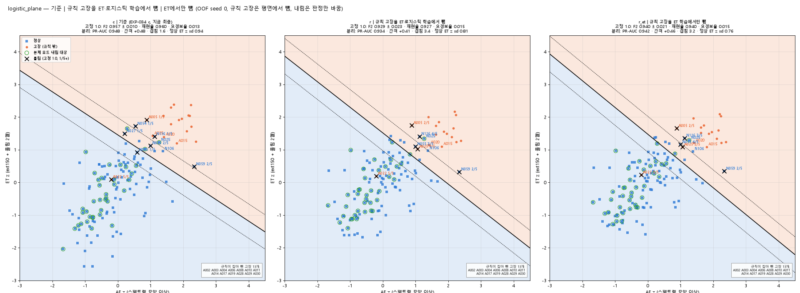
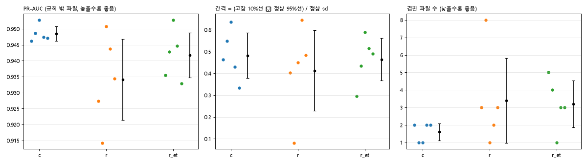
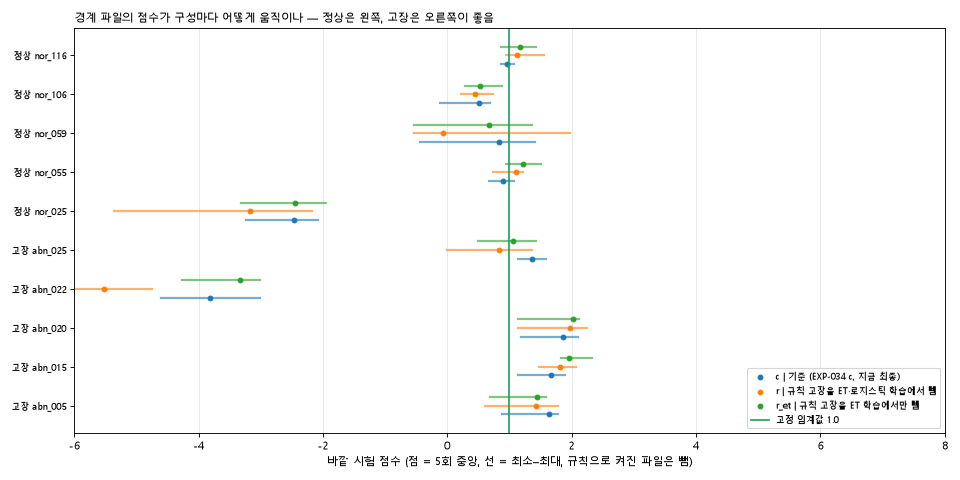
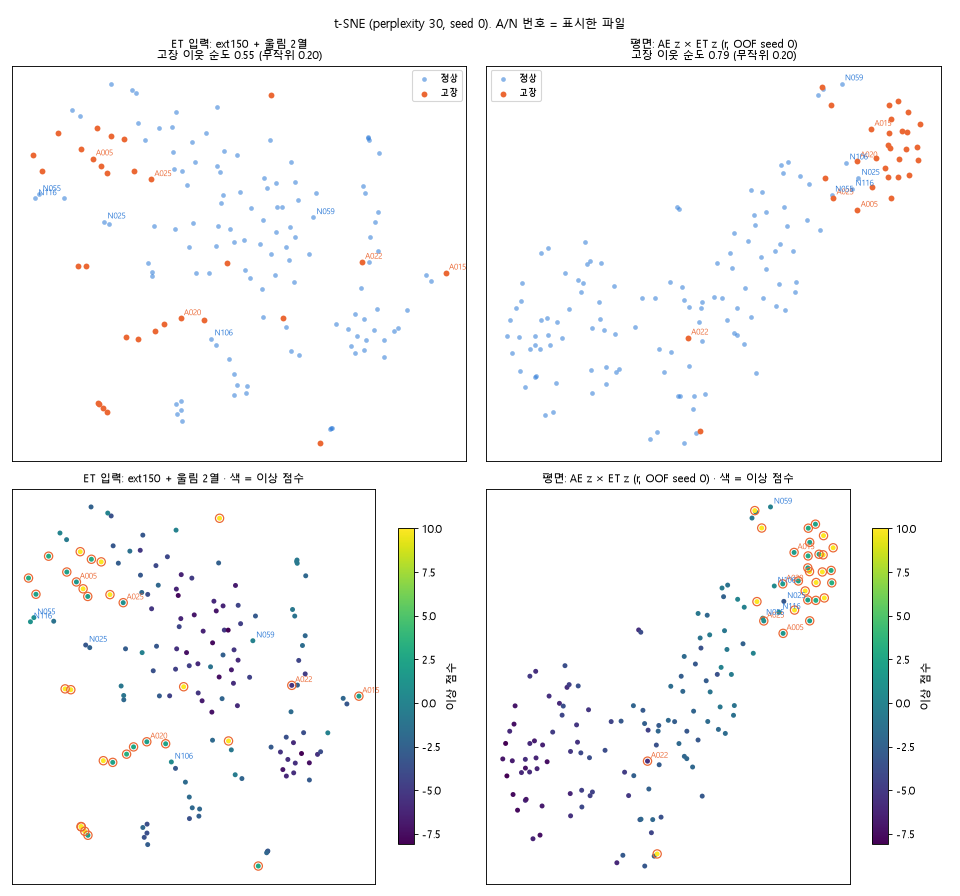
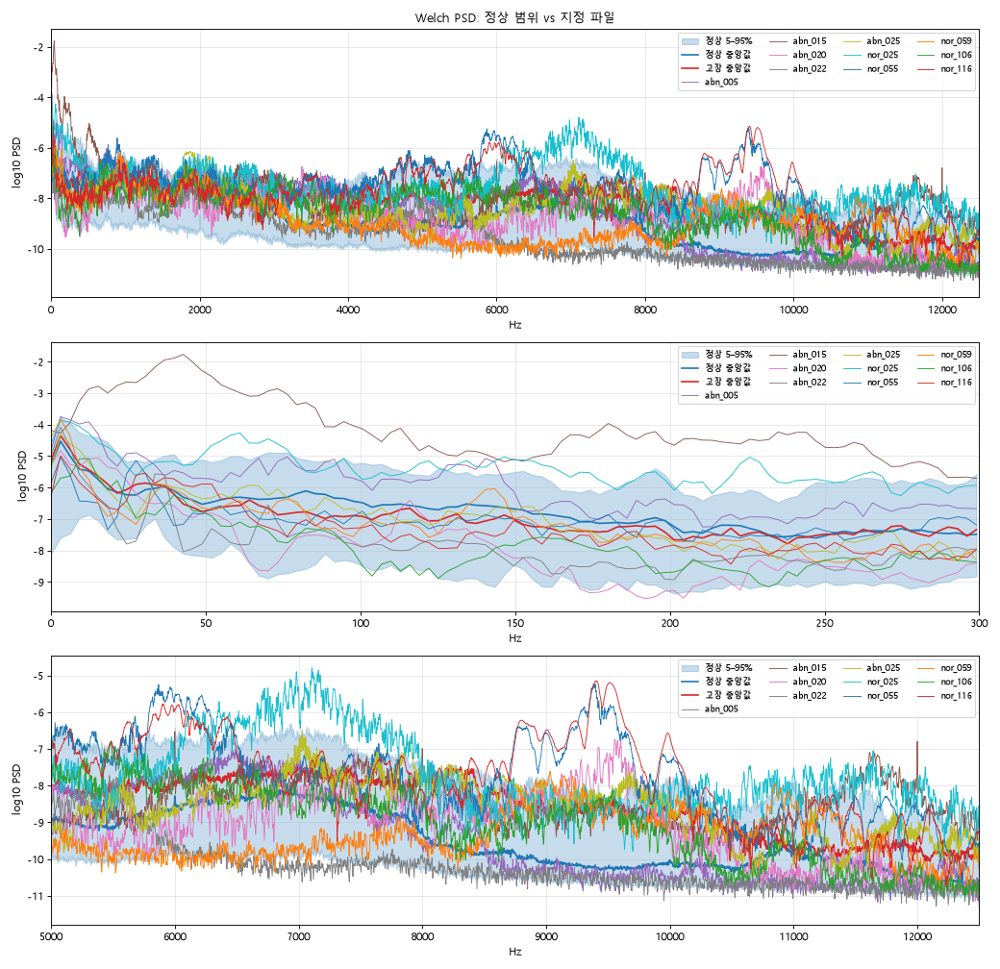

# EXP-038 역할 분리 ET — 규칙이 잡는 고장을 ET·로지스틱 학습에서 뺀다

노션 카드 (실험 DB에 그대로 옮긴다)

| 팀원 | 모델 | F2 점수 | 변경 사항 | 메모 |
|---|---|---|---|---|
| 이동훈 | EXP-034 c, 단 ET·로지스틱은 규칙 밖 고장 + 정상으로만 학습 | 0.929 ± 0.023 | 학습 fold 안에서 규칙(유격 · 8.3 kHz)이 켜진 고장을 ET·로지스틱 학습에서 뺌. 새 문턱·대역 없음 (H1, H2, H3) | 기각. 정상의 ET z 퍼짐은 줄었지만(sd 0.94 → 0.81) 규칙 밖 고장의 ET z가 더 많이 내려와(중앙값 1.92 → 1.49) 분리가 오히려 줄었다(PR-AUC 0.948 → 0.934, 겹친 파일 1.6 → 3.4). 고장 025 · 005가 경계로 내려옴. 규칙 고장은 ET에게 '고장다움'을 가르치는 예시이기도 하다 → 기준 유지. 파라미터 튜닝도 seed 진단(학습 운 몫 약 12%)상 분리 이득 없음 |

- 가설: H1, H2, H3 ([물리가설](../../../1_기준·기록/물리가설.md))
- 실행: 2026-11-17 · git `a46605e+수정중` · 코드 [run.py](run.py)
- 평가: 중첩 CV (바깥 5 × 안쪽 4, seed 5개). 자주 놓침 = seed 5번 중 3번 이상

## 결과

| 구성 | F2 | 재현율 | 오경보율 | 정밀도 | F2 (고장 10%·40%) | 자주 놓침 | 오경보 3회+ |
|---|---|---|---|---|---|---|---|
| fold마다: c \| 기준 (EXP-034 c, 지금 최종) | 0.955 ± 0.007 | 0.967 | 0.023 | 0.913 | 0.934 · 0.966 | 022 | 2 |
| fold마다: r \| 규칙 고장을 ET·로지스틱 학습에서 뺌 | 0.942 ± 0.017 | 0.953 | 0.027 | 0.900 | 0.918 · 0.955 | 022 | 2 |
| fold마다: r_et \| 규칙 고장을 ET 학습에서만 뺌 | 0.936 ± 0.019 | 0.940 | 0.020 | 0.922 | 0.918 · 0.946 | 022 025 | 2 |
| 고정 1.0: c \| 기준 (EXP-034 c, 지금 최종) | 0.957 ± 0.010 | 0.960 | 0.013 | 0.948 | 0.945 · 0.964 | 022 | 0 |
| 고정 1.0: r \| 규칙 고장을 ET·로지스틱 학습에서 뺌 | 0.929 ± 0.023 | 0.927 | 0.015 | 0.940 | 0.915 · 0.936 | 022 025 | 2 |
| 고정 1.0: r_et \| 규칙 고장을 ET 학습에서만 뺌 | 0.940 ± 0.021 | 0.940 | 0.015 | 0.941 | 0.926 · 0.947 | 022 | 2 |

## 해석

**기각. 규칙이 잡는 고장 13개를 ET·로지스틱 학습에서 빼면, 정상 무리는 예상대로 좁아지지만(정상 ET z sd 0.94 → 0.81) 규칙 밖 고장 무리가 그보다 더 많이 정상 쪽으로 내려온다(ET z 중앙값 1.92 → 1.49).** 그래서 미리 정한 분리 지표가 모두 나빠졌다(PR-AUC 0.948 → 0.934, 간격 +0.48 → +0.41, 겹친 파일 1.6 → 3.4). 중첩 F2도 고정 1.0에서 0.957 → 0.929로 떨어졌고, 고장 025(0/5 → 4/5)와 005가 경계 아래로 내려왔다. ET에서만 뺀 r_et도 같은 방향이다(0.940). 규칙 고장은 이미 해결된 파일이지만, ET에게는 규칙 밖 고장과 공유하는 '고장다움'(충격·고주파 모양)을 가르치는 예시이기도 하다. 지금 구성(EXP-034 c)을 유지한다.

<!-- key-figs: 자동 (save_fig key=True) -->

*logistic_plane* — 규칙 고장을 학습에서 빼면 정상 무리가 좁아지고 고장 무리와의 간격이 벌어지는가

<!-- /key-figs -->

**그림 읽는 법**
- 가로 = AE z(스펙트럼 모양 이상), 세로 = ET z(충격 피처 이상), 실선 = 로지스틱 경계, 주황 바탕 = 고장 쪽. 규칙이 잡은 고장 13개는 평면에서 빼고 오른쪽 아래 상자에 적었다. × = 고정 1.0에서 5번 중 1번 이상 틀림, 초록 원 = 본체 모드 내림 대상
- 제목 셋째 줄 = 미리 정한 분리 지표(바깥 seed 5개 평균)와 평면의 정상 ET z sd

1. **왜 이 실험을 했나**: 사용자 목표는 "과적합 없이 평면에서 고장과 정상을 더 떨어뜨리기"였다. 그런데 파라미터 튜닝에는 근거가 없었다
   - EXP-018(AE·ET 역할별 최적화)과 EXP-026(SVM 튜닝)에서 이득이 없었다
   - 11-17 진단(seed 10개): 평면 z의 정상 퍼짐 가운데 학습 운(AE seed · OOF 분할 · ET 나무)에서 오는 몫은 축마다 약 12%였다. 10 seed 평균의 PR-AUC 0.90은 단일 seed 범위(0.82–0.93) 안이다 → 퍼짐은 대부분 파일 사이의 실제 차이다
   - 그래서 튜닝 대신 'ET가 무엇을 배우나'를 바꿨다. 새 문턱·대역은 없고, 학습 fold 안에서 기존 규칙만으로 뺄 파일을 정했다
2. **가설의 절반만 맞았다**: 정상 무리는 좁아졌다(ET z sd 0.94 → 0.81 · r_et 0.76). 그러나 규칙 밖 고장의 ET z도 1.92 → 1.49로 내려왔다. 평면에서는 고장 무리가 경계 쪽으로 붙는다(가운데 그림의 005 · 025 · 015)
3. **해석**: 규칙 고장(8.3 kHz 모드 · 유격 반복)과 규칙 밖 고장은 ET 입력(ext150 + 울림)에서 일부 모양을 공유한다. 고장 30개 중 13개를 빼면 ET가 '고장다움'을 배울 예시가 17개로 줄고, 나무가 정상 쪽 세부에 맞춰진다. EXP-028(못 가르는 정상을 학습에서 뺌)과 같은 결론이다. **학습 파일을 빼서 경계를 다듬는 방식은 이 데이터에서 효과가 없다**
4. **경계 파일**: 오경보 059는 r에서 내려갔지만(+0.83 → −0.07), 055 · 116은 올라갔고 고장 025는 +1.36 → +0.82로 임계값 아래로 내려갔다. 이득보다 손해가 크다
5. **남은 방향**: 평면의 겹침은 특정 파일(정상 055 · 116 · 059, 고장 022 · 025 · 005)에 몰려 있다. 이 파일들은 [EXP-036](../../base/EXP-036_1117_경계파일_9.5k단일사건·울림다양성/README.md)(9.5 kHz 단일 사건 내림)이 물리 근거로 다룬다. 두 축(AE · ET)을 다시 학습시키는 방법으로는 더 벌어지지 않는다

## 그림

### separation
미리 정한 분리 지표 3개 (점 = 바깥 seed, 검은 점·막대 = 평균 ± sd)

### edge_files
구성별 경계 파일 바깥 점수

### tsne
입력 공간과 평면에서 경계 파일은 어디에 있는가 (2행 색 = r의 바깥 점수 중앙값)

### psd_missed
경계 파일의 PSD가 정상 범위 밖으로 나가는 주파수

