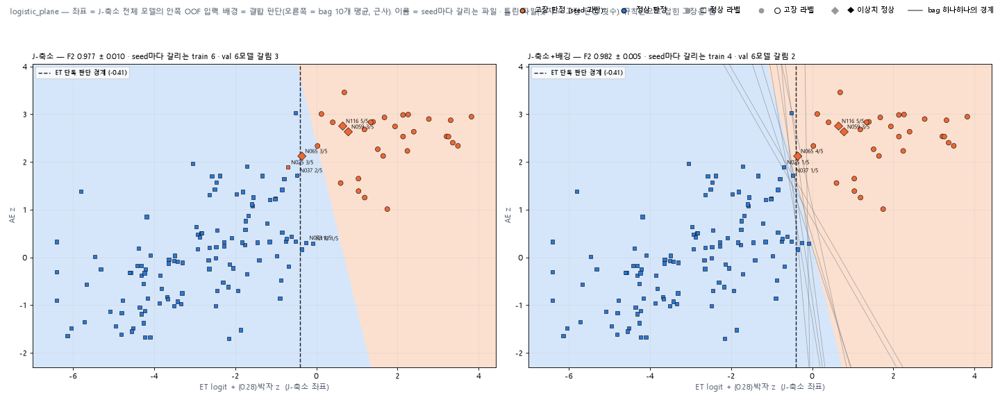
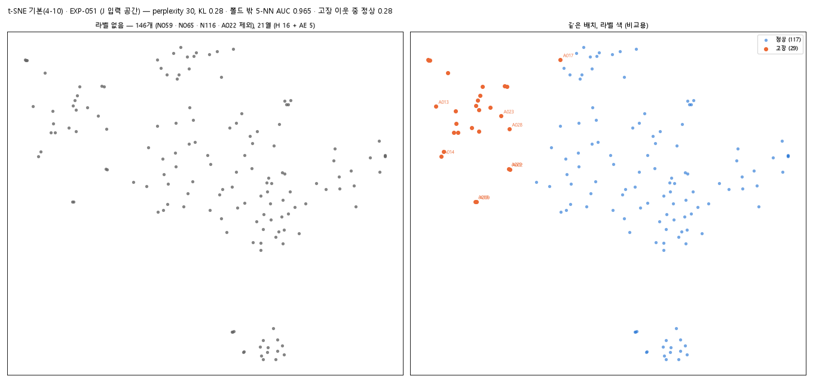
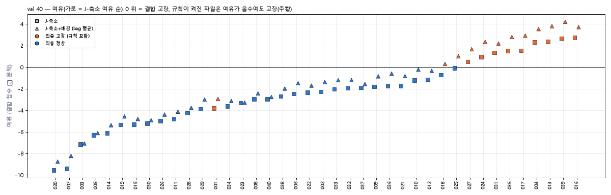

# EXP-051 J-축소 + 배깅 (부분표본 80 % × 10)

노션 카드 (실험 DB에 그대로 옮긴다)

| 팀원 | 모델 | F2 점수 | 변경 사항 | 메모 |
|---|---|---|---|---|
| 이동훈 | J-축소(ET + 박자 z + AE z → 로지스틱, 울림 비율 축소 α=3) × 배깅 10 (층화 80 %), 평균 여유 OR E2 과반 OR 8.3k | 0.982 ± 0.005 | EXP-050 J-축소를 층화 80 % 부분표본 10개로 학습해 평균 여유로 판정(신효섭 RF 배깅과 같은 틀). 같은 분할 (H1, H2) | J-축소보다 +0.005(sd 안). 오경보 18 → 14회(025 · 037 · 073 · 110 줄고 065 3 → 4), 재현율 1.000 유지. seed마다 갈리는 train 6 → 4, val 6모델 갈림 3 → 2. val 고장 10 → 12(018 · 025가 고장으로) |

## 주요 변경점 (기준 실험 대비)

- 배깅 10 (StratifiedShuffleSplit 80 %, bag b의 ET seed = b)
- 판정 = 평균 여유 ≥ 0 OR E2 과반 OR 8.3k
- 기준 = J-축소(EXP-050)

- 가설: H1, H2 ([물리가설](../../1_기준·기록/물리가설.md))
- 실행: 2026-11-22 · git `6e8e901+수정중` · 코드 [run.py](run.py)
- 평가: 중첩 CV (바깥 5 × 안쪽 4) · 모드 seed 5 · ET 300. 자주 놓침 · 오경보 n회+ = seed 과반. quick 수치는 선별용, 기록 수치는 QE_FULL=1

## 결과

| 구성 | F2 | 재현율 | 오경보율 | 정밀도 | F2 (고장 10%·40%) | 자주 놓침 | 오경보 3회+ |
|---|---|---|---|---|---|---|---|
| J-축소+배깅 | 0.982 ± 0.005 | 1.000 | 0.023 | 0.915 | 0.960 · 0.993 | — | 3 |

## 해석

**판정: 기각(사용자 11-22). 점수 상승이 sd 안이고, val 고장 증가(018 · 025)는 bag 문턱이 낮아져서 생긴 것이다(아래 '배깅 판정 풀어 보기'). 기준 구성은 J-축소 유지.** 배깅을 붙이면 F2가 0.977에서 0.982로 0.005 오른다. 표준편차(0.010) 안이라서, 판단 기준(sd 넘는 개선 또는 새로 잡은 고장)은 넘지 못한다.** 오른 몫은 모두 오경보가 줄어서 나왔다. 고장은 두 구성 모두 30개 다 잡는다. 정상 025 · 037 · 073 · 110의 오경보가 줄어 총 18회에서 14회가 됐고, 065만 3회에서 4회로 늘었다. 이상치 정상 059 · 116은 그대로다. 판정 흔들림도 줄었다(seed마다 판정이 갈리는 train 6 → 4, 모델 6개 사이에서 갈리는 val 3 → 2). **대신 val 판정이 바뀐다.** val 018과 025가 고장으로 넘어가서 val 고장이 10개에서 12개가 된다. 축소만 했을 때는 J와 같은 10개였다. quick 선별에서는 차이가 더 컸다(0.968 → 0.984, +0.016).

<!-- key-figs: 자동 (save_fig key=True) -->

*logistic_plane* — J-축소 vs J-축소+배깅의 결합 경계 (오른쪽 회색 선 = bag 10개 각각)

*tsne_라벨* — 기본 t-SNE(4-10). 빨간 원 = 배깅 오경보

<!-- /key-figs -->

### 그림 읽는 법
- **logistic_plane**: 왼쪽 = J-축소, 오른쪽 = 배깅. 좌표는 둘 다 J-축소 전체 모델의 안쪽 OOF 결합 입력이다(가로 = ET logit + 박자 몫, 세로 = AE z). 점 색은 그 구성의 중첩 CV seed 과반 판정이다.
  - 오른쪽 배경은 bag 10개 결합기의 평균 여유 부호이고, 회색 선은 bag 하나하나의 경계다. bag마다 ET가 달라 좌표가 조금씩 다르므로 근사로 그렸다(각 bag의 박자 몫은 J-축소 비율로 둠).
  - bag 경계선이 크게 퍼져 있다(w_AE 0.04–1.49, 문턱 −0.38–0.53). 평균하면 이 퍼짐이 눌려 경계 정상(N025 · N037)이 안정된다.
  - 그림 위쪽 범례가 제목과 겹친다(그림 배치 실수, 계산에는 영향 없음).
- **tsne_라벨**: 기본 t-SNE(4-10). 빨간 원 = 배깅 오경보(seed 과반).

### 흔들림 · 결합기
| | J-축소 | 배깅 |
|---|---|---|
| seed마다 판정이 갈리는 train | 6 (N025 N037 N059 N065 N073 N110) | 4 (N025 N037 N059 N065) |
| 모델 6개(바깥 5폴드 + 전체)의 val 판정이 갈리는 파일 | 3 (V018 V025 V036) | 2 (V018 V025) |
| 모델 6개의 val 고장 수 | 10 · 11 · 12 · 12 · 12 · 10 | 10 · 10 · 12 · 12 · 12 · 12 |
| 결합기 | w_AE 0.47 · 문턱 1.14 | bag별 w_AE 0.04–1.49 · 문턱 −0.38–0.53 |

- bag 하나만 쓰면 val 고장 수가 11–16개로 흩어진다(16 · 14 · 12 · 15 · 11 · 11 · 11 · 13 · 12 · 13). 평균한 모델은 12개다.
- val 018 · 025는 J-축소에서도 폴드에 따라 판정이 갈리던 파일이다. 배깅에서도 여전히 갈린다(6모델 중 일부만 고장). 즉 배깅이 이 두 파일을 확실한 고장으로 만든 것은 아니다. 평균 여유가 0을 살짝 넘었을 뿐이다(018 +0.29, 025 +1.01).

### 배깅 판정 풀어 보기 ([분석/bag별_판정.md](분석/bag별_판정.md) · [그림](분석/bag별_판정.png))
- val 40개 모두에서 배깅 평균 여유가 J-축소보다 높다(평균 +0.81). bag들의 문턱(−0.38–0.53, 평균 0.15)이 J-축소 문턱(1.14)보다 1쯤 낮기 때문이다. 경계 근처 val 전체가 고장 쪽으로 한 칸 올라간다
- val 025는 bag 10개 모두 결합 고장(여유 0.02–2.61)이다. val 018은 6/10으로 갈리고, 평균이 +0.29라 고장이 됐다. 그다음 010(5/10, 평균 −0.22) · 012(3/10) · 036(3/10)은 평균이 0 아래라 정상이다
- 규칙으로 고장이 된 val은 001(8.3k) 하나이고, E2가 과반인 val은 없다

### 주의
- 배깅 방식(10개 · 80 % · 평균 여유)은 실행 전에 정했다. 처음 해 본 설정이고 다른 값은 돌리지 않았다.
- 계산량이 J-축소의 10배다(full 약 20분). 제출 파이프라인(`src/final.py`)에 넣으려면 bag 10개를 저장해야 한다.

## 그림

### val_판정
val 40의 여유: J-축소 vs 배깅 평균

## 중간 단계 결과 (비교 · 절제 · 이전 실험 값)

| 구성 | F2 | 재현율 | 오경보율 | 정밀도 | F2 (고장 10%·40%) | 자주 놓침 | 오경보 3회+ |
|---|---|---|---|---|---|---|---|
| J-축소 | 0.977 ± 0.010 | 1.000 | 0.030 | 0.895 | 0.949 · 0.991 | — | 4 |