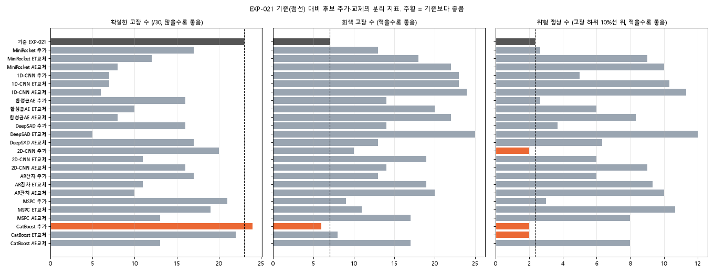
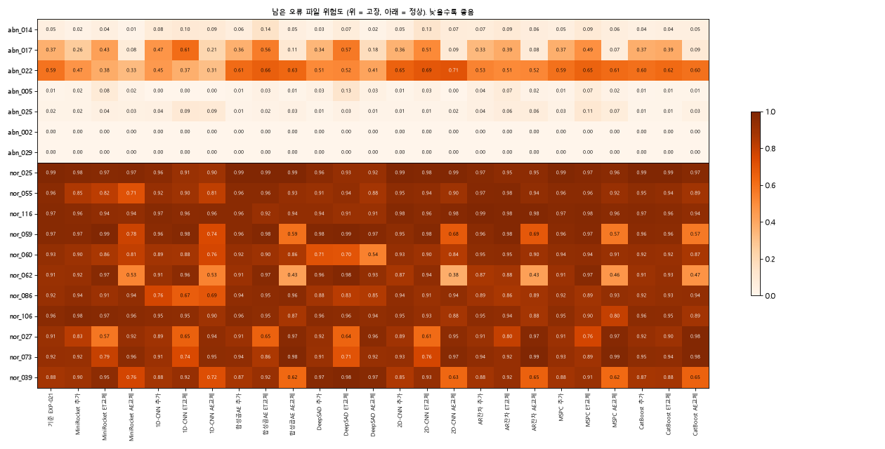

# EXP-022 EXP-021 기준으로 후보 모델 재검토 (추가·교체, 분리 판정)

노션 카드 (실험 DB에 그대로 옮긴다)

| 팀원 | 모델 | F2 점수 | 변경 사항 | 메모 |
|---|---|---|---|---|
| 이동훈 | EXP-021(AE + ET → 로지스틱 + 8.3k 규칙) + 후보 8종 추가·교체 |  | EXP-021 주 구성을 기준으로 EXP-019 후보를 추가·AE/ET 교체하고 OOF 분리 판정으로 비교 (H1, H2, H3) |  |

- 가설: H1, H2, H3 ([물리가설](../../../../notes/물리가설.md))
- 실행: 2026-11-14 · git `1771fbd+수정중` · 코드 [run.py](run.py)

## 그림

### separation_bars
어떤 후보·넣는 방식이 확실한 고장을 늘리면서 회색 고장·위험 정상을 늘리지 않는가

### hard_files
EXP-021이 놓친 014·017·022와 오경보 N-A(025·055·116)·059를 후보가 다르게 보는가

