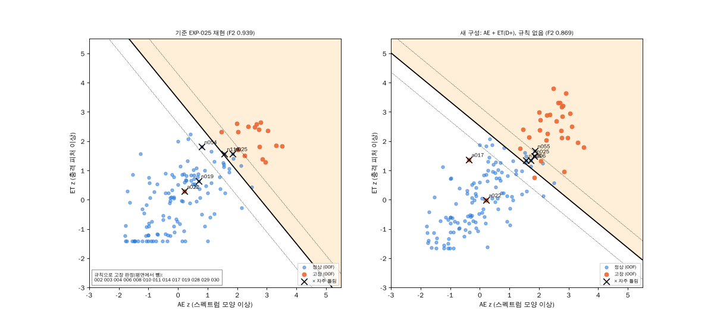
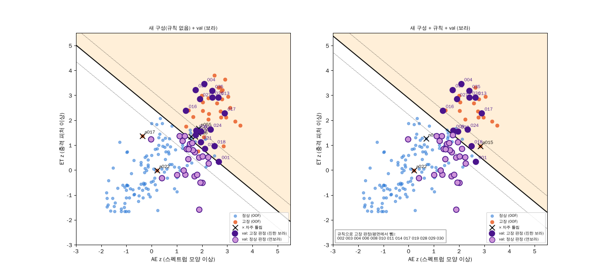
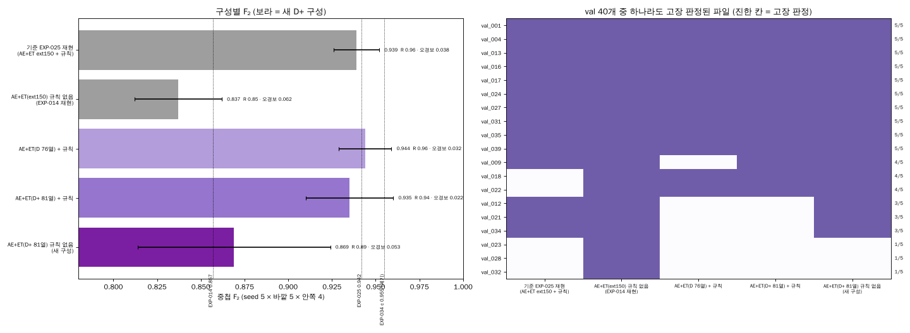
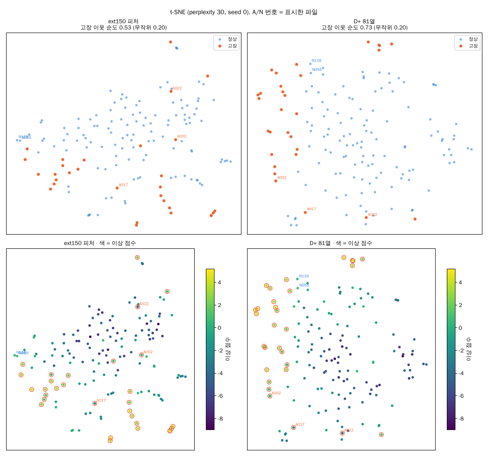
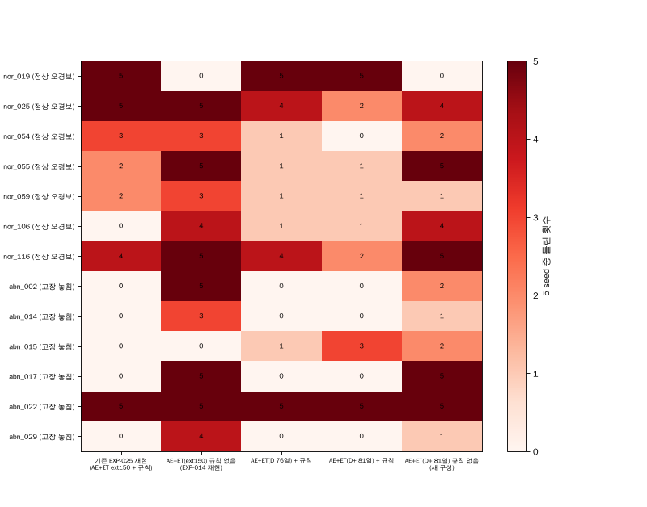
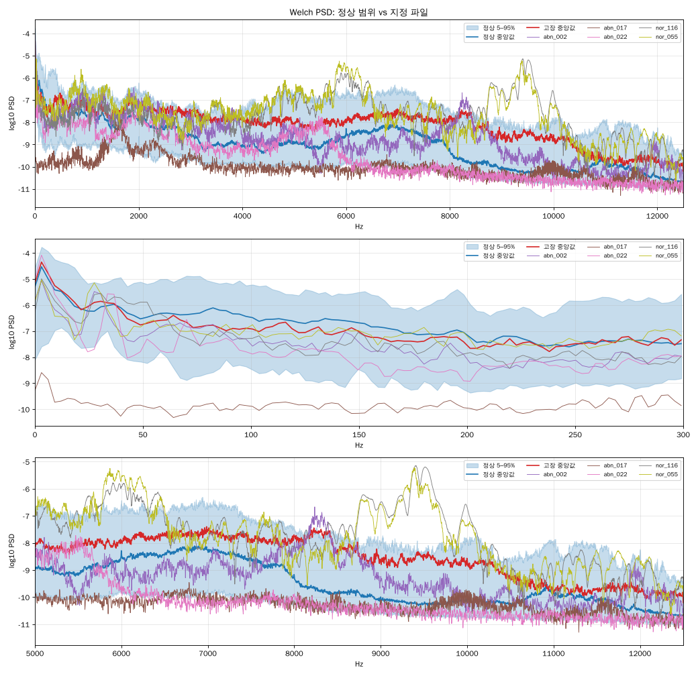

# EXP-036 D+ 피처로 규칙을 모델 안으로 (AE + ET(D+))

노션 카드 (실험 DB에 그대로 옮긴다)

| 팀원 | 모델 | F2 점수 | 변경 사항 | 메모 |
|---|---|---|---|---|
| 이동훈 | AE + ET(D+ 81열) → 로지스틱 (규칙 없음 / + 규칙) | 0.869 ± 0.055 | ET 입력을 ext150 → D+(대표 62 + 울림 4 + 물리 10 + 규칙 기반 5)로 교체, 규칙 유무 비교 (H1, H2′) | 규칙의 기반 수치(P83·W83·K1–K3)를 ET 입력에 넣은 새 구성(규칙 없음)은 F₂ 0.869 ± 0.055로 EXP-014 재현(0.837 ± 0.025)보다 +0.032 높고 002 · 014 · 029를 규칙 없이 잡았지만 sd가 커서 확정할 수 없고, 규칙을 포함한 구성은 기준(0.939, 기록 0.942)을 넘지 못했다(D 76열 0.944 · D+ 81열 0.935, 모두 sd 안). 채택하지 않는다. |

- 가설: H1, H2′ ([물리가설](../../../1_기준·기록/물리가설.md))
- 실행: 2026-11-19 · git `07c53a9+수정중` · 코드 [run.py](run.py)
- 평가: 중첩 CV (바깥 5 × 안쪽 4, seed 5개). 자주 놓침 = seed 5번 중 3번 이상

## 결과

| 구성 | F2 | 재현율 | 오경보율 | 정밀도 | F2 (고장 10%·40%) | 자주 놓침 | 오경보 3회+ |
|---|---|---|---|---|---|---|---|
| 기준 EXP-025 재현 (AE+ET ext150 + 규칙) | 0.939 ± 0.013 | 0.960 | 0.038 | 0.863 | 0.905 · 0.957 | 022 | 4 |
| AE+ET(ext150) 규칙 없음 (EXP-014 재현) | 0.837 ± 0.025 | 0.853 | 0.062 | 0.781 | 0.789 · 0.863 | 002 014 017 022 029 | 6 |
| AE+ET(D 76열) + 규칙 | 0.944 ± 0.015 | 0.960 | 0.032 | 0.884 | 0.915 · 0.959 | 022 | 3 |
| AE+ET(D+ 81열) + 규칙 | 0.935 ± 0.025 | 0.940 | 0.022 | 0.916 | 0.915 · 0.945 | 015 022 | 1 |
| AE+ET(D+ 81열) 규칙 없음 (새 구성) | 0.869 ± 0.055 | 0.887 | 0.053 | 0.812 | 0.826 · 0.893 | 017 022 | 4 |

## 해석

## 해석

<!-- key-figs: 자동 (save_fig key=True) -->

*logistic_plane* — AE z × ET z 평면의 로지스틱 경계(굵은 선 = 임계값, 점선 ±1). 기준은 규칙으로 잡힌 고장을 뺐고 새 구성은 규칙 없이 전부 보인다. ×는 5 seed 중 3번 이상 틀린 파일

*val_plane* — 새 구성에 val 40개를 보라색으로 겹침. 진한 보라 = 고장 판정. 왼쪽은 규칙 없이, 오른쪽은 규칙을 더했을 때

*summary* — 구성별 F₂ 비교와 val 판정 일치도 (한 장 요약)

<!-- /key-figs -->

규칙의 기반 수치(P83·W83·K1–K3)를 ET 입력에 넣은 새 구성(규칙 없음)은 F₂ 0.869 ± 0.055로 EXP-014 재현(0.837 ± 0.025)보다 +0.032 높고 002 · 014 · 029를 규칙 없이 잡았지만 sd가 커서 확정할 수 없고, 규칙을 포함한 구성은 기준(0.939, 기록 0.942)을 넘지 못했다(D 76열 0.944 · D+ 81열 0.935, 모두 sd 안). 채택하지 않는다.

**그림 읽는 법**
- `logistic_plane`: 가로 = AE z, 세로 = ET z, 굵은 선 = 로지스틱 임계값(점선 ±1), 주황 바탕 = 고장 쪽. × = 5 seed 중 3번 이상 틀린 파일. 기준(왼쪽)은 규칙으로 잡힌 고장 12개를 평면에서 빼서 상자에 적었고, 새 구성(오른쪽)은 규칙 없이 모든 파일이 보인다. 새 구성에서는 고장 002 · 014가 경계 위쪽으로 올라오지만(ET z 상승) 정상 025 · 055 · 106 · 116이 경계 근처에 남는다.
- `val_plane`: 같은 평면에 val 40개(보라, 진한 보라 = 고장 판정). 왼쪽 규칙 없음, 오른쪽 규칙 포함.
- `summary`: 구성별 F₂(막대 = 평균, 선 = sd)와 val 판정이 5개 구성에서 얼마나 일치하는지.

**상세**
1. **규칙 없는 쪽 (EXP-014 재현 → D+)**: F₂ 0.837 → 0.869(+0.032, sd 0.025 · 0.055라 유의 아님). 놓침이 002 014 017 022 029 → 017 022로 줄고(002 5/5 → 2/5, 014 3/5 → 1/5, 029 4/5 → 1/5) 오경보 3회+는 6개 → 4개(025 055 106 116). 18번(휴대폰 분석)의 3 seed 결과 0.897 ± 0.026이 5 seed에서 0.869 ± 0.055로 내려갔다: seed 3 · 4에서 점수가 낮아 평균이 하락하고 sd가 두 배가 됐다 → **3 seed 결과는 낙관적이었다.**
2. **규칙 포함**: 기준 0.939 vs D 76열 + 규칙 0.944 ± 0.015(+0.005) vs D+ + 규칙 0.935 ± 0.025(−0.004). 모두 sd 안이라 차이가 없다. D+ + 규칙은 오경보율이 0.022로 가장 낮고(기준 0.038) 오경보 3회+가 019 하나뿐이지만 재현율이 0.940으로 낮아(015 놓침 3/5) F₂가 상쇄된다.
3. **오경보 025 · 116**: 기준은 025 5/5 · 116 4/5. D 76열 + 규칙은 025 4/5 · 116 4/5로 거의 그대로이고, **D+ + 규칙은 둘 다 해소**(남은 3회+ 오경보는 019 5/5). 다만 015 미탐이 새로 생긴다(3/5).
4. **임계값**: 규칙 없는 구성은 바깥 fold마다 고른 임계값이 −0.65–1.19로 크게 흔들려(사분위 −0.12–0.64) 고정 임계값을 정하기 어렵다. D+ + 규칙은 중앙값 0.91, 사분위 0.80–1.12로 기준(중앙값 0.73, 사분위 0.55–0.91)보다 좁다. 고정 임계값 후보 ≈ 0.9이나 EXP-035 방식으로 다시 훑어야 한다.
5. **val (라벨 없음)**: 5개 구성이 모두 고장으로 본 파일 10개(001 004 013 016 017 024 027 031 035 039). 018 · 022 · 009는 4/5, 012 · 021 · 034는 3/5, 023 · 028 · 032는 EXP-014 재현에서만. OOF 임계값이 구성마다 달라 판정 수가 12–19로 달라진다 → val은 경계 영역에 밀집해 있어 판정이 임계값에 민감하다. (val 점수는 train 150개 전체로 학습한 최종 모델의 점수이고 train 점은 OOF라 눈금이 조금 다를 수 있다.)
6. **한계**: 017 · 022는 모든 규칙 없는 구성에서 5/5 놓친다(022는 규칙 포함에서도 5/5). 이 둘은 학습 폴드에 닮은 고장이 없는 단독 유형이라, 규칙 채택 기준 C2(근거 파일 3개 이상)에 걸려 겨냥한 규칙을 만들 수 없다. 규칙 기반 5열의 정의(8.20–8.45 kHz 대역 등)는 002 등을 본 뒤 설계된 것이라 규칙과 같은 종류의 낙관 편향이 있다.

**판정**: 채택 안 함(스크리닝 유지, 기각 후보). 규칙 포함 구성은 기준 대비 sd 안쪽이라 "유의미"(sd 넘는 개선) 기준 미충족이고, 규칙 없는 구성은 개선 가능성은 있으나 sd 0.055로 불안정하다. 최종 구성은 EXP-025(사용자 결정)를 유지한다. **다음**: ① 같은 구성들로 고정 임계값 재결정(EXP-035 방식, 025 기준), ② seed를 늘려 규칙 없는 D+의 sd 확인, ③ val AE z가 높게 나오는 원인(AE 분포 이동) 진단.

## 그림

### tsne
ext150과 D+ 입력 공간에서 고장이 정상과 따로 모이는가. 아래 줄 = 새 구성의 OOF 이상 점수

### hard_files
구성마다 어떤 파일을 몇 번 틀렸는가 (고장 = 놓침, 정상 = 오경보)

### psd_focus
놓친 고장(002·017·022)과 오경보 정상(116·055)의 PSD가 정상 범위(띠) 밖으로 나가는 주파수가 있는가

