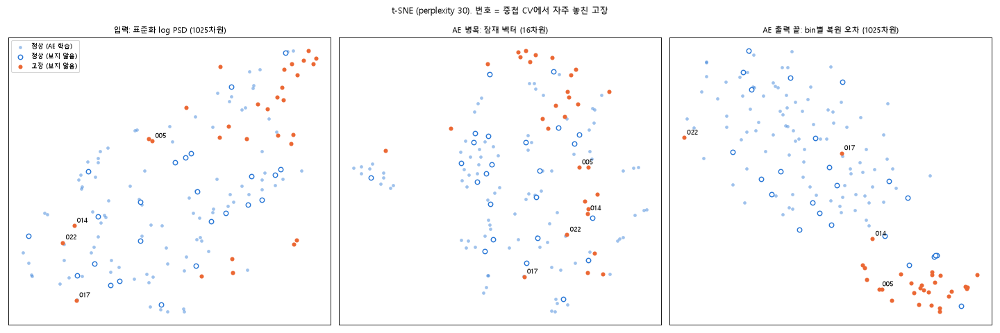
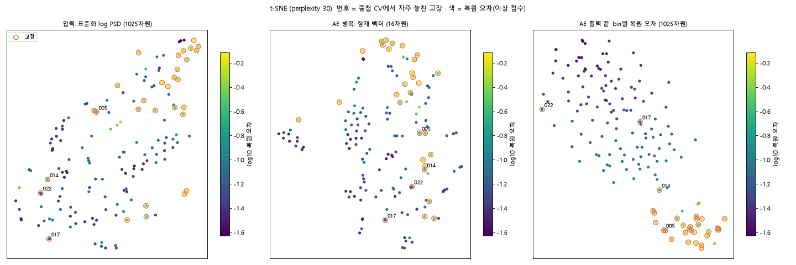
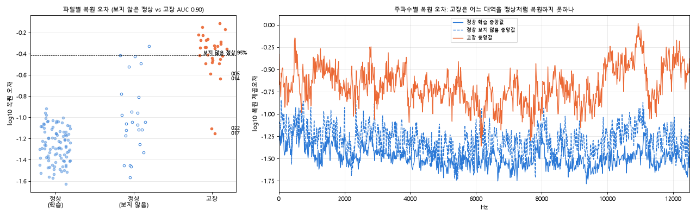
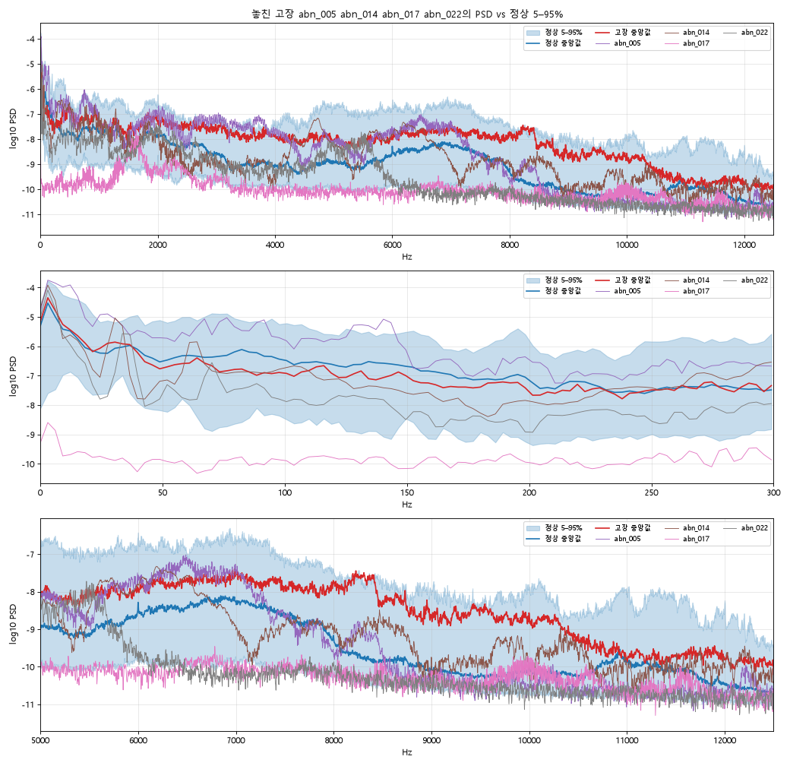

# EXP-012 스펙트럼 MLP 오토인코더 (신효섭 보고서 재현) + t-SNE

노션 카드 (실험 DB에 그대로 옮긴다)

| 팀원 | 모델 | F2 점수 | 변경 사항 | 메모 |
|---|---|---|---|---|
| 이동훈 | MLP 오토인코더 (정상만 학습) | 0.832 ± 0.027 | 200 Hz 고역통과 log PSD(1초×8구간) → AE 1025-128-16-128-1025 복원 오차 | 보고서의 스펙트럼 AE를 그대로 재현하니 0.832로 보고서(0.837)와 거의 같다. 오경보율 0.068로 지금까지 가장 낮고, t-SNE에서는 출력 끝(복원 오차)에서만 고장이 한 덩어리로 모인다 |

- 가설: — ([물리가설](../../../notes/물리가설.md))
- 실행: 2026-11-13 · git `1771fbd+수정중` · 코드 [run.py](run.py)
- 평가: 중첩 CV (바깥 5 × 안쪽 4, seed 5개). 자주 놓침 = seed 5번 중 3번 이상

## 결과

| 구성 | F2 | 재현율 | 오경보율 | 정밀도 | F2 (고장 10%·40%) | 자주 놓침 | 오경보 3회+ |
|---|---|---|---|---|---|---|---|
| 스펙트럼 AE (보고서 구조) | 0.832 ± 0.027 | 0.853 | 0.068 | 0.758 | 0.780 · 0.861 | 005 014 017 022 | 7 |

## 그림

### tsne_group
입력 → 병목 → 출력 끝으로 갈수록 고장(주황)이 정상(파랑)과 따로 모이는가. 흰 원 = AE가 보지 않은 정상



### tsne_score
같은 배치를 복원 오차로 칠함. 오차가 큰 영역과 고장이 겹치는가



### recon_error
복원 오차가 고장에서 큰가, 어느 주파수에서 큰가 (t-SNE용 AE 기준)



### psd_missed
놓친 고장의 PSD가 정상 범위(파란 띠) 밖으로 나가는 주파수가 있는가



## 놓친 고장·오경보 (seed 5번 중 3번 이상)

```
자주 놓침(4개): abn_005 abn_014 abn_017 abn_022
자주 오경보(7개): nor_025 nor_039 nor_055 nor_059 nor_062 nor_106 nor_116
```

## t-SNE용 AE (정상 96개 학습)

```
보지 않은 정상 24개 vs 고장 30개 복원오차 AUC = 0.901
병목 16개 중 항상 0인(죽은) 유닛 = 0개
```

## 메모
보고서의 스펙트럼 AE를 그대로 재현하니 0.832로 보고서(0.837)와 거의 같다. 오경보율 0.068로 지금까지 가장 낮고, t-SNE에서는 출력 끝(복원 오차)에서만 고장이 한 덩어리로 모인다

### 구현 (보고서 5장 기준)
- 입력: 평균 제거 → 200 Hz 고역통과(Butterworth 4차, 양방향) → 1초 구간 8개(겹침) → log Welch PSD(nperseg 2048, 1025 bin) → 학습 정상의 bin별 평균·표준편차로 표준화
- 구조: 1025 → 128 → 16 → 128 → 1025, ReLU, MSE, Adam 0.001, 60 epoch, 정상만 학습
- 점수: 구간 8개 복원 오차의 평균 (보고서에 집계 방식이 없어 평균으로 정함)
- 보고서와 다른 점: torch 대신 sklearn `MLPRegressor`(같은 구조) / 임계값은 우리 중첩 CV 방식(안쪽 OOF F2 최대) / 최종안 "AE OR 피처 12개 LR" 중 LR 쪽은 미구현

### 해석
1. **점수**: F2 0.832 ± 0.027, 재현율 0.853, 오경보율 0.068. ext150+ET(0.827, 오경보율 0.093)와 F2는 같고 오경보는 더 적다. 보고서의 AE 단독 0.837(중복 묶으면 0.822)과 일치 → 재현 성공
2. **놓친 고장이 바뀌었다**: 005 014 017 022. 피처 모델들이 늘 놓치던 **002·029를 잡는다**. 반대로 피처 모델이 잡던 005·014는 놓친다 → 피처 모델과 결합(보고서의 OR)할 근거
3. **t-SNE (tsne_group)**
   - 입력 스펙트럼: 고장이 위쪽에 몰리긴 하지만 정상과 섞여 있다
   - 병목(16차원): 입력과 비슷하게 섞여 있다. 병목은 "정상 스펙트럼을 압축하는 좌표"라서 고장을 따로 모으도록 학습된 게 아니다
   - **출력 끝(bin별 복원 오차)**: 고장 대부분이 오른쪽 아래에 한 덩어리로 모인다. AE의 구분 능력은 잠재 공간이 아니라 "정상처럼 복원되지 않는 정도"에서 나온다
   - 놓친 017·022는 출력 끝에서도 정상 무리 안 → 이 둘은 AE 기준으로도 정상처럼 생긴 고장
4. **복원 오차 (recon_error)**: 고장은 200 Hz–12.5 kHz 전 대역에서 오차가 크다(특정 대역만이 아님). AE가 보지 않은 정상 24개도 학습 정상보다 오차가 약 2배 커서(과적합 간격), 오경보는 이 간격에서 생긴다. 보지 않은 정상 vs 고장 AUC 0.90

### 다음 후보
- 보고서 최종안처럼 피처 LR(또는 ET)과 OR 결합: 놓친 고장 집합이 서로 달라 이득 가능성이 크다
- 정상 과적합 간격 줄이기: 병목 크기·epoch·드롭아웃을 안쪽 CV로 비교
