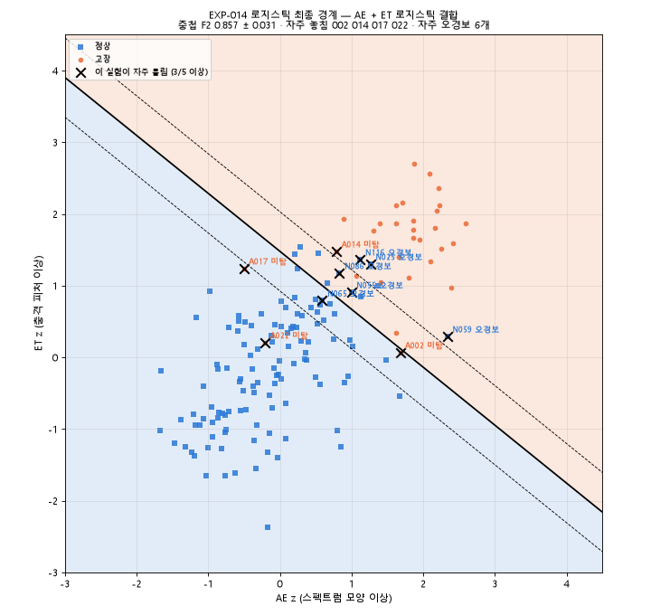
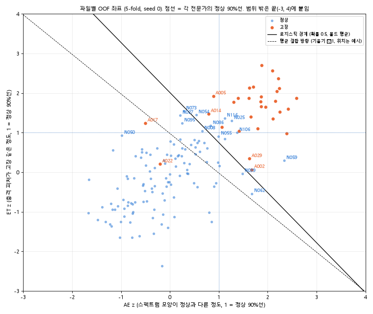
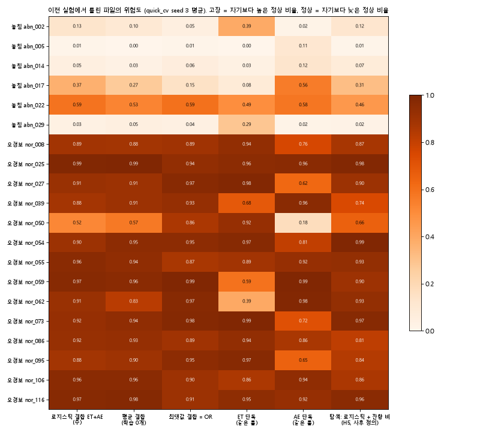
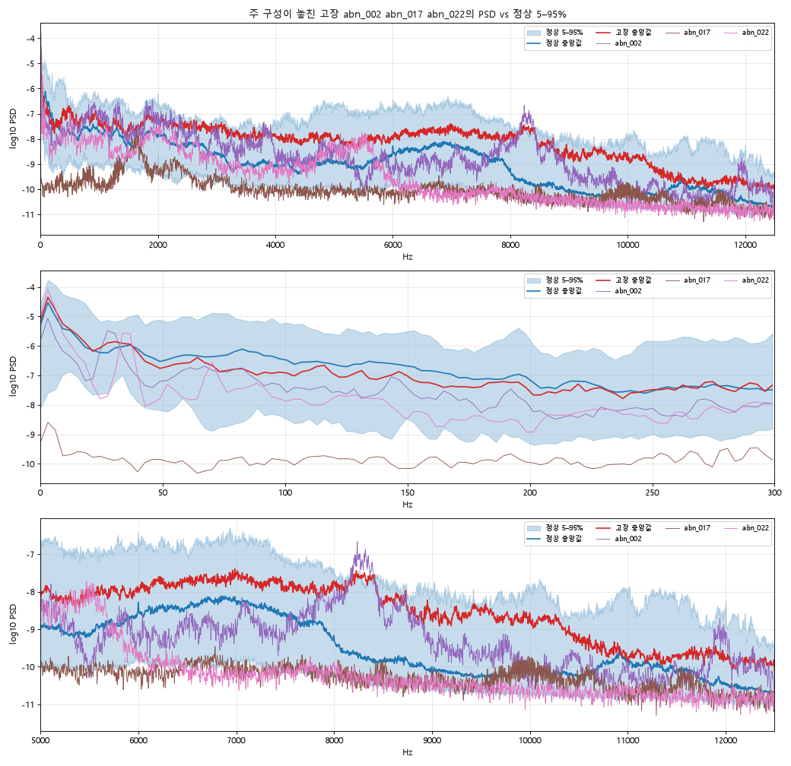
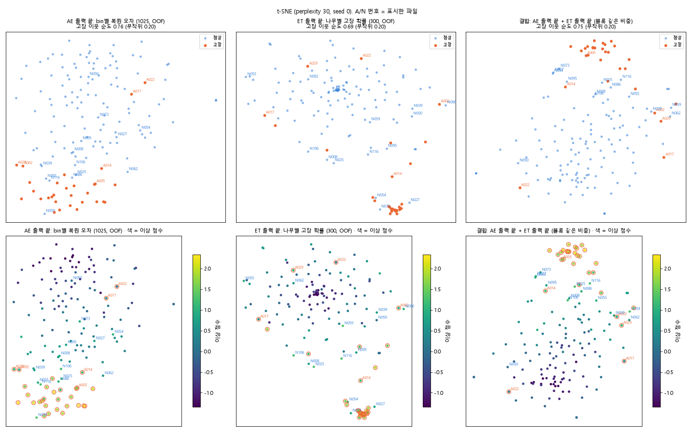
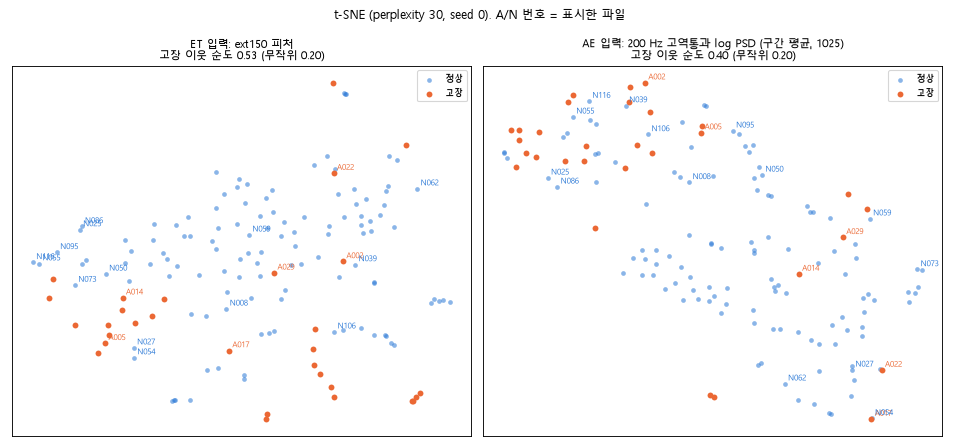

# EXP-014 두 전문가 결합 — ET(충격) + 스펙트럼 AE(모양) → 2차원 로지스틱 경계

노션 카드 (실험 DB에 그대로 옮긴다)

| 팀원 | 모델 | F2 점수 | 변경 사항 | 메모 |
|---|---|---|---|---|
| 이동훈 | ET(ext150) + 스펙트럼 AE → 정상 기준 z → L2 로지스틱 | 0.857 ± 0.031 | ET 점수와 AE 복원 오차를 폴드 안 정상 OOF 기준 z로 맞춰 파라미터 3개 로지스틱으로 결합 (H1, H2, H3) | ET(충격)와 AE(스펙트럼 모양)를 정상 기준 z로 맞춰 결합하면 PR-AUC가 0.85–0.86에서 0.93–0.94로 오른다. 학습한 가중치가 거의 1:1이라 학습 없는 평균 결합(0.937)과 로지스틱(0.929)은 같은 수준이다. 남은 회색지대는 고장 002·017·022와 정상 025·055·059·106·116이다 |

- 가설: H1, H2, H3 ([물리가설](../../../1_기준·기록/물리가설.md))
- 실행: 2026-11-14 · git `1771fbd+수정중` · 코드 [run.py](run.py)
- 평가: 중첩 CV (바깥 5 × 안쪽 4, seed 5개). 자주 놓침 = seed 5번 중 3번 이상

## 결과

| 구성 | F2 | 재현율 | 오경보율 | 정밀도 | F2 (고장 10%·40%) | 자주 놓침 | 오경보 3회+ |
|---|---|---|---|---|---|---|---|
| 최종 후보: 로지스틱 결합 ET+AE (주) | 0.857 ± 0.031 | 0.880 | 0.063 | 0.780 | 0.807 · 0.884 | 002 014 017 022 | 6 |
| 최종 후보: 평균 결합 (학습 0개) | 0.839 ± 0.017 | 0.873 | 0.083 | 0.726 | 0.777 · 0.874 | 002 017 022 029 | 10 |

## 로지스틱 최종 경계



*logistic_plane* — 로지스틱 최종 경계 — 두 전문가 점수 평면(AE z · ET z, OOF seed 0)에서 실선 = 결정값 0, 점선 = 여백 ±1, 마름모·원 = 이 실험의 규칙이 무조건 고장으로 바꾸는 파일, X = 이 실험이 자주 틀린 파일 (코드 [fig_logistic_plane.py](../../fig_logistic_plane.py))

- 두 축을 함께 쓰는 대각선 경계. 고장 무리(오른쪽 위)와 정상 무리(왼쪽 아래)를 가르지만, 017(왼쪽 위)·022·002(가운데 아래)는 정상 쪽, 025·055·116(선 바로 위)는 고장 쪽에 남는다
- 이 회색지대는 경계 모양으로 풀리지 않았다(EXP-015 SVM 기각) → 규칙 축(EXP-021·025)으로 정보를 더함

## 그림

### boundary_2d
ET만 놓친 고장(A002·A029)은 오른쪽, AE만 놓친 고장(A005·A014·A017)은 위쪽에 있는가. 한쪽만 오경보인 정상은 경계 아래로 내려오는가. 라벨 = 이전 실험에서 틀린 파일



### hard_files
ET 문제(002·029 놓침, 027·050·054·073·095 오경보)와 AE 문제(005·014·017 놓침, 039·059·062·106 오경보)가 결합에서 옅어지는가. 022·025·055·116(둘 다 틀림)은 남는가



### psd_missed
놓친 고장의 PSD가 정상 범위(파란 띠) 밖으로 나가는 주파수가 있는가



### tsne
모델이 실제로 판단하는 출력 끝단에서 고장이 모이는가. AE·ET 각각보다 결합 공간에서 더 모이는가. 2행 색 = 평균 결합 점수(OOF). 번호 = 이전 실험에서 틀린 파일



### tsne_input
비교용: 모델을 거치기 전 입력 공간. 출력 끝(tsne)보다 고장이 덜 모이는가



## quick_cv 결과 (5-fold × seed 3, 임계값 없음)

```
로지스틱 결합 ET+AE (주)                        PR-AUC 0.929 ± 0.000 · ROC-AUC 0.960 ± 0.001
평균 결합 (학습 0개)                            PR-AUC 0.937 ± 0.004 · ROC-AUC 0.967 ± 0.002
최댓값 결합 = OR                              PR-AUC 0.889 ± 0.036 · ROC-AUC 0.961 ± 0.009
ET 단독 (같은 틀)                             PR-AUC 0.861 ± 0.025 · ROC-AUC 0.943 ± 0.007
AE 단독 (같은 틀)                             PR-AUC 0.852 ± 0.027 · ROC-AUC 0.942 ± 0.002
탐색: 로지스틱 + 잔향 비 (H5, 사후 정의)              PR-AUC 0.900 ± 0.020 · ROC-AUC 0.962 ± 0.003
기준 비교(같은 방식이 아님): EXP-007 ET 중첩 F2 0.827, EXP-012 AE 0.832
```

## 어려운 파일의 정상 중 순위 (고장은 1에 가까울수록, 정상은 0에 가까울수록 좋음)

```
파일          로지스틱 결합 ET | 평균 결합 (학습  | 최댓값 결합 = O | ET 단독 (같은  | AE 단독 (같은  | 탐색: 로지스틱 +
abn_002             0.87 |       0.90 |       0.95 |       0.61 |       0.98 |       0.88
abn_005             0.99 |       1.00 |       0.99 |       1.00 |       0.89 |       0.99
abn_014             0.95 |       0.97 |       0.94 |       0.97 |       0.88 |       0.93
abn_017             0.63 |       0.73 |       0.85 |       0.92 |       0.44 |       0.69
abn_022             0.41 |       0.47 |       0.41 |       0.51 |       0.42 |       0.54
abn_029             0.97 |       0.95 |       0.96 |       0.71 |       0.98 |       0.98
nor_008             0.89 |       0.88 |       0.89 |       0.94 |       0.76 |       0.87
nor_025             0.99 |       0.99 |       0.94 |       0.96 |       0.96 |       0.98
nor_027             0.91 |       0.91 |       0.97 |       0.98 |       0.62 |       0.90
nor_039             0.88 |       0.91 |       0.93 |       0.68 |       0.96 |       0.74
nor_050             0.52 |       0.57 |       0.86 |       0.92 |       0.18 |       0.66
nor_054             0.90 |       0.95 |       0.95 |       0.97 |       0.81 |       0.99
nor_055             0.96 |       0.94 |       0.87 |       0.89 |       0.92 |       0.93
nor_059             0.97 |       0.96 |       0.99 |       0.59 |       0.99 |       0.90
nor_062             0.91 |       0.83 |       0.97 |       0.39 |       0.98 |       0.93
nor_073             0.92 |       0.94 |       0.98 |       0.99 |       0.72 |       0.97
nor_086             0.92 |       0.93 |       0.89 |       0.94 |       0.86 |       0.81
nor_095             0.88 |       0.90 |       0.95 |       0.97 |       0.65 |       0.84
nor_106             0.96 |       0.96 |       0.90 |       0.86 |       0.94 |       0.86
nor_116             0.97 |       0.98 |       0.91 |       0.95 |       0.92 |       0.96
```

## 주 구성: 정상 90% 선 아래 고장 · 정상 상위 5% 정상

```
고장(3개): abn_002 abn_017 abn_022
정상(5개): nor_025 nor_055 nor_059 nor_106 nor_116
```

## OOF 한 번(seed 0) 임계값 없는 지표

```
AE                       PR-AUC 0.851 · ROC-AUC 0.941
ET                       PR-AUC 0.889 · ROC-AUC 0.949
평균                       PR-AUC 0.934 · ROC-AUC 0.969
OR                       PR-AUC 0.905 · ROC-AUC 0.969
로지스틱(폴드 평균 계수)           PR-AUC 0.937 · ROC-AUC 0.969
로지스틱 계수 (폴드 평균): AE +1.616 · ET +1.277 · 절편 -2.568
```

## 메모
ET(충격)와 AE(스펙트럼 모양)를 정상 기준 z로 맞춰 결합하면 PR-AUC가 0.85–0.86에서 0.93–0.94로 오른다. 학습한 가중치가 거의 1:1이라 학습 없는 평균 결합(0.937)과 로지스틱(0.929)은 같은 수준이다. 남은 회색지대는 고장 002·017·022와 정상 025·055·059·106·116이다

후속 분석: [2-11 README2 — 8–9 kHz 봉우리](../../../2_EDA/유의미/2-11_1114_경계파일특징_8.25khz/README2.md) (회색지대 002·029: 큰 봉우리가 8.2–8.45 kHz면 고장, 8.45–8.75 kHz면 정상)

### 평가 방식
탐색 비교라서 `quick_cv`(5-fold × seed 3, PR-AUC, 임계값 없음)로만 봤다. F2는 아직 없다. EXP-007·012의 중첩 F2와는 직접 비교할 수 없어서, 같은 틀에서 다시 계산한 ET·AE 단독 값을 기준으로 삼았다. 주 구성(로지스틱)은 실행 전에 정했다.

### 해석
1. **결합 효과가 분명하다**: 평균 0.937 ± 0.004, 로지스틱 0.929 ± 0.000. ET 단독 0.861 ± 0.025, AE 단독 0.852 ± 0.027보다 약 +0.07 높다. sd의 3배가 넘는 차이다.
2. **경계는 사실상 45° 직선이다**: 로지스틱 계수가 AE +1.6, ET +1.3으로 거의 같다. 데이터가 학습한 경계가 "두 z의 합"과 같으므로, 파라미터가 없는 평균 결합이 과적합 위험이 가장 작은 같은 모양의 경계다.
3. **OR(최댓값)은 0.889로 더 낮다**: 한쪽만 이상한 정상까지 모두 고장으로 올린다. 오경보 합집합 문제다.
4. **ET 문제 해결** (정상 중 순위, ET 단독 → 평균 결합): 놓침 002 0.61 → 0.90, 029 0.71 → 0.95. 오경보 050 0.92 → 0.57, 027 0.98 → 0.91, 073 0.99 → 0.94, 095 0.97 → 0.90 (부분적).
5. **AE 문제 해결** (AE 단독 → 평균 결합): 놓침 005 0.89 → 1.00, 014 0.88 → 0.97. 오경보 039 0.96 → 0.91, 062 0.98 → 0.83 (부분적). **059·106은 그대로다.**
6. **남은 회색지대 (boundary_2d)**
   - abn_022: 두 축 모두 정상 무리 한가운데에 있다(0.47). 이 두 정보원으로는 잡을 수 없다 → H4(저주파 흔들림 + 충격 동기, 고역통과 전 신호) 같은 새 축이 필요하다.
   - abn_017: ET는 잡지만(0.92) AE z가 −0.5라서 평균하면 0.73으로 **오히려 나빠진다**. 평균 결합의 대가다.
   - abn_002·029 ↔ nor_059·062: 그림 오른쪽 아래, 같은 영역(AE↑, ET≈0)에 함께 있다. 두 축으로는 가를 수 없다.
   - nor_025·055·116·106: 고장 무리의 왼쪽 아래 가장자리, 두 축 모두 약간 높은 곳에 있다. 둘 다 틀리던 정상이라 결합으로도 해결되지 않는다.
7. **잔향 비(H5, 탐색)는 도움이 안 된다**: 0.900 ± 0.020으로 오히려 하락했다. 2-6에서 본 차이는 큰 충격 파일에서만 나타나는 상호작용이라, 선형 항으로 넣으면 다른 파일에 노이즈가 된다. 그림을 본 뒤 정의한 값이기도 해서 여기서는 채택하지 않는다.

8. **t-SNE (tsne, 11-14 추가. 그림만 추가했고 수치는 그대로)**: 고장 이웃 순도는 ET 입력 0.53, AE 입력 0.40, 두 입력을 이어 붙여도 0.53이다(무작위 0.20). **입력을 합치는 것으로는 나아지지 않고, 점수 단계에서 합칠 때 나아진다.** 2행을 보면 결합 점수가 높은 곳이 세 배치 모두에서 고장과 겹친다. 오경보 정상 N025·055·086·116은 ET 입력과 AE 입력 양쪽에서 고장 무리 바로 옆에 붙어 있다. 회색지대가 특정 표현 탓이 아니라는 것과 같은 결론이다

9. **t-SNE 출력 끝단 (tsne, 11-14 교체)**: 고장 이웃 순도는 AE 출력 끝(bin별 복원 오차) 0.76, ET 출력 끝(나무별 확률) 0.69, 두 끝단 결합 0.75다. 입력 공간(tsne_input) 0.40–0.53보다 높다. 결합 공간에서는 고장 본진이 한쪽에 모인다. 그 밖의 위치는 다음과 같다
   - A002·A029: 가장자리에서 N059·N062와 붙어 있다
   - A017: 혼자 떨어져 있다
   - A022: 정상 무리 안에 있다
   - 오경보 정상 N025·055·116·086·106: 고장 본진과 정상 무리 사이 띠에 있다
   - boundary_2d와 같은 회색지대다

### 최종 후보 확인 — 중첩 CV F2 (11-14)
| 구성 | F2 | 재현율 | 오경보율 | 비교 |
|---|---|---|---|---|
| **로지스틱 결합 (주, 사전 지정)** | **0.857 ± 0.031** | **0.880** | **0.063** | ET 0.827 ± 0.031 (오경보율 0.093) · AE 0.832 ± 0.027 (0.068) |
| 평균 결합 | 0.839 ± 0.017 | 0.873 | 0.083 | |

- **재현율과 오경보율이 동시에 지금까지 중 가장 좋다.** 재현율은 0.880(ET 0.867, AE 0.853), 오경보율은 0.063(AE 0.068, ET 0.093)이다. 결정 "고장 비율"의 목표(재현율↑·오경보율↓)와 같은 방향이라 고장 10%·40% 환산에서도 둘 다보다 높다(0.807 · 0.884)
- **다만 F2 차이는 +0.025–0.030으로 sd(0.03) 수준이다.** 우리 기준으로는 "같은 수준 ~ 약간 우세"다. quick_cv의 PR-AUC 차이(+0.07)만큼 F2가 크게 벌어지지는 않았다. 임계값 근처의 회색지대 파일 8개가 F2를 결정하기 때문이다
- **quick_cv에서는 평균 ≥ 로지스틱이었지만, 중첩 CV에서는 로지스틱이 F2·오경보율 모두 낫다.** 차이는 ±1 sd 안이다. 주 구성은 사전 지정대로 로지스틱으로 둔다
- 자주 놓침 002 014 017 022 / 자주 오경보 025 055 059 065 086 116. 둘 다 회색지대 목록과 같다

### 다음 후보
- 회색지대용 세 번째 축 (아래)
- 회색지대용 세 번째 축: 022는 H4(저주파), 002·029 vs 059·062는 같은 AE 오차 안에서 "어느 주파수가 올라갔나"(2-7 다음 후보: 8–11 kHz vs 3–8 kHz)
