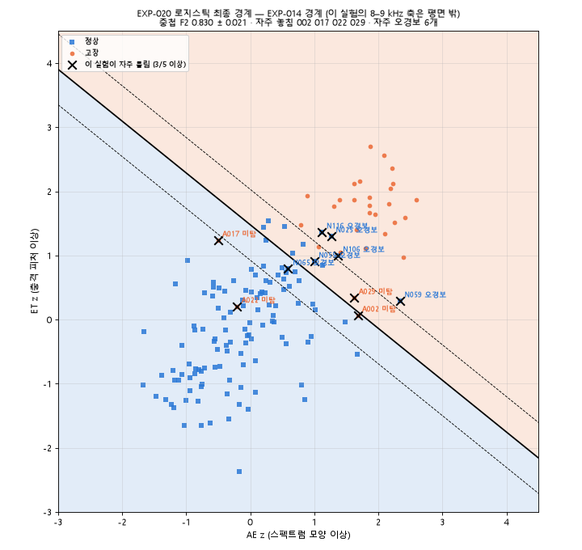
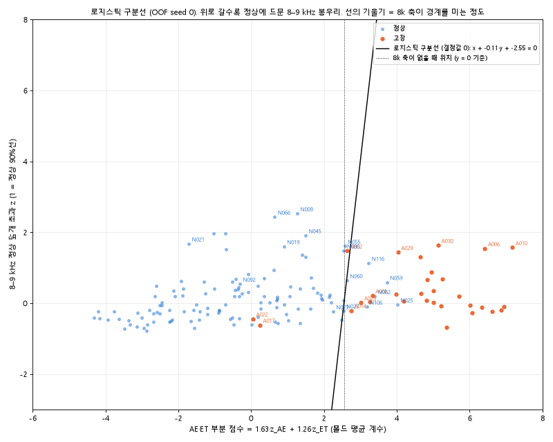
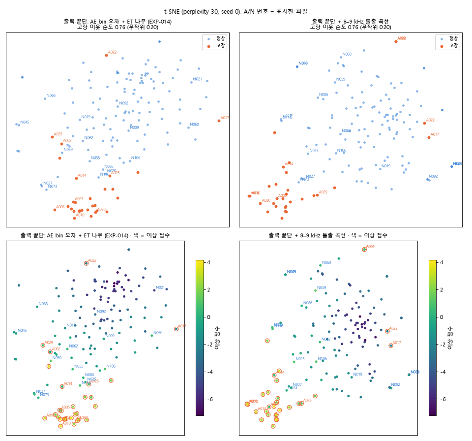
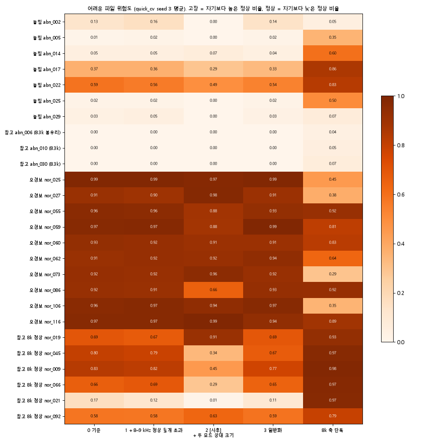
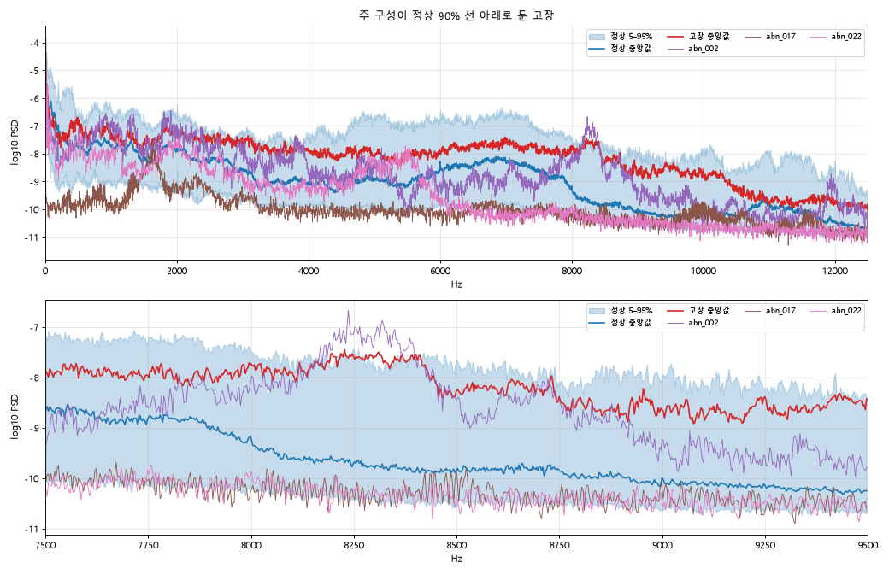

# EXP-020 8–9 kHz 봉우리 축 — 정상 봉우리 덮개 초과를 ET·AE 결합에 추가

노션 카드 (실험 DB에 그대로 옮긴다)

| 팀원 | 모델 | F2 점수 | 변경 사항 | 메모 |
|---|---|---|---|---|
| 이동훈 | ET + 스펙트럼 AE + 8–9 kHz 봉우리 축 → 정상 기준 z → L2 로지스틱 | 0.830 ± 0.021 | EXP-014 결합에 '학습 정상의 주파수별 돌출 90%선을 넘는 봉우리 최댓값(8–9 kHz)' 한 열 추가 (H2) |  |

- 가설: H2 ([물리가설](../../../../notes/물리가설.md))
- 실행: 2026-11-14 · git `1771fbd+수정중` · 코드 [run.py](run.py)
- 평가: 중첩 CV (바깥 5 × 안쪽 4, seed 5개). 자주 놓침 = seed 5번 중 3번 이상

## 결과

| 구성 | F2 | 재현율 | 오경보율 | 정밀도 | F2 (고장 10%·40%) | 자주 놓침 | 오경보 3회+ |
|---|---|---|---|---|---|---|---|
| 중첩: 1 + 8–9 kHz 정상 덮개 초과 (주) | 0.830 ± 0.021 | 0.853 | 0.072 | 0.755 | 0.776 · 0.860 | 002 017 022 029 | 6 |

## 로지스틱 최종 경계



*logistic_plane* — 로지스틱 최종 경계 — 두 전문가 점수 평면(AE z · ET z, OOF seed 0)에서 실선 = 결정값 0, 점선 = 여백 ±1, 마름모·원 = 이 실험의 규칙이 무조건 고장으로 바꾸는 파일, X = 이 실험이 자주 틀린 파일 (코드 [fig_logistic_plane.py](../../fig_logistic_plane.py))

- 이 실험의 8–9 kHz 축은 평면 밖이라 EXP-014 경계를 그렸다. 주 구성(정상 덮개 초과)은 002·029를 새로 잡지 못했다(X) → '같은 파일 안 두 모드 비교'(EXP-021)로 이어짐

## 그림

### boundary_lr
A002·A029가 위로 올라가 구분선을 넘는가, 8.6–8.7 kHz 봉우리 정상(N045·009·066·021)은 아래에 남는가



### tsne
8–9 kHz 돌출을 더하면 A002·A029가 고장 무리로 옮겨 가는가. 2행 색 = 주 구성 OOF 점수(seed 0)



### hard_files
8k 축으로 002·029가 옅어지는가, 8.6–8.7 kHz 봉우리 정상(045·009·066·021)과 8.25 kHz 정상(019)·092가 진해지지 않는가



### psd_missed
(보조) 놓친 고장의 PSD가 정상 범위(파란 띠) 밖으로 나가는 주파수가 있는가



## quick_cv 결과 (5-fold × seed 3, 임계값 없음) · 통과 기준

```
0 기준: 로지스틱(AE, ET) (EXP-014)                       PR-AUC 0.929 ± 0.000 · ROC-AUC 0.960 ± 0.001
1 + 8–9 kHz 정상 덮개 초과 (주)                           PR-AUC 0.923 ± 0.003 · ROC-AUC 0.959 ± 0.000
2 [사후] + 두 모드 상대 크기 (8.20–8.45 − 8.45–8.75)        PR-AUC 0.950 ± 0.001 · ROC-AUC 0.971 ± 0.000
3 일반화: + 2–12 kHz 정상 덮개 초과                         PR-AUC 0.916 ± 0.003 · ROC-AUC 0.959 ± 0.002
  1 통과 기준: ① 미달 (차 -0.006) · ② 미달 (0.90 넘은 회색 고장 0개 , 회색 정상 평균 pct 변화 -0.002)
  2 통과 기준: ① 통과 (차 +0.021) · ② 미달 (0.90 넘은 회색 고장 1개 002, 회색 정상 평균 pct 변화 -0.037)
  3 통과 기준: ① 미달 (차 -0.013) · ② 미달 (0.90 넘은 회색 고장 0개 , 회색 정상 평균 pct 변화 -0.003)
```

## 0 정상 90% 선 아래 고장 · 정상 상위 5%

```
고장: 002 017 022
정상: 025 055 059 106 116
```

## 1 정상 90% 선 아래 고장 · 정상 상위 5%

```
고장: 002 017 022
정상: 025 055 059 106 116
```

## 2 정상 90% 선 아래 고장 · 정상 상위 5%

```
고장: 017 022
정상: 025 027 073 116
```

## 3 정상 90% 선 아래 고장 · 정상 상위 5%

```
고장: 002 017 022
정상: 025 054 059 106
```

## 8–9 kHz 덮개 초과 축 단독

```
PR-AUC 0.272 ± 0.025 · ROC-AUC 0.590
```

## 메모
주 구성(정상 덮개 초과)은 기준에 못 미쳤다(중첩 F2 0.830, 기준 0.857). 8.6–8.7 kHz 봉우리를 가진 정상이 덮개에 덮이지 않아 002·029보다 점수가 높았다. 반면 [사후] 두 모드 상대 크기는 0.950(+0.021)으로 지금까지 quick_cv 최고였다 → README2 개념의 핵심은 "정상에 드문 위치"가 아니라 **"같은 파일 안에서 8.3 kHz 모드가 8.6 kHz 모드보다 솟았나"**이다

### 해석
1. **주 구성이 실패한 이유 (boundary_lr)**
   - 8k 축 z가 N066·N009·N045·N021(8.6–8.7 kHz 큰 봉우리 정상)은 1.8–2.5인데, A002·A029는 약 1.5로 더 낮다
   - 정상 120개 중 8.6–8.7 kHz 큰 봉우리를 가진 파일은 약 8개(7%)다. 90% 덮개는 상위 10%를 덮지 않으므로, **바로 그 봉우리 정상들을 덮지 못한다**
   - 고장 본진은 2–12 kHz가 넓게 올라 있어 돌출이 작다(축에서 0 근처). 그래서 로지스틱이 이 축에 −0.11을 줬다 = 사실상 쓰지 않음
   - 단독 PR-AUC 0.272, ROC-AUC 0.59로 거의 무작위다. 2–12 kHz로 넓히면(3) 더 나쁘다(0.916)
2. **[사후] 두 모드 상대 크기가 잘 되는 이유 (hard_files 3열)**
   - 002 위험이 0.13에서 0.00, 029가 0.03에서 0.00이 된다
   - 동시에 8.6 kHz 정상 045 0.80 → 0.34, 009 0.83 → 0.45, 066 0.66 → 0.29, 086 0.92 → 0.66으로 **아래로 내려간다**
   - 같은 파일 안에서 두 모드를 빼므로 게인과 정상 봉우리의 흔함에 상관없이 "어느 모드가 들떴나"만 남는다(H2′)
   - 다만 nor_019(8.25 kHz 봉우리 정상) 0.69 → 0.91, 027·073이 올라간다. 통과 기준 ②는 미달이다(0.90을 넘은 회색 고장 1개)
3. **사후 구성의 한계**: 8.20–8.45 / 8.45–8.75 kHz 경계는 2-9에서 고장 라벨을 보고 정했다. +0.021은 그 선택 이득을 포함한 낙관적인 값이다

### 결론과 분류
- 주 구성은 유의미 기준(기준선을 sd 넘게 개선하거나 놓친 고장을 새로 잡음)에 **미달**이다. 사용자 지시로 `유의미/`에 만들었고, 분류는 사용자 판단에 맡긴다(제안: 기각으로 옮기되 "두 모드 비교" 교훈은 남긴다)
- 다음 후보: 두 모드 경계를 **학습 폴드의 정상만으로** 정한 상대 크기 축
  - 정상 큰 봉우리 위치 분포의 최빈 구간(8.6–8.7 kHz 예상)을 "정상 모드"로 둔다
  - 그 밖의 8–9 kHz 최대 돌출 − 정상 모드 안 최대 돌출로 계산한다
  - 고장 라벨을 쓰지 않고 [사후] 구성을 재현할 수 있는지가 관건이다
