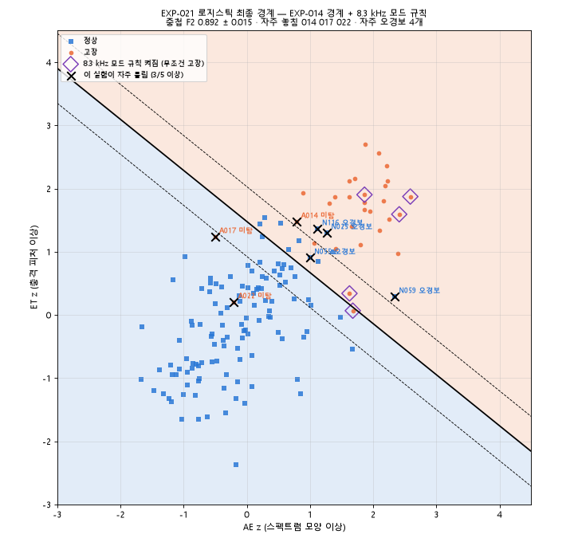
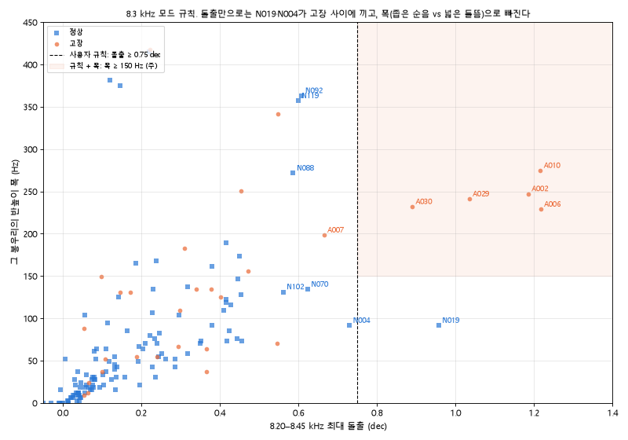
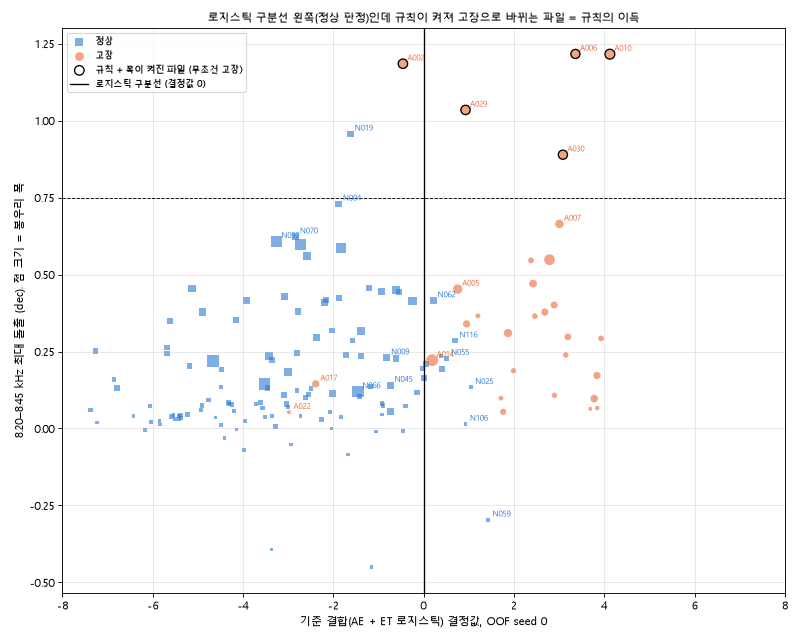
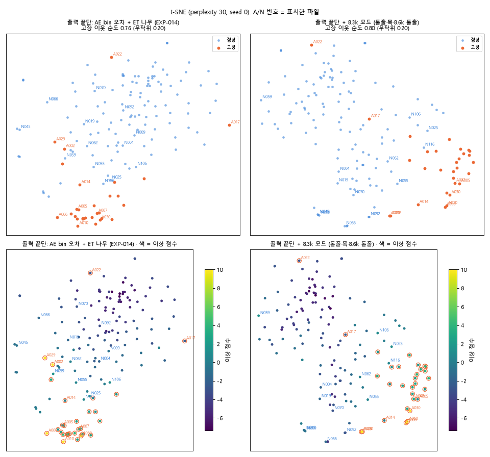
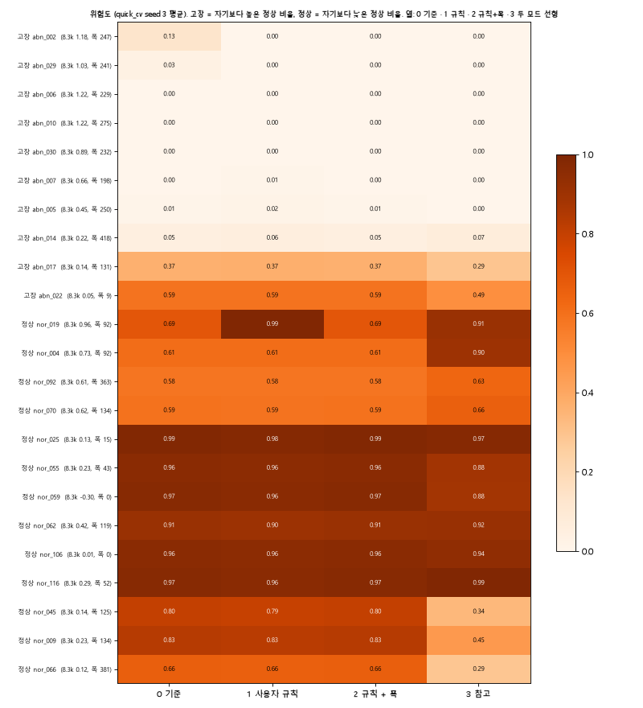
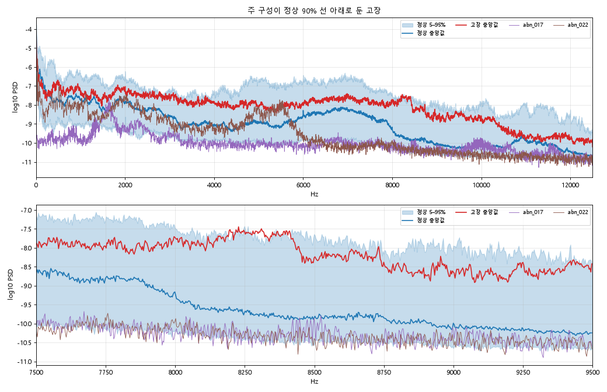

# EXP-021 8.3 kHz 모드 규칙 — 8.20–8.45 kHz 넓은 봉우리면 무조건 고장

노션 카드 (실험 DB에 그대로 옮긴다)

| 팀원 | 모델 | F2 점수 | 변경 사항 | 메모 |
|---|---|---|---|---|
| 이동훈 | ET + 스펙트럼 AE → 로지스틱, + 8.3 kHz 모드 규칙(돌출·폭) 무조건 고장 | 0.892 ± 0.015 | EXP-014 결합 위에 '8.20–8.45 kHz 돌출 ≥ 0.75 dec 이고 폭 ≥ 150 Hz면 고장' 규칙을 덮어씀 (H2) | 8.20–8.45 kHz에 넓은 봉우리(돌출 ≥ 0.75 dec, 폭 ≥ 150 Hz)가 있으면 무조건 고장으로 덮어쓰니 중첩 F2가 0.857 → 0.892 ± 0.015로 올랐다. 재현율 0.907·오경보율 0.043으로 둘 다 지금까지 최고이고, 놓치던 002가 해결됐다. 경계·문턱은 그림을 보고 정한 값이라 점수는 낙관적이다 |

- 가설: H2 ([물리가설](../../../../notes/물리가설.md))
- 실행: 2026-11-14 · git `1771fbd+수정중` · 코드 [run.py](run.py)
- 평가: 중첩 CV (바깥 5 × 안쪽 4, seed 5개). 자주 놓침 = seed 5번 중 3번 이상

## 결과

| 구성 | F2 | 재현율 | 오경보율 | 정밀도 | F2 (고장 10%·40%) | 자주 놓침 | 오경보 3회+ |
|---|---|---|---|---|---|---|---|
| 중첩: 2 규칙 + 폭: 돌출 ≥ 0.75 & 폭 ≥ 150 Hz → 고장 (주) | 0.892 ± 0.015 | 0.907 | 0.043 | 0.840 | 0.856 · 0.912 | 014 017 022 | 4 |
| 중첩: 1 사용자 규칙: 8.3k 돌출 ≥ 0.75 → 고장 | 0.887 ± 0.015 | 0.907 | 0.052 | 0.815 | 0.844 · 0.910 | 014 017 022 | 5 |
| 중첩: 0 기준: EXP-014 (AE + ET → 로지스틱) | 0.857 ± 0.031 | 0.880 | 0.063 | 0.780 | 0.807 · 0.884 | 002 014 017 022 | 6 |

## 해석

8.20–8.45 kHz에 넓은 봉우리(돌출 ≥ 0.75 dec, 폭 ≥ 150 Hz)가 있으면 무조건 고장으로 덮어쓰니 중첩 F2가 0.857 → 0.892 ± 0.015로 올랐다. 재현율 0.907·오경보율 0.043으로 둘 다 지금까지 최고이고, 놓치던 002가 해결됐다. 경계·문턱은 그림을 보고 정한 값이라 점수는 낙관적이다

<!-- key-figs: 자동 (save_fig key=True) -->

*logistic_plane* — 로지스틱 최종 경계 — 두 전문가 점수 평면(AE z · ET z, OOF seed 0)에서 실선 = 결정값 0, 점선 = 여백 ±1, 마름모·원 = 이 실험의 규칙이 무조건 고장으로 바꾸는 파일, X = 이 실험이 자주 틀린 파일 (코드 [fig_logistic_plane.py](../../fig_logistic_plane.py))

<!-- /key-figs -->

1. **규칙이 켜지는 파일**
   - 규칙 + 폭: 고장 002·006·010·029·030만 켜지고, 정상은 하나도 켜지지 않는다
   - 사용자 규칙(돌출만): 여기에 nor_019가 더해진다. 019는 폭 92 Hz의 좁은 순음이라 폭 조건에서 빠진다(rule_map)
2. **중첩 F2**
   - 규칙 + 폭: 0.892 ± 0.015 (재현율 0.880 → 0.907, 오경보율 0.063 → 0.043). 기준보다 +0.035로 sd(0.015–0.031)를 넘는다
   - 사용자 규칙: 0.887 ± 0.015. 019가 늘 오경보가 되어 오경보율 0.052
   - 자주 놓침: 기준 002 014 017 022 → 규칙 014 017 022 (**002 해결**)
3. **오경보율도 함께 내려간 이유**: 규칙이 002·029를 확실히 고장으로 올려 주자, 안쪽 CV가 이 둘을 잡으려고 임계값을 낮출 필요가 없어졌다. 임계값이 올라가면서 경계 정상(025 055 106 …)의 오경보가 줄었다. 회색지대 고장 하나가 임계값 전체를 끌어내리고 있었다는 뜻이다
4. **quick_cv**: 규칙 + 폭 0.946, 사용자 규칙 0.896, 두 모드 선형 입력 0.950
   - 사용자 규칙이 quick_cv에서 낮은 것은 019가 +100으로 모든 고장 위에 올라 PR 곡선 맨 앞을 깎기 때문이다
   - 두 모드 선형 입력은 PR-AUC는 비슷하지만 027·073을 올리는 부작용이 있다(EXP-020)
5. **한계 (결정.md '대역 예외')**
   - 대역 8.20–8.45 kHz, 돌출 0.75 dec, 폭 150 Hz는 모두 그림을 본 뒤 정했다 → +0.035는 낙관적이다
   - 규칙이 켜지는 고장은 30개 중 5개다. 그중 원래 못 잡던 것은 002(가끔 029)뿐이라, 이득은 사실상 파일 1–2개에서 나온다
   - 폭 문턱 150 Hz는 정상 92 Hz와 고장 198 Hz 사이에 여유가 크다(약 2배). 반면 돌출 0.75 dec는 nor_004(0.73)와 가깝다. 다만 004는 폭 92 Hz라 폭 조건으로도 걸러진다
   - val은 확인용으로만 쓰고, val을 보고 문턱을 고치지 않는다
6. **남은 오류 (중첩 CV seed 5번 중 틀린 횟수)**
   - 놓친 고장: 017 5/5 · 022 5/5 · 014 4/5. 017·022는 구분선 왼쪽 정상 무리 안이고 8.3 kHz 봉우리도 없다
   - 자주 오경보: 025 5/5 · 055 4/5 · 116 4/5 (2-11의 "큰 사건 한 번" N-A형) · 059 3/5 (조용한 6–8 kHz 모양형 N-B). 가끔: 065·086·106 2번, 027·039·054·095 1번
   - 규칙은 고장을 위로 올리기만 하므로 오경보 정상은 직접 내리지 못한다. 이 정상들은 8.3 kHz 돌출이 0.3 미만이라 이 축에서 정보가 없다
   - 그림의 세로선(결정값 0)은 실제 임계값이 아니다. fold마다 F2 최대 임계값을 따로 고르므로 구분선 오른쪽 정상도 늘 오경보는 아니다(062 0번, 106 2번)
7. **014가 3/5 → 4/5로 한 번 더 놓친 이유 (11-14 추적)**: 014의 점수는 그대로이고, **임계값이 올라가서** 경계에 있던 014가 아래로 떨어졌다. 014가 든 바깥 fold의 seed별 결과:

   | seed | 기준: 임계값 → 판정 | 규칙+폭: 임계값 → 판정 | 014 점수 | 그 fold 오경보 정상 (기준 → 규칙) |
   |---|---|---|---|---|
   | 0 | 0.409 → 놓침 | 0.409 → 놓침 | 0.189 | 116 → 116 |
   | 1 | 0.608 → 고장 | 0.608 → 고장 | 0.788 | 없음 |
   | **2** | **0.067 → 고장** | **0.501 → 놓침** | **0.458** | **039 060 116 → 116** |
   | 3 | 0.892 → 놓침 | 0.892 → 놓침 | 0.697 | 055 → 055 |
   | 4 | 0.868 → 놓침 | 0.868 → 놓침 | 0.431 | 없음 |

   - seed 2에서 기준 모델은 안쪽 CV의 002·029를 잡으려고 임계값을 0.067까지 낮췄다. 014(0.458)는 그 덕분에 **우연히** 잡혔고, 대가로 정상 039·060이 오경보였다
   - 규칙이 002·029를 올리자 임계값이 0.501로 올라가 014가 놓침이 됐다. 대신 039·060 오경보가 사라졌다 → "014 하나 ↔ 오경보 2개"의 교환
   - 014는 규칙 때문에 나빠진 것이 아니라 원래 임계값 근처의 경계 파일이다(점수 0.19–0.79, 임계값 0.41–0.89). 안정적으로 잡으려면 014 자체의 점수를 올려야 한다. 2-11에서 014는 "반복 충격인데 AE가 약한" 유형이므로 "가장 큰 사건을 가린 Peak·파고율" 축이 겨냥하는 대상이다

### 결론
- **유의미**(기준을 sd 넘게 개선하고 놓치던 002를 새로 잡음) → `유의미/`로 옮긴다
- 최종 후보: EXP-014 결합 + 8.3 kHz 모드 규칙(돌출 + 폭). 규칙은 "조용한 8.25 kHz형" 고장 전용이다
- 물리 해석: 고장에서는 8.3 kHz 공진이 충격으로 들떠 감쇠가 큰 **넓은** 봉우리가 되고, 정상의 8.3 kHz 봉우리는 **좁은** 순음이다 (H2′ 보강)

## 그림

### rule_map
규칙 영역(오른쪽 위)에 고장만 들어가는가. 폭 조건이 N019·N004(좁은 순음)를 빼는가

### boundary_lr
구분선 왼쪽에 있던 A002(·A029)가 규칙으로 고장이 되는가, 규칙이 정상을 끌어올리지 않는가

### tsne
8.3k 모드 특징을 더하면 A002·A029가 고장 무리 쪽으로 가는가. 2행 색 = 주 구성 OOF 점수(±10에서 자름, 규칙 +100)

### hard_files
규칙으로 002·029가 0이 되는가, 규칙 1에서 N019(·N004)가 1로 올라가고 규칙 2에서는 그대로인가

### psd_missed
(보조) 놓친 고장의 PSD가 정상 범위(파란 띠) 밖으로 나가는 주파수가 있는가

