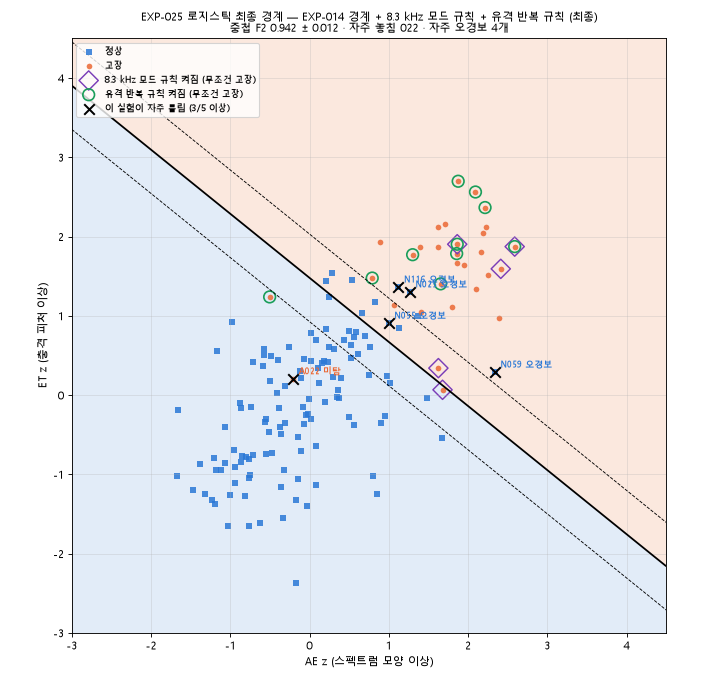
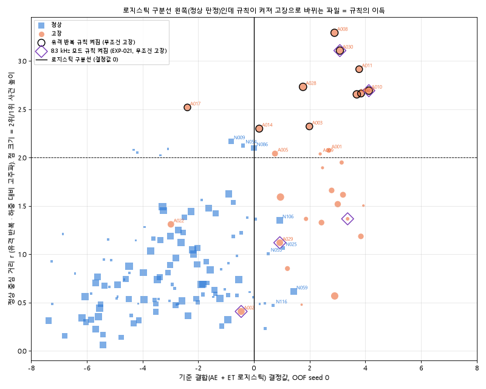
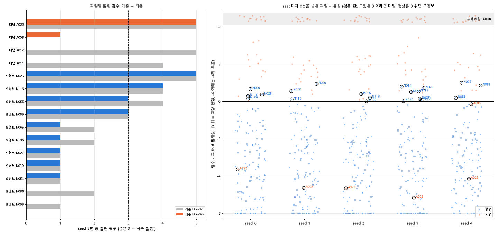
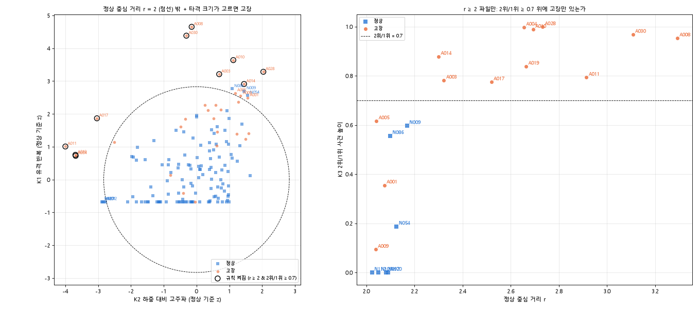
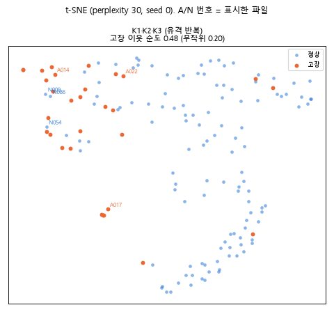

# EXP-025 유격 반복 규칙 — 정상 중심에서 멀고 타격 크기가 고르면 고장

노션 카드 (실험 DB에 그대로 옮긴다)

| 팀원 | 모델 | F2 점수 | 변경 사항 | 메모 |
|---|---|---|---|---|
| 이동훈 | ET + 스펙트럼 AE → 로지스틱 + 8.3k 규칙 + 유격 반복 규칙 | 0.942 ± 0.012 | EXP-021에 '정상 중심 거리 r ≥ 2(유격 반복·하중 대비 고주파) 이고 2위/1위 사건 ≥ 0.7이면 고장' 규칙 추가 (H1) | 유격 반복 규칙(정상 중심 거리 r ≥ 2 이고 2위/1위 사건 ≥ 0.7이면 고장)을 EXP-021에 더하니 014·017이 해결되고 중첩 F2가 0.892 → 0.942 ± 0.012로 올랐다. 재현율 0.907 → 0.960, 오경보율 0.043 → 0.033으로 둘 다 좋아졌다. 규칙은 25번 모두 같은 고장 10개만 켰고 정상은 한 번도 켜지 않았다. 문턱 2·0.7은 사후 값이라 점수는 낙관적이다 |

- 가설: H1 ([물리가설](../../../1_기준·기록/물리가설.md))
- 실행: 2026-11-14 · git `8e4525e+수정중` · 코드 [run.py](run.py)
- 평가: 중첩 CV (바깥 5 × 안쪽 4, seed 5개). 자주 놓침 = seed 5번 중 3번 이상

## 결과

| 구성 | F2 | 재현율 | 오경보율 | 정밀도 | F2 (고장 10%·40%) | 자주 놓침 | 오경보 3회+ |
|---|---|---|---|---|---|---|---|
| 중첩: 1 + 유격 반복 규칙 (주) | 0.942 ± 0.012 | 0.960 | 0.033 | 0.880 | 0.913 · 0.958 | 022 | 4 |
| 중첩: 0 기준: EXP-021 | 0.892 ± 0.015 | 0.907 | 0.043 | 0.840 | 0.856 · 0.912 | 014 017 022 | 4 |

## 해석

유격 반복 규칙(정상 중심 거리 r ≥ 2 이고 2위/1위 사건 ≥ 0.7이면 고장)을 EXP-021에 더하니 014·017이 해결되고 중첩 F2가 0.892 → 0.942 ± 0.012로 올랐다. 재현율 0.907 → 0.960, 오경보율 0.043 → 0.033으로 둘 다 좋아졌다. 규칙은 25번 모두 같은 고장 10개만 켰고 정상은 한 번도 켜지 않았다. 문턱 2·0.7은 사후 값이라 점수는 낙관적이다

<!-- key-figs: 자동 (save_fig key=True) -->

*logistic_plane* — 로지스틱 최종 경계 — 두 전문가 점수 평면(AE z · ET z, OOF seed 0)에서 실선 = 결정값 0, 점선 = 여백 ±1, 마름모·원 = 이 실험의 규칙이 무조건 고장으로 바꾸는 파일, X = 이 실험이 자주 틀린 파일 (코드 [fig_logistic_plane.py](../../fig_logistic_plane.py))

*boundary_lr* — 로지스틱 구분선 근처·왼쪽에 있던 014·017이 규칙으로 고장이 되는가, 규칙이 정상을 끌어올리지 않는가

<!-- /key-figs -->

**그림 읽는 법** — x = 기준 결합(AE + ET 로지스틱) 결정값 (OOF seed 0) · y = 정상 중심 거리 r · 점 크기 = 2위/1위 사건 높이 · 검은 원 = 유격 반복 규칙 켜짐 · 보라 마름모 = 8.3 kHz 모드 규칙 켜짐(EXP-021부터, 002·006·010·029·030) · 점선 = r 2 · x는 두 규칙을 빼고 계산한 기준 점수

- **002** (결정값 −0.45, r 0.41): 유격 규칙 대상이 아니지만 8.3 kHz 규칙(마름모)이 잡는다. 주 구성에서 25번 모두 잡힘

- **017** (결정값 −2.39): 구분선 왼쪽 정상 무리 안. 진동이 정상보다 훨씬 작아 AE·ET 모두 정상으로 본다. 그러나 r 2.52(점선 위)이고 타격이 고르다(0.77) → 규칙이 고장으로 바꾼다
- **014** (결정값 +0.19): 구분선 바로 오른쪽이지만 실제 임계값(0.41–0.89)보다 낮아 늘 놓쳤다. r 2.30, 2위/1위 0.88 → 규칙이 고장으로 바꾼다
- 점선 위의 다른 고장 8개(003 004 008 010 011 019 028 030)는 원래 구분선 오른쪽 멀리 있어서 규칙이 없어도 잡힌다
- **정상 009·054·086**은 점선 바로 위에 있지만 점이 작다(2위/1위 0.60 · 0.19 · 0.56) → 켜지지 않는다. 문턱 0.7과의 여유는 0.10(009)
- 구분선 오른쪽 오경보 정상 025·055·059·106·116은 모두 점선 아래(r < 2) → 이 규칙과 무관하다

### 1. 규칙
- 출발: [2-12 유격 반복 · 하중 대비 고주파](../../../2_EDA/유의미/2-12_1114_저에너지고장/2-12_1114_저에너지고장.md) · 그림 코드 [fig_boundary.py](fig_boundary.py) · fold별 추적 [trace.py](trace.py) → [figs/trace.txt](figs/trace.txt)
- 가설 H1′: 간극(유격)이 있으면 하중 크기와 무관하게, 같은 간극·같은 질량이 부딪쳐 **비슷한 크기의 타격이 반복**된다
- 축 (라벨 무관, `src/features.py` `feature_table_knock`). σ = 200 Hz 고역통과 신호의 1.4826·MAD, 사건 = \|h\| > 8σ
  - K1 유격 반복 = log10(두 번째로 큰 사건 / σ)
  - K2 하중 대비 고주파 = log10(저주파(<20 Hz) RMS / σ)
  - K3 = 2위/1위 사건 높이
- 규칙 (`src/experts.py` `KnockRule`): r = √((z1² + z2²)/2), z = K1·K2를 **바깥 fold 학습 정상의** 중앙값·MAD로 맞춘 값. r ≥ 2 이고 K3 ≥ 0.7이면 점수 +100
- 문턱 2·0.7은 2-12에서 라벨을 본 뒤 정했다 (결정.md '사후 문턱 예외')

### 2. 규칙이 켜진 파일
- seed 5 × 바깥 5-fold **25번 모두 같은 고장 10개**(003 004 008 010 011 **014** **017** 019 028 030), 정상 0번
- 두 무리다 (rule_map)
  - 하중이 작은데 타격 반복 (K2 음수): 004 011 019 017 — 2-12의 "왼쪽 무리", L3 연속 금속 타격
  - 하중은 큰데 바탕이 조용하고 타격 반복 (K2 양수): 003 008 010 014 028 030
- 켜지지 않은 r ≥ 2 고장 001·005·009는 큰 사건 하나가 지배한다(2위/1위 0.09–0.62). 셋 다 기준 모델이 잡는다

### 3. 014·017은 규칙의 +100만으로 잡혔다 (각자 테스트 fold에 든 5번)

| seed | 014 점수 | 임계값 | 기준 → 주 | 017 점수 | 임계값 (기준 → 주) | 기준 → 주 |
|---|---|---|---|---|---|---|
| 0 | 0.189 | 0.409 | 놓침 → 고장 | −2.389 | 0.409 → 0.409 | 놓침 → 고장 |
| 1 | 0.788 | 0.608 | 고장 → 고장 | −1.367 | 0.478 → 0.864 | 놓침 → 고장 |
| 2 | 0.458 | 0.501 | 놓침 → 고장 | −2.396 | 0.035 → 0.474 | 놓침 → 고장 |
| 3 | 0.697 | 0.892 | 놓침 → 고장 | −1.764 | 0.124 → 0.333 | 놓침 → 고장 |
| 4 | 0.431 | 0.868 | 놓침 → 고장 | −2.013 | 0.080 → 0.695 | 놓침 → 고장 |

- 014는 점수가 임계값 근처를 오가는 경계 파일이다. EXP-021 해석 7의 "014를 안정적으로 잡으려면 014 자체의 점수를 올려야 한다"를 이 규칙이 했다
- 017은 점수가 모든 정상보다 낮다(−1.4 ~ −2.4). 기준 모델은 017을 잡으려고 임계값을 0.035–0.124까지 내리기도 했지만 그래도 못 잡았다

### 4. 오경보도 줄었다 — 임계값이 올라가서
- 정상별 오경보 횟수 (기준 → 주): 086 2→0 · 065 2→1 · 106 2→1 · 055 4→3 · 095 1→0. 나머지(025 5 · 116 4 · 059 3 · 027·039·054 1)는 그대로
- 014·017이 안쪽 CV에 있으면, 기준 모델은 이 둘을 잡으려고 임계값을 낮췄다. 규칙이 둘을 +100으로 올려 주자 그럴 필요가 없어져 **25개 fold 중 15개에서 임계값이 올랐다**

| seed·fold | 임계값 기준 → 주 | 사라진 오경보 |
|---|---|---|
| 1·2 | 0.193 → 1.083 | 055 |
| 2·2 | 0.313 → 1.412 | 065 · 106 |
| 2·4 | 0.325 → 1.117 | 086 |
| 4·1 | 0.488 → 0.751 | 086 · 095 (대가: 005 놓침) |

- EXP-021의 002·029 때와 같은 기전이다: **회색지대 고장 한두 개가 임계값 전체를 끌어내리고 있었다**
- 대가: 005가 1번(seed 4·fold 1) 놓쳤다. 점수 0.585 < 올라간 임계값 0.751. 005는 r 2.04지만 2위/1위 0.62라 규칙이 켜지지 않는 경계 파일

### 5. quick_cv 분리 판정 (seed 3, 임계값 없음)

| 구성 | PR-AUC | 확실한 고장 | 회색 고장 | 위험 정상 |
|---|---|---|---|---|
| 기준 EXP-021 | 0.946 ± 0.002 | 23 | 005 014 017 020 022 025 028 | 2.3 |
| + 유격 반복 규칙 | **0.973 ± 0.002** | **26** | 005 020 022 025 | **0.3** |

### 6. 물리 해석과 한계
- 건강한 연결부의 큰 타격은 노면 사건 하나가 지배한다(2위/1위 작음). 간극이 있으면 같은 간극·질량이 반복해서 부딪친다(크기가 고름)
- 이 규칙은 초기 고장 전용이 아니라 **고장 공통 기전(간극 타격)** 을 잰다. 켜진 10개 중 8개는 원래 잡히던 고장이다. 014·017이 잡힌 이유는 K1이 타격을 그 파일의 바탕(σ)으로 나눠 재기 때문이다 → 바탕이 조용하거나(014) 진동 전체가 작아도(017) 타격이 드러난다
- 한계
  - 문턱 r = 2, K3 = 0.7과 축 K1·K2는 014를 보며 나왔다(선택 편향) → **+0.050은 낙관적**
  - 이득은 사실상 014·017 두 파일과 그 덕분에 올라간 임계값에서 나온다
  - 정상 쪽 여유 0.10(nor_009). 요철이 반복되는 노면 같은 "덜컹거림이 반복되는 정상"이 val·test에 있으면 오경보 → val에서 규칙이 켜진 정상을 따로 확인(문턱은 고치지 않음)
  - "저주파 = 하중"은 가정이다(가속도이지 힘이 아님)
  - 자세한 의미·틀렸을 수 있는 점은 [2-12 "이 지식의 의미"](../../../2_EDA/유의미/2-12_1114_저에너지고장/2-12_1114_저에너지고장.md#이-지식의-의미--무엇을-알게-됐고-무엇을-잘못-판단했을-수-있나)

### 7. 남은 오류 — 왜 이 파일들만 틀리나 (아래 그림 errors, 코드 [fig_errors.py](fig_errors.py), 수치 [figs/errors.txt](figs/errors.txt))

**그림 읽는 법** — 왼쪽 = 파일별 seed 5번 중 틀린 횟수(회색 기준 EXP-021 → 색 최종 EXP-025). 오른쪽 = seed마다 모든 파일의 (점수 − 그 fold 임계값). 0선 위 = 고장 판정. 규칙(+100)이 켜진 파일은 맨 위 회색 띠. 검은 원 = 틀린 파일

- **미탐은 사실상 022 하나다.** 022는 5번 모두 임계값보다 **3.7–5.2 아래**, 정상 무리 한가운데에 있다. 임계값을 조금 내려서는 잡을 수 없다(내리면 정상 수십 개가 먼저 넘어온다) → 지금 정보로 구분 불가
- **005는 경계 파일이다.** 여유가 +0.14 ~ +1.58로 늘 0선 바로 위에 있다가, seed 4에서만 −0.17로 내려갔다(임계값이 올라간 fold). 운에 따라 1/5 정도 놓친다
- **오경보는 0선 바로 위에 몰린 정상 몇 개다.** 대부분 여유가 +0.0 ~ +1.0으로 작다
  - 025: 5번 모두 +0.35 ~ +0.99 (큰 사건 한 번, N-A형)
  - 116: +0.09 ~ +0.53으로 4번, seed 4만 −0.32
  - 055: −0.42 ~ +0.84를 오가 3번 (N-A형)
  - 059: +0.18 ~ +0.93으로 3번, seed 2·3은 −0.83 · −1.26 (조용한 6–8 kHz형, N-B)
  - 그 밖에 027 039 054 065 106은 1번씩, 모두 여유 +0.0 ~ +0.8
- **왜 개수가 이렇게 작은가**: 고장 대부분은 규칙 띠(+100) 또는 0선 위 +1 이상에 있고, 정상 대부분은 0선 아래 −1 이하에 있다. 틀리는 것은 **0선 근처 ±1 안에 있는 파일 몇 개**와 정상 무리 안 깊숙이 있는 022뿐이다
- 기준(EXP-021)과 비교하면 014·017(미탐)과 086·095(오경보)가 사라졌고, 065·106·055는 줄었다(해석 4: 임계값 상승). 025·116·059는 그대로다 → 다음에 내려야 할 정상은 이 셋. 모두 r < 2라 유격 규칙과 무관하다

### 결론
- **유의미** (기준을 sd 넘게 개선, 놓치던 014·017을 새로 잡음) → `유의미/`
- 최종 후보: EXP-014 결합(AE + ET → 로지스틱) + 8.3 kHz 모드 규칙(002·029) + 유격 반복 규칙(014·017 등)
- 다음 병목: 오경보 N-A형(025·116·055)과 022 → 논의는 [README2](README2.md) ("확실한 선이 있는가", SVM 비선형 경계, 다음 할 일)

## 그림

### rule_map
r ≥ 2 밖이고 2위/1위 ≥ 0.7인 영역(검은 테두리)에 고장만 들어가는가, 014·017이 들어가는가

### tsne
유격 반복 공간에서 014·017이 고장 무리에 있는가, 이웃 정상 009·054·086은 어디인가

