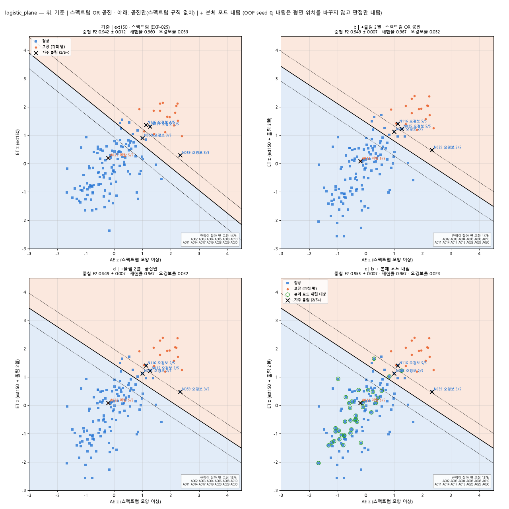
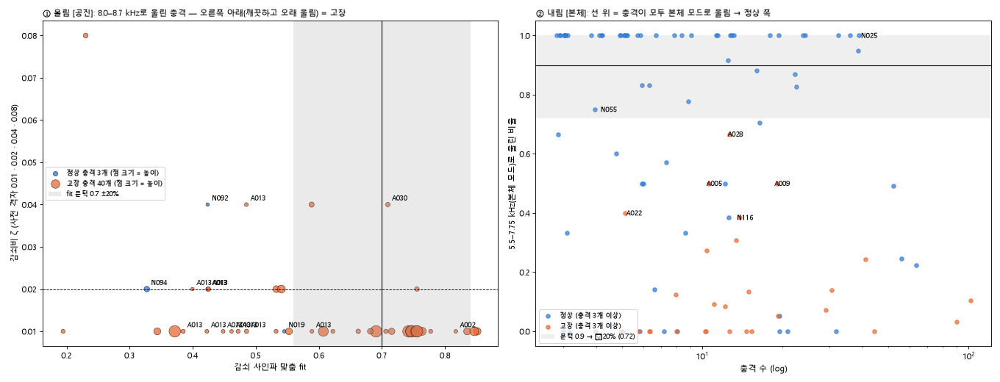
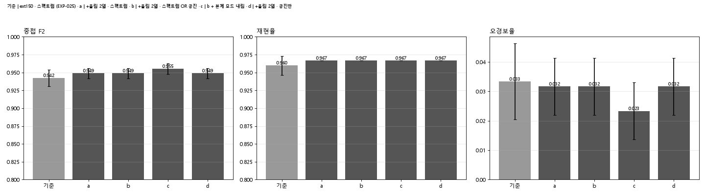
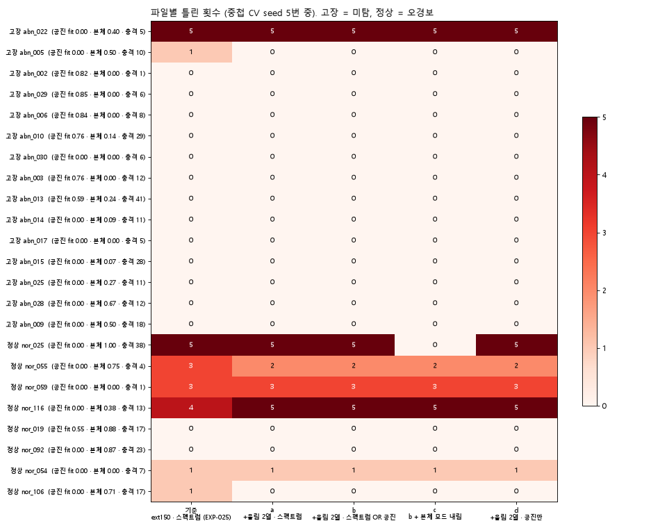
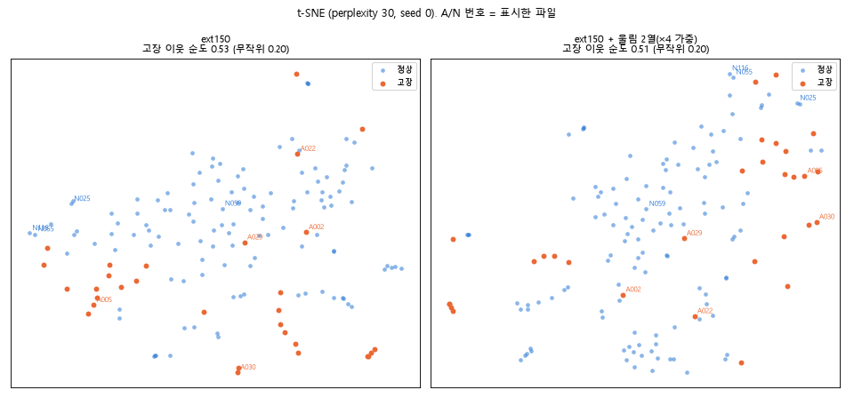
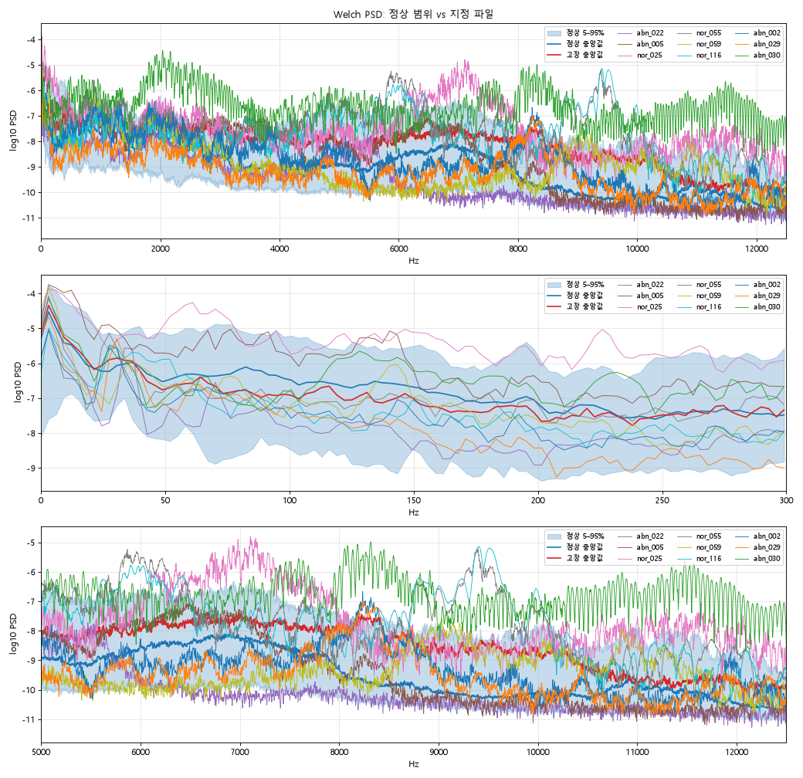

# EXP-034 충격 울림 규칙 — 8.3 kHz 깨끗한 공진(올림) · 본체 모드 울림(내림)

노션 카드 (실험 DB에 그대로 옮긴다)

| 팀원 | 모델 | F2 점수 | 변경 사항 | 메모 |
|---|---|---|---|---|
| 이동훈 | AE + ET(ext150 + 울림 2열) → 로지스틱 + 유격 규칙 + 8.3k(스펙트럼 OR 공진) + 본체 모드 내림 | 0.955 ± 0.007 (기준 EXP-025 0.942 ± 0.012) | 2-16 규칙 수치: 8.0–8.7 kHz 깨끗한 공진 충격(ζ ≤ 0.02, fit ≥ 0.7) ≥ 1개 → 고장 / 충격 ≥ 3 & 5.5–7.75 kHz 울림 ≥ 0.9 → 정상 쪽. ET에 울림 2열 (H1, H2) | 공진 규칙만으로 8.3k 스펙트럼 규칙을 대신한다(d = b = 0.949, 002 · 029 포함). 본체 모드 내림으로 오경보 025 해소(5/5 → 0), 미탐 증가 없음 → 0.955, 오경보율 0.033 → 0.023. 기준보다 sd 넘게 개선. 022는 그대로 5/5. 대역·문턱 사후 |

- 가설: H1, H2 ([물리가설](../../../1_기준·기록/물리가설.md)) · 규칙 수치의 출처: [2-16 규칙 수치 도출](../../../2_EDA/유의미/2-16_1116_울림주파수/2-16_울림주파수.md)
- 실행: 2026-11-16 · git `f4975d6+수정중` · 코드 [run.py](run.py) (3차). 1차 · 2차 결과와 코드는 [figs/1차/](figs/1차/) · [figs/2차/](figs/2차/)
- 평가: 중첩 CV (바깥 5 × 안쪽 4, seed 5개). 자주 놓침 = seed 5번 중 3번 이상

## 결과 (3차)

| 구성 | F2 | 재현율 | 오경보율 | 정밀도 | F2 (고장 10%·40%) | 자주 놓침 | 오경보 3회+ |
|---|---|---|---|---|---|---|---|
| 기준 \| ext150 · 스펙트럼 (EXP-025) | 0.942 ± 0.012 | 0.960 | 0.033 | 0.880 | 0.913 · 0.958 | 022 | 4 |
| a \| +울림 2열 · 스펙트럼 | 0.949 ± 0.007 | 0.967 | 0.032 | 0.885 | 0.920 · 0.964 | 022 | 3 |
| b \| +울림 2열 · 스펙트럼 OR 공진 | 0.949 ± 0.007 | 0.967 | 0.032 | 0.885 | 0.920 · 0.964 | 022 | 3 |
| **c \| b + 본체 모드 내림** | **0.955 ± 0.007** | 0.967 | **0.023** | 0.913 | 0.934 · 0.966 | 022 | 2 |
| d \| +울림 2열 · 공진만 (스펙트럼 규칙 없이) | 0.949 ± 0.007 | 0.967 | 0.032 | 0.885 | 0.920 · 0.964 | 022 | 3 |

- 울림 2열 = 충격 중 2.125–4.125 kHz로 울린 비율 · 5.5–7.75 kHz로 울린 비율 (충격 0개 = −1). 유격 반복 규칙은 모든 구성에 있음
- 공진 규칙 = 8.0–8.7 kHz로 울린 충격 중 감쇠비 ζ ≤ 0.02이고 감쇠 사인파 맞춤 fit ≥ 0.7인 충격이 하나라도 있으면 고장
- 본체 모드 내림 = 충격 3개 이상이고 5.5–7.75 kHz로 울린 비율 ≥ 0.9이면 점수를 학습 정상 OOF 중앙값 이하로 (규칙으로 켜진 파일 제외)

## 해석

**충격 울림으로 만든 두 규칙이 모두 작동한다. 공진 규칙은 8.3 kHz 스펙트럼 규칙을 그대로 대신하고(d = b = 0.949, 002 · 029 모두 잡음), 본체 모드 내림은 우리만 틀리던 오경보 025를 없앤다(5/5 → 0, 새 미탐 없음).** 둘을 함께 쓴 c는 0.955 ± 0.007로 기준(0.942 ± 0.012)보다 sd 넘게 높고, 오경보율은 0.033 → 0.023이다. 울림 2열(a)만으로도 경계 고장 005와 오경보 055 · 106이 줄었다. 남은 오류는 미탐 022(5/5)와 오경보 116(5/5) · 059(3/5) · 055(2/5)다. 규칙의 대역·문턱은 라벨을 본 뒤 정한 값이라 점수는 낙관적일 수 있다.

<!-- key-figs: 자동 (save_fig key=True) -->

*logistic_plane* — 새 규칙으로 002 등이 평면에서 빠지는가, 본체 모드 내림 대상(초록 원)에 오경보 025가 들어가는가

*ring_rules* — 두 울림 규칙의 축 · 문턱 · ±20% 여유. 정상(파랑)과 고장(주황)이 문턱 근처에 있는가

<!-- /key-figs -->

**그림 읽는 법**
- logistic_plane: 가로 = AE z(스펙트럼 모양 이상), 세로 = ET z(충격 피처 이상), 실선 = 로지스틱 경계, 주황 바탕 = 고장 쪽. 규칙이 잡은 고장은 빼고 오른쪽 아래 상자에 적었다. × = 5번 중 2번 이상 틀림. 오른쪽 아래(c)의 초록 원 = 본체 모드 내림 대상 정상 38개. 내림은 평면 위치를 바꾸지 않고 판정만 내린다(025는 경계 위에 있지만 c에서는 정상 판정)
- ring_rules 왼쪽: 8.0–8.7 kHz로 울린 충격 하나하나, 가로 = fit, 세로 = ζ, 점 크기 = 높이. 오른쪽 아래(깨끗하고 오래 울림)가 고장이다. 오른쪽: 파일마다 충격 수 × 본체 모드 비율, 선 위 = 정상 쪽으로 내림

1. **공진 규칙은 스펙트럼 규칙을 대신한다 (d)**
   - 공진 규칙이 켜는 고장은 002 003 006 010 029, 정상은 0개다. 스펙트럼 규칙이 켜던 030은 유격 규칙이나 모델 점수로 잡힌다
   - 그래서 스펙트럼 규칙을 빼도(d) 점수가 같다. 002를 놓친 2차와 달리, 충격 수가 아니라 **충격 하나의 울림 모양**으로 판단해서 충격 1개인 002도 잡는다
   - fit 문턱 여유: 정상 쪽(아래)으로 −20%(0.56)까지 내려도 정상 0. 위로 +10%(0.77)면 잡는 고장이 3개로 줄어든다 → 0.7보다 올리지 않는다
   - 두 규칙을 OR로 쓰면(b · c) 같은 고장을 서로 다른 근거(시간 영역 울림 · 주파수 영역 봉우리) 둘로 확인한다
2. **본체 모드 내림은 025만 정확히 고친다 (c)**
   - 내림 대상은 정상 38개, 고장 0개다(문턱 −20%인 0.72, 1.5초 창에서도 고장 0)
   - 오경보 중 해당 파일은 025(충격 38개가 모두 본체 모드)뿐이다. 055(0.75) · 116(0.38) · 059(충격 1개)는 해당하지 않는다
   - 정상으로 내리는 규칙이라 틀리면 미탐이다. 학습 데이터에서는 미탐이 늘지 않았다(재현율 0.967 그대로)
3. **울림 2열 (a)**: 기준 대비 005 미탐(1/5 → 0)과 106 · 055 오경보가 줄었다. 116은 4/5 → 5/5로 늘었다(큰 타격 하나가 9.5 kHz로 울려 본체 모드 근거가 없음)
4. **남는 것**: 022(2 kHz로 울림, 정상 008 · 028과 같은 자리) · 116(9.5 kHz 큰 타격 한 번) · 059(충격 1개, 10 kHz)는 울림으로도 가르지 못한다
5. **결정 대기**
   - 최종 구성을 c로 바꿀지(기준보다 sd 넘게 개선). 바꾸면 `src/final.py`에 충격 검출 · 울림 주파수 계산 · 두 규칙을 넣고 7단계 학습을 다시 해야 한다
   - 결정.md "사후 문턱 예외"에 두 규칙을 올릴지. 공진(8.0–8.7 kHz · ζ · fit)과 본체 모드(5.5–7.75 kHz · 0.9 · 충격 3개) 모두 라벨을 본 뒤 정했다

## 이전 실행 요약 (같은 날)

| 실행 | 바꾼 것 | 주요 결과 |
|---|---|---|
| [1차](figs/1차/README_1차.md) | ET에 울림 3열(2–5 kHz 비율 · 5–8 kHz 비율 · 대역 비) · ext 압축 · 8.3k 규칙 유무 | 울림 3열 0.952 ± 0.011(오경보 0.020). 8.3k 규칙을 빼면 002 · 029 미탐(8 kHz 울림을 입력에서 뺐기 때문). 압축만 0.916, 압축+울림 0.937 |
| [2차](figs/2차/README_2차.md) | 울림 1열(2.25–4 kHz, 2 kHz 칸 제외) · 8.3k 울림 비율 규칙(8.0–8.7 kHz ≥ 0.1, 충격 2개 이상) 단독 · OR · AND | 울림 비율 규칙은 029 등 고장 6개 · 정상 0이지만 **충격 1개인 002를 '충격 2개 이상' 조건에서 놓침**(0.907). OR = 0.942 |
| 3차 (위) | 비율 대신 충격 하나의 울림 모양(ζ · fit)으로 공진 판단 · 본체 모드 내림 · 울림 2열 | 0.955 ± 0.007 |

## 그림

### scores
구성별 중첩 F2 · 재현율 · 오경보율 (막대 = 평균, 선 = sd)

### hard_files
어느 파일이 구성마다 맞고 틀리는가

### tsne
입력 공간마다 고장이 정상과 따로 모이는가, 문제 파일은 어디에 있는가

### psd_missed
문제 파일의 PSD가 정상 범위 밖으로 나가는 주파수

