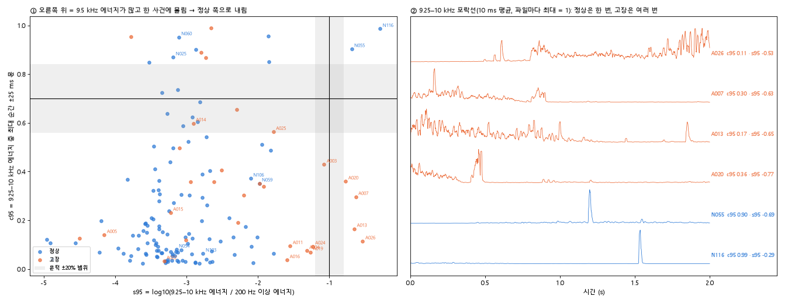
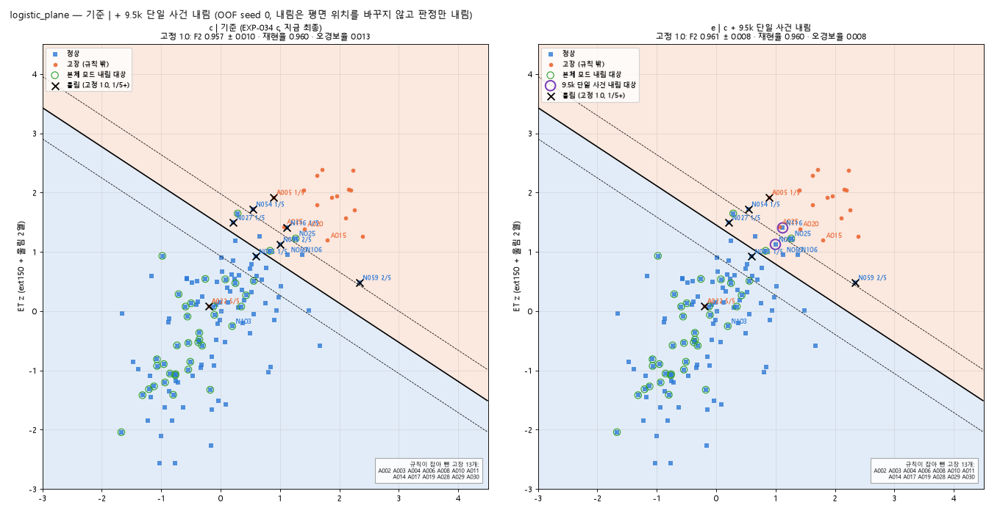
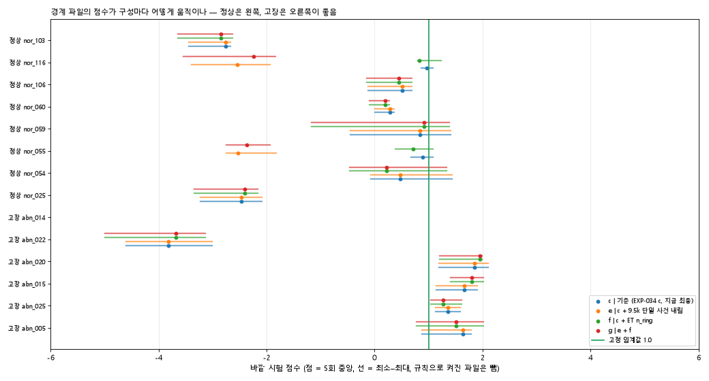
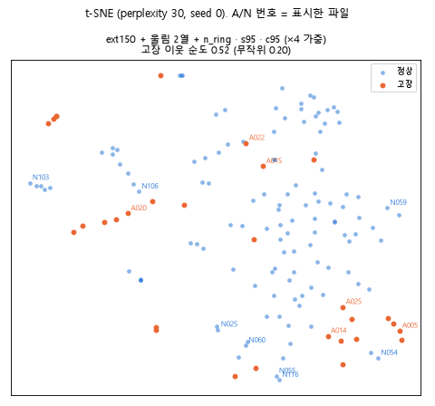
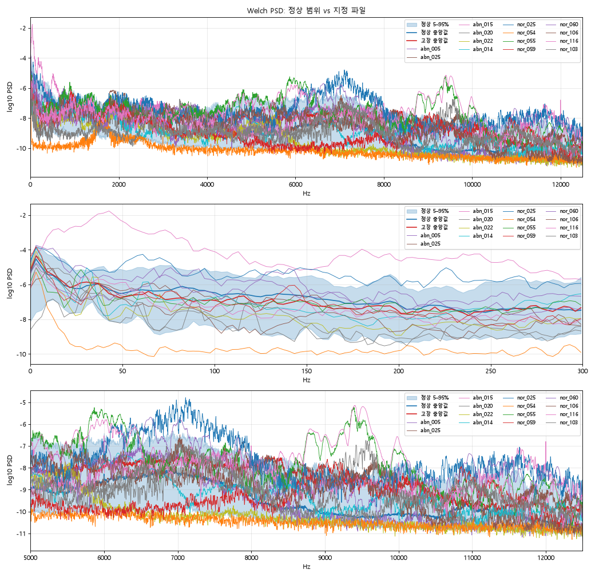

# EXP-036 경계선 파일 — 9.5 kHz 단일 사건 내림 · 울림 주파수 다양성

노션 카드 (실험 DB에 그대로 옮긴다)

| 팀원 | 모델 | F2 점수 | 변경 사항 | 메모 |
|---|---|---|---|---|
| 이동훈 | EXP-034 c + 9.5 kHz 단일 사건 내림 (+ ET 울림 다양성 1열) | 0.961 ± 0.008 | 9.25–10 kHz 에너지 몫 ≥ 10^−1 & 한 사건(±25 ms) 몫 ≥ 0.7 → 정상 쪽 내림 / ET에 울림 주파수 종류 수 (H2, H1) | 9.5k 단일 사건 내림으로 오경보 055 · 116 해소, 새 미탐 없음. fold마다 0.955 → 0.964(sd 넘음), 고정 1.0 0.957 → 0.961, 임계값 0.6–1.1에서 F2 평평. n_ring은 효과 없음. 005 · 025를 올리는 축은 못 찾음(HIT_k4는 여유 11%). 대역·문턱 사후, 지지 정상 2개 |

- 가설: H2, H1 ([물리가설](../../../1_기준·기록/물리가설.md))
- 실행: 2026-11-17 · git `a46605e+수정중` · 코드 [run_1차.py](run_1차.py)
- 평가: 중첩 CV (바깥 5 × 안쪽 4, seed 5개). 자주 놓침 = seed 5번 중 3번 이상

## 결과

| 구성 | F2 | 재현율 | 오경보율 | 정밀도 | F2 (고장 10%·40%) | 자주 놓침 | 오경보 3회+ |
|---|---|---|---|---|---|---|---|
| fold마다: c \| 기준 (EXP-034 c, 지금 최종) | 0.955 ± 0.007 | 0.967 | 0.023 | 0.913 | 0.934 · 0.966 | 022 | 2 |
| fold마다: e \| c + 9.5k 단일 사건 내림 | 0.964 ± 0.009 | 0.967 | 0.012 | 0.956 | 0.953 · 0.970 | 022 | 1 |
| fold마다: f \| c + ET n_ring | 0.950 ± 0.013 | 0.960 | 0.023 | 0.914 | 0.928 · 0.961 | 022 | 2 |
| fold마다: g \| e + f | 0.957 ± 0.012 | 0.960 | 0.013 | 0.949 | 0.945 · 0.964 | 022 | 1 |
| 고정 1.0: c \| 기준 (EXP-034 c, 지금 최종) | 0.957 ± 0.010 | 0.960 | 0.013 | 0.948 | 0.945 · 0.964 | 022 | 0 |
| 고정 1.0: e \| c + 9.5k 단일 사건 내림 | 0.961 ± 0.008 | 0.960 | 0.008 | 0.967 | 0.953 · 0.965 | 022 | 0 |
| 고정 1.0: f \| c + ET n_ring | 0.957 ± 0.012 | 0.960 | 0.013 | 0.949 | 0.945 · 0.964 | 022 | 0 |
| 고정 1.0: g \| e + f | 0.963 ± 0.012 | 0.960 | 0.007 | 0.974 | 0.956 · 0.966 | 022 | 0 |

## 해석

**9.5 kHz 단일 사건 내림(e)으로 오경보 정상 055 · 116이 사라지고 새 미탐은 없다.** fold마다 임계값을 고르는 지금 검증 방식에서 0.955 ± 0.007 → **0.964 ± 0.009**(sd를 넘음)이고, 오경보율은 0.023 → 0.012로 줄었다. 제출 정책(고정 1.0)에서는 0.957 → 0.961로 sd 안이다. 대신 F2가 임계값 0.6–1.1 구간 전체에서 0.960–0.965로 평평해져서, 임계값을 어디에 두든 덜 흔들린다. 울림 주파수 다양성(f, ET에 1열)은 효과가 없고 고장 025를 1/5 놓치게 만들어 기각한다. 고장 005 · 025는 이번 장치로 바뀌지 않았다(005는 고정 1.0에서 1/5 놓침, 최소 점수 0.88). 단 대역(9.25–10 kHz)은 2-0_2에서 라벨을 본 뒤 고른 칸이고 지지 파일이 정상 2개뿐이라 사후다.

<!-- key-figs: 자동 (save_fig key=True) -->

*rule95_axes* — 9.5 kHz 몫이 높은 파일 중 정상(한 사건)과 고장(여러 충격)이 c95로 갈리는가, 문턱 ±20% 여유

*logistic_plane* — 9.5k 내림 대상(보라 원)이 오경보 055 · 116과 겹치는가, 경계 고장 005 · 025는 어디에 있는가

<!-- /key-figs -->

**그림 읽는 법**
- rule95_axes ①: 가로 = 9.25–10 kHz 에너지가 200 Hz 이상 전체 에너지에서 차지하는 몫(log10), 세로 = 그 대역 에너지 중 가장 큰 순간 ±25 ms 안에 든 몫. 회색 띠 = 문턱 ±20%. 오른쪽 위 칸(정상 055 · 116만)이 내림 대상이다. ② 9.25–10 kHz 포락선. 정상은 한 번 솟고 끝나고, 고장(026 · 007 · 013 · 020)은 여러 충격에서 반복해서 솟는다
- logistic_plane: 가로 = AE z, 세로 = ET z, 실선 = 로지스틱 경계. 보라 큰 원 = 9.5k 내림 대상, 초록 원 = 본체 모드 내림 대상, × = 고정 1.0에서 1/5 이상 틀림. 내림은 평면 위치를 바꾸지 않고 판정만 내린다

**상세**
1. **경계 파일 정리 (EXP-035 바깥 점수, 고정 1.0 기준)**: 정상 쪽 최대 054 1.43 · 059 1.40 · 065 1.09 · 116 1.08 · 055 1.07 · 027 1.04, 고장 쪽 최소 005 0.88 · 025 1.13 · 015 1.14 · 020 1.19. 022는 −4.6으로 경계가 아니라 피처 밖의 고장이다. 고장 014는 유격 규칙, 정상 025 · 103은 본체 모드 내림으로 이미 처리돼 있다(바깥 점수 중앙 −2.5 · −2.8)
2. **9.5 kHz 규칙이 갈리는 이유 (H2)**: 9.5 kHz 몫이 높은 파일은 9개(s95 ≥ −1.3)인데, 고장 7개의 c95는 0.07–0.43이고 정상 055 · 116은 0.90 · 0.99다. 고장은 충격마다 고주파로 울리는 "고주파 링잉"(2-0 L1 유형)이고, 정상은 외부 타격 한 번이 9.5 kHz 모드를 울린 것이다. 사용자가 본 "055 · 116은 H3 9.5–9.75 kHz가 독보적"은 맞지만, 같은 칸이 고장 003 · 007 · 013 · 026 · 020에서도 높아서 칸 크기만으로는 못 가른다. **언제·몇 번 울렸나**를 보면 갈린다
3. **문턱 민감도**: s95 −1.2~−0.8 × c95 0.56~0.84의 모든 조합에서 정상 055 · 116만 켜지고 고장은 0. 1.5초 창 4개에서는 055가 4개 모두, 116이 일부 창에서 켜진다. **고장 003이 창 하나에서 켜진다**(전체 2초에서는 c95 0.43). 003은 유격 · 공진 규칙으로 +100이라 내림이 적용되지 않지만, 규칙 밖의 고주파 링잉 고장이 짧은 구간에서 충격 한 번만 보이면 내려갈 수 있다는 위험 신호다
4. **대역을 넓히면 (9–11 kHz)**: 정상 065(충격 1개, 10.25 kHz)까지 잡히지만 고장 001(c 0.75)이 문턱 ±20% 안에 들어온다 → 9.25–10 kHz를 유지
5. **n_ring (f)**: 정상 중앙 2 · 고장 중앙 6으로 전체에서는 갈리지만(경계 21개 AUC 0.86), ET 입력에 넣으면 ext150 충격 피처와 겹쳐 이득이 없다(0.950, 025 1/5 미탐)
6. **고장 005 · 025를 올리는 후보 (넣지 않음)**: 2-14의 `HIT_k4`(4번째로 큰 타격 높이)는 005 1.60(바탕의 40배) vs 정상 최대 001 1.44(28배). 문턱 1.5로 두면 005만 새로 잡히지만 001까지 여유가 11%라 EXP-030 감사 기준(±20%에서 정상 0)을 통과하지 못한다. 025는 1.36으로 정상 009 · 086 · 001보다 낮다. 025의 유격 규칙 r(1.59)도 정상 001보다 낮다(앞선 분석). **005 · 025를 깨끗하게 올리는 축은 찾지 못했다.** e에서는 정상 쪽 최대가 054 · 059로 줄어 임계값 0.85에서 005도 잡힌다(F2 0.965, 사후)
7. **남은 오경보 054 · 059 · 027 · 065**: 059 · 065는 충격 1개가 9–10.25 kHz로 울린 정상이다. "충격 1개면 감점"은 EXP-030에서 1.5초 창 문제로 이미 제외했다. 054(1.5 kHz 충격 7개, ζ 0.08)는 유격 고장과 모양이 같아 현재 정보로는 못 가른다

## 그림

### edge_files
구성별 경계 파일 바깥 점수

### tsne
새 값을 더한 입력 공간에서 경계 파일은 어디에 있는가

### psd_missed
경계 파일의 PSD가 정상 범위 밖으로 나가는 주파수

