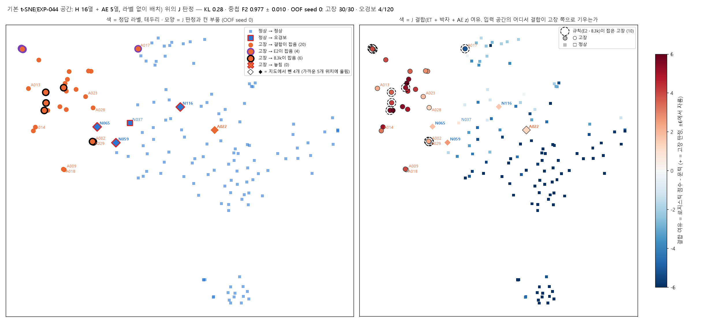
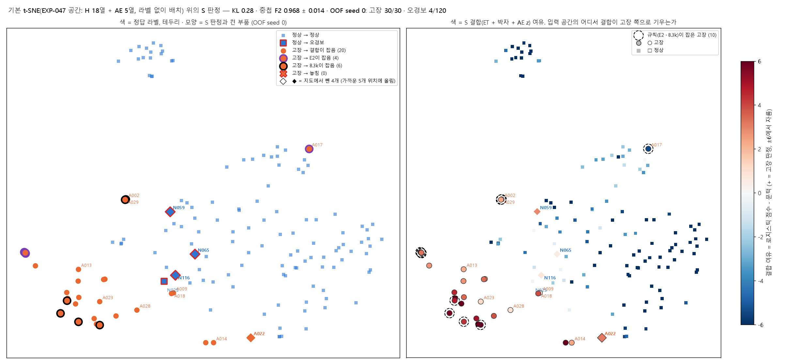

# 6-2 기본 t-SNE 위의 J · S 판정 + 11-22 그림 총정리

**결론: 라벨 없이 배치한 입력 공간(21열)에서도 고장 대부분은 왼쪽 무리에 모이고, J의 결합 여유도 그 무리에서 +로 기운다. 입력 공간에서 정상 쪽에 섞인 고장 8개는 두 가지 방식으로 잡힌다. A009 · A018 · A014 · A028 · A022는 결합이 AE z나 박자 z로 끌어올려 잡고, A017(E2) · A002(8.3k)는 결합 여유가 −로 규칙만 잡는다. 오경보 N059 · N065 · N116 · N037은 고장 무리와 정상 무리 사이 경계에 있다(정보 한계와 일치).**

- 지도는 `tsne_default`(EXP-044 `tsne_라벨`)와 **같은 공간 · 같은 seed · 같은 배치**다. H 16열(박자 S 포함) + AE 5열이고, 라벨과 모델은 배치에 쓰지 않는다.
- ◆ 4개(059 · 065 · 116 · 022)는 지도 계산에서 빠진 파일이다. 원래 21열 공간에서 가장 가까운 5개의 위치 평균에 올렸다.
- **왼쪽**: 색 = 정답, 테두리 = J가 잡은 부품(OOF seed 0). 주황 얇은 테두리 = 결합, 보라 = E2, 검정 = 8.3k, 빨간 테두리 □ = 오경보.
  - 부품이 겹치면 8.3k > E2 > 결합 순으로 표시한다. 예를 들어 A029는 결합 여유도 +2.28이다.
- **오른쪽**: 색 = 결합 여유(로지스틱 점수 − 폴드 문턱). 빨강 = 결합이 고장, 파랑 = 정상. 점선 원 = 규칙이 잡은 고장.

## 섞인 점의 J 판정 (전체는 [표](표_J판정_섞인점.md))

| 파일 | 이웃 고장(5) | ET logit | 박자 z | AE z | 결합 여유 | 켠 부품 | 중첩 5회 |
|---|---|---|---|---|---|---|---|
| A018 | 1 | 1.26 | 0.1 | 2.71 | +3.91 | 결합 | 5/5 |
| A014 | 1 | 0.04 | **3.9** | 1.31 | +3.19 | 결합 | 5/5 |
| A029 | 1 | 0.78 | 0.0 | 1.97 | +2.28 | 8.3k | 5/5 |
| A028 | 2 | 0.41 | 1.5 | 1.42 | +1.38 | 결합 | 5/5 |
| A022 ◆ | 2 | −0.08 | **8.5** | −0.24 | +1.32 | 결합 | 5/5 |
| A009 | 1 | 0.07 | 0.0 | **2.29** | +0.17 | 결합 | 5/5 |
| A002 | 1 | −0.85 | 0.0 | 1.97 | **−2.48** | 8.3k | 5/5 |
| A017 | 0 | −1.27 | 0.0 | −0.83 | **−5.08** | E2 | 5/5 |
| N059 ◆ | 2 | 1.17 | 0.0 | 2.55 | +2.60 | 결합 | 3/5 |
| N065 ◆ | 3 | 0.63 | 0.0 | 0.72 | +1.81 | 결합 | 4/5 |
| N116 ◆ | 1 | 0.68 | 0.0 | 1.85 | +1.60 | 결합 | 5/5 |
| N037 | 0 | 0.09 | 0.0 | 0.92 | +0.82 | 결합 | 2/5 |

이웃 고장(5) = t-SNE 전 21열 공간에서 가까운 5개 중 고장 수. 2 이하이면 "섞인 고장"이다.

## 해석
- **t-SNE와 메인 그림이 다르게 보이는 이유가 파일 단위로 확인된다.** A009는 ET가 0.07로 정상 수준이지만 AE z가 2.29라서 결합이 간신히(+0.17) 잡는다. t-SNE는 21열에 같은 비중을 줘서 이 AE 신호가 묻히고, 로지스틱은 AE에 따로 가중치를 줘서 살린다. A014 · A022는 박자 z가 같은 역할을 한다.
- **규칙 2개가 없으면 A002 · A017을 놓친다.** 두 파일은 결합 여유가 −이고, A017은 정상 무리 한가운데에 있다(이웃 고장 0). K(규칙 없음)가 자주 놓친 파일과 같다.
- **오경보 4개는 모두 결합이 냈고, 두 무리 사이에 있다.** N059 · N116은 AE z가 고장 수준(2.55 · 1.85)이다. 입력 공간에서도 고장과 가까워 피처로 가르기 어렵다(4-9 결론과 같음).

## S(EXP-047, 8–12.5k 쪼갬) 판정

- 지도는 EXP-047 공간(H 18열 + AE 5열)이다. 섞인 고장 8개와 잡는 부품 수(결합 20 · E2 4 · 8.3k 6)는 J와 같다.
- 쪼갠 열로 경계 고장의 결합 여유가 올라간다: **A009 +0.17 → +0.99 · A002 −2.48 → −0.26 · A022 +1.32 → +3.11** (A022는 중첩 4/5로 한 번 놓침).
- 오경보는 N037 대신 **N025**(여유 +0.23, 중첩 4/5)가 생긴다. N065 · N116의 여유는 줄어든다(+1.81 → +0.50, +1.60 → +0.79). 중첩 F2는 0.968로 J(0.977)보다 낮다.
- 사용자 판단("경계 고장 2개만 처리하면 더 잘 갈림")과 맞는 그림이다. A002 · A017은 S에서도 결합 여유가 −다.

## 뷰어

EDA 뷰어 "로지스틱 경계" 화면 아래 t-SNE 카드에도 같은 판정을 덧입혔다(EXP-044 · 047). 색을 정답 라벨 / 결합 결정값 중에서 고르고, 규칙 기호와 ◆ 4개가 나온다. 뷰어 지도는 val 40개를 함께 펼친 것이라 이 그림과 배치는 다르다.

## 11-22 그림 총정리 (어제 만든 그림의 역할)

| 묻는 것 | 그림 | 공간 | 요점 |
|---|---|---|---|
| J는 어떻게 판단하나 (메인) | [EXP-044 logistic_plane](../../5_모델비교/4_최종모델J/EXP-044_1122_AE추가/figs/logistic_plane.png) | 모델 출력: ET + 박자 z 환산 × AE z | 로지스틱 경계 vs ET 단독 경계, 부품별 잡음 |
| 입력 공간에서 정상 · 고장이 갈리나 | [4-10 tsne_S3_AE5](../../4_피처/4-10_1122_tSNE_AE공간/figs/tsne_S3_AE5.png), [공간 비교](../../4_피처/4-10_1122_tSNE_AE공간/figs/tsne_공간비교.png) | 입력 21열 | AE 5열을 더하면 고장 무리가 라벨 없이도 보임, 5-NN AUC 0.975 |
| 그 공간에서 J는 어디를 잡나 | **이 그림** [tsne_J판정](figs/tsne_J판정.png) · [tsne_S판정](figs/tsne_S판정_EXP047.png) | 입력 21 · 23열 + 판정 | 섞인 고장 = 결합(AE · 박자) 또는 규칙. S는 경계 고장 여유가 오름 |
| val은 어디에 놓이나 | [EXP-044 val_판정](../../5_모델비교/4_최종모델J/EXP-044_1122_AE추가/figs/val_판정.png), [tsne_val포함](../../5_모델비교/4_최종모델J/EXP-044_1122_AE추가/figs/tsne_val포함.png) | 출력 평면 / 입력 21열 | val 고장 판정 10/40, val 이동의 큰 몫은 ET |
| 이상치 정상 학습 제외 | [EXP-046 logistic_plane](../../5_모델비교/아카이브/EXP-046_1122_이상치정상_학습제외/figs/logistic_plane.png) | 출력 평면 | 0.961, J보다 낮음 |
| 8–12.5k 쪼개기 | [EXP-047 logistic_plane](../../5_모델비교/아카이브/EXP-047_1122_8-12k쪼개기/figs/logistic_plane.png), [tsne_라벨](../../5_모델비교/아카이브/EXP-047_1122_8-12k쪼개기/figs/tsne_라벨.png) | 출력 평면 / 입력 | 0.968. 경계 고장 2개만 처리하면 지도가 더 잘 갈림(사용자: 중요 실험) |
| 결합을 비선형으로 | [EXP-045 logistic_plane](../../5_모델비교/4_최종모델J/EXP-045_1122_비선형결합/figs/logistic_plane.png) | 출력 평면 | 모두 lin보다 나쁨 → 기각 |
| 공유용 (팀) | [EXP-044 공유_1122](../../5_모델비교/4_최종모델J/EXP-044_1122_AE추가/공유_1122/) 그림 1–4 | 출력 평면 | 학습 · val 최종 판단, val 여유, 결정축 |

발표에서는 두 그림을 짝지어 쓴다. **"입력 공간(t-SNE)에서 섞인 점 → J가 어느 부품으로 풀었나(이 그림) → 그 판단의 경계(logistic_plane)"** 순서다.

## 방법 메모
- 판정은 EXP-044 run.py의 `oof_ae`와 같은 계산이다(StratifiedGroupKFold 5겹, seed 0). 중첩 5회 횟수는 EXP-044 `result.json`에서 가져왔다.
- 지도는 `tsne_space`와 같은 값인지 assert로 확인했다(KL 0.28).
- 실행: `conda run -n qe-phm python "단계/6_오류분석/6-2_1122_J판정_tSNE/run.py"`. 출력 = `figs/tsne_J판정.png` · `표_J판정_섞인점.md` · `log.txt`
