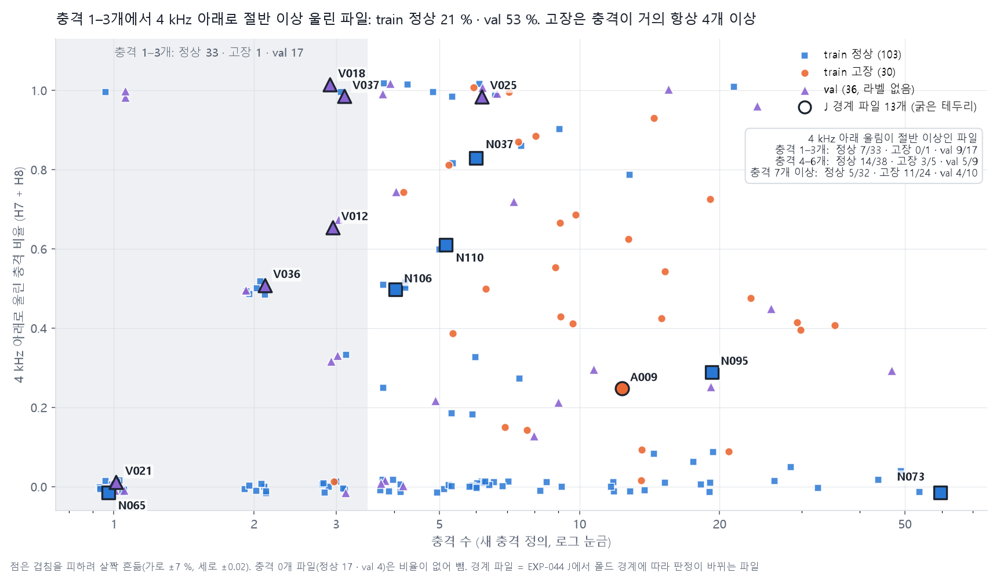

# 6-4 J 경계 파일 진단 (11-22)

**결론: J(EXP-044)의 경계 파일 13개 중 8개는 "충격은 2–6개뿐인데 그중 다수가 4 kHz 아래로 울린" 파일이다.** ET의 울림 비율 피처(H7 · H8 · H9)가 몇 개 안 되는 충격의 주파수만 보고 고장 쪽으로 민다. 충격이 1–3개인 파일 중 4 kHz 아래로 절반 이상 울린 비율은 train 정상 21 %(7/33), val 53 %(9/17)이고, 고장은 충격이 거의 항상 4개 이상이다(29/30).

가로 = 충격 수(로그), 세로 = 4 kHz 아래로 울린 충격 비율(H7 + H8, ET가 보는 값). 굵은 테두리 = 경계 파일 13개(EXP-044 J에서 폴드 경계에 따라 판정이 바뀌는 파일). 코드 [run.py](run.py).

## 경계 파일 유형
| 유형 | 파일 | 경계로 민 것 |
|---|---|---|
| A. 충격 적음(2–6개) + 낮은 울림 | N037 · N110 · N106 · V025 · V018 · V037 · V012 · V036 | 울림 비율(H8 · H9 기여 +0.4–0.9). 세기 · 후속 충격은 정상 수준, 이웃 대부분 정상 |
| B. 고주파 한 번 | N065(10.2 kHz) · V021(9.8 kHz) | 충격 1개. 정보 한계 |
| C. 본체 모드 떨림(충격 많음) | N073(60개) · N095(18개) | N073은 박자 z +1.76 |
| D. 큰 타격 뒤 덜컥거림 | A009 | 본체 모드(5–6.5 kHz)로 울려 ET가 약하게 봄, AE가 버팀 |

## 시간 구조 피처 점검 (모델 추가 전 확인)
- 사건 수 · 지속 시간 · 큰 타격 뒤 30–600 ms 후속 충격 · 300 ms 몰림은 충격 수(H1)와 같은 정보다(ρ 0.74–0.96). 충격 수 4–15개끼리만 보면 AUC 0.57–0.67
- "후속 충격 5개 이상"은 정상 13 · 고장 12로 안 갈린다. 간격 규칙성(V025 · V012)은 고장 1개(023)뿐 → 고장 3개 이상 규칙 미달
- 충격 세기(g)는 충격 수를 맞춰도 AUC 0.75지만 절대 크기라 게인에 흔들린다(H3)
- → 새 시간 피처보다 "충격이 적을 때 울림 비율을 얼마나 믿을지"가 경계의 핵심이다. 단 충격 4–6개 구간에서는 이 비율이 고장(3/5)과 정상(14/38)을 실제로 가르므로, 비율을 깎는 보정은 그 구간 고장 신호도 약하게 할 위험이 있다
