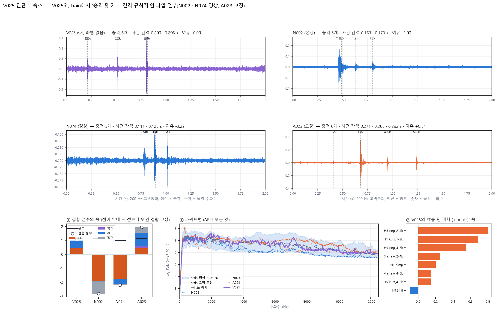

# 6-6 V025 진단 (11-22, 기준 구성 J-축소)

**결론: V025가 경계(여유 −0.09)에 있는 가장 큰 이유는 울림 주파수가 정확히 2 kHz 대역 경계에 걸린 것이다.** 충격 6개 중 4개가 2000 Hz 격자로 맞춰졌고, 2000 Hz는 2–4k로 센다. 그래서 H8(2–4k 울림 비율)이 학습 정상 최상위(100 %)가 되어 ET를 고장 쪽으로 민다(+0.8). 같은 울림을 1–2k로 셌다면 여유는 −2.05로 확실한 정상이다. 그 위에 val 공통의 AE 상승(+0.61)이 얹혀 문턱 바로 밑까지 올라왔다. 단 2000 Hz 울림은 train에서 고장 충격에 더 흔하다(고장 12 % · 정상 3 %). 그래서 순전히 계산상의 우연이라고만 볼 수는 없다.

위 4칸은 파형이다(200 Hz 고역통과, 점선 = 충격, 숫자 = 울림 주파수). V025와 함께, train에서 "충격 몇 개 + 간격 규칙적"(사건 3개 이상, 간격 CV < 0.1, 라벨 없이 정한 기준)인 파일을 전부 놓았다(N002 · N074 정상, A023 고장). 아래 왼쪽은 결합 점수의 몫, 가운데는 스펙트럼, 오른쪽은 V025의 ET를 민 피처다. 수치는 [표_V025.md](표_V025.md), 코드는 [run.py](run.py).

## V025는 어떤 파일인가
- 충격 6개가 **쌍으로 3번**(10 ms 안에 두 번씩) 난다. 시점은 0.211 · 0.510 · 0.806 s로 **정확히 0.30 s 간격**이다(간격 CV 0.006, train 어느 파일보다 규칙적).
- 세기는 0.21 g로 작고, 울림은 1.8 · 2.0 kHz다.
- **시간 모양은 고장 A023을 닮았다.** A023은 0.27–0.29 s 간격으로 4번 친다. 하지만 A023은 3–5 kHz로 운다.
- **울림은 정상 N002 · N074를 닮았다.** 두 정상은 충격 5개가 규칙적으로 나고 1.0–2.0 kHz로 운다. 다만 간격은 0.11–0.17 s다. J-축소는 이 둘을 확실한 정상으로 본다(여유 −3.99 · −3.22).

## 결합 분해 (J-축소, 여유 = ET + 박자 + AE + 절편 − 문턱)
| 파일 | ET | 박자 | AE | 절편 | 문턱 | 여유 |
|---|---|---|---|---|---|---|
| V025 | +0.45 | 0.00 | +0.61 | 0.00 | 1.14 | **−0.09** |
| N002 (정상) | −1.94 | 0.00 | −0.01 | −0.88 | 1.15 | −3.99 |
| N074 (정상) | −1.75 | 0.00 | −0.40 | −0.06 | 1.01 | −3.22 |
| A023 (고장) | +0.43 | +0.19 | +0.94 | +0.39 | 1.15 | +0.81 |

- **ET +0.45**: 민 피처는 H8 2–4k 울림 비율 +0.80(정상 백분위 100) · H3 1–2k 첨도 +0.69(85) · H9 4–8k 울림 비율 +0.55(낮아서, 15) 순이다. 정상 N002 · N074와의 ET 차이(약 2.3)는 대부분 H8에서 나온다.
- **AE +0.61**: 복원 오차 평균이 학습 정상 88 %, 4–8 kHz는 99 %다. val 전체의 배경이 train보다 높은 현상(2-26, 3–5 kHz +10.9 dB)과 같은 방향이다.
- 규칙(E2 · 8.3k)은 켜지지 않는다. 박자 z는 0이다.

## 대역 경계 점검
- 울림 주파수는 감쇠 사인파 사전을 써서 **250 Hz 격자**(1000, 1250, …, 8 ms 창)로 맞춘다. 2000 Hz는 2–4k 쪽으로 센다(`np.digitize` 경계 2000). V025의 실제 울림은 1.9–2.0 kHz 근처로 보인다.
- **2.0 kHz 울림을 1–2k로 셌다면**(H7 = 1, H8 = 0): 여유 −0.09 → **−2.05**(ET +0.45 → −1.52).
- train 충격 중 2000 Hz 격자에 떨어진 비율: 정상 3 %(25개) · 고장 12 %(48개). 충격의 절반 이상이 2000 Hz인 파일은 정상 4 · 고장 2다. → 2 kHz 울림 자체는 고장 쪽 신호가 조금 있다.

## 주기 잠금은 아니다
- V025의 주기 잠금 점수(2-13, LOCK_S)는 **0**이다. 잠금 계산은 0.3–1.2 s에서 저주파(30 Hz 아래) 자기상관이 가장 큰 주기를 찾는다. V025에서는 T = 0.88 s가 골라졌고, 그 간격으로 떨어진 충격 쌍이 없어 hit = 0이 됐다.
- 충격 간격 0.30 s는 탐색 범위의 맨 끝이고, 저주파 하중은 이 주기로 반복되지 않는다. 주기 잠금 규칙은 J · J-축소에 들어 있지도 않다. → "주기 잠금 때문에 고장 쪽"이라는 설명은 맞지 않는다. V025를 고장 쪽으로 민 것은 2 kHz 울림 비율(ET)과 AE다.

## 얼마나 흔들리나
- 바깥 5폴드 모델 + 전체 모델 6개의 여유: −0.06 · +0.35 · +0.80 · +1.41 · +1.27 · **−0.09(전체)** → 6개 중 4개가 고장이다. 전체 학습 모델만 겨우 정상이다.
- 가까운 train 5개(기본 t-SNE 공간, t-SNE 전)는 N106 · N006 · N070 · N066 · N082로 모두 정상이다.

## 정리: 정상 쪽 근거 vs 고장 쪽 근거
| 정상 쪽 | 고장 쪽 |
|---|---|
| 울림(1.8–2.0 kHz)이 정상 N002 · N074와 같다. 2 kHz를 1–2k로 세면 여유 −2.05 | 0.30 s 간격의 쌍 충격이 고장 A023의 시간 모양과 닮았다(간격 CV 0.006) |
| 가까운 train 5개가 모두 정상 | 2000 Hz 울림은 train 고장 충격에 4배 흔하다(12 % vs 3 %) |
| 충격 세기가 작다(0.21 g) | AE 오차가 학습 정상 88–99 % |
| | 폴드 모델 6개 중 4개가 고장 판정 |

모델 쪽 개선 후보(아직 실험 안 함): 울림 대역을 칼같이 나누지 말고 경계 근처 울림을 양쪽에 나눠 세기(예: 2000 Hz는 1–2k · 2–4k에 반씩). 이렇게 하면 V025는 정상 쪽으로 가지만, 2 kHz로 우는 고장 신호도 함께 약해질 수 있다.
