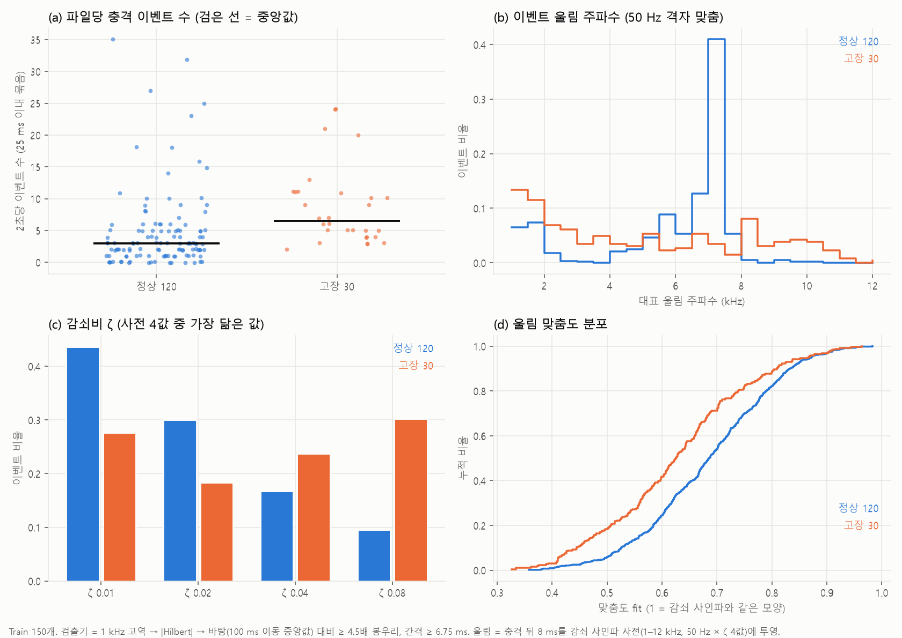

# 2-2 충격 이벤트 · 울림 (11-24)

Train 150개(정상 120 · 고장 30)에 지난 프로젝트의 충격 검출기를 그대로 돌려, 파일당 충격 횟수 · 울림 주파수 · 감쇠비 · 맞춤도를 정상과 고장으로 비교했다. 고주파 트랙만 다룬다(저주파 트랙은 나중).
코드 [run.py](run.py) · 수치 [figs/충격이벤트_수치.txt](figs/충격이벤트_수치.txt) · 표 [figs/files.csv](figs/files.csv) · [figs/events.csv](figs/events.csv)

## 1. 검출기 사양 (`src/impacts.py`의 `detect_impacts`, `impact_rings_v2`)

| 단계 | 내용 |
|---|---|
| 전처리 | 평균 제거 → 1 kHz 고역통과(4차 Butterworth, 양방향) |
| 포락선 | \|Hilbert\| → 1000 Hz 저역 다듬기 |
| 바탕 | 포락선의 100 ms 이동 중앙값(1 kHz로 솎아 계산 후 보간) |
| 충격 | 포락선 ÷ 바탕 ≥ 4.5인 봉우리, 봉우리 간격 ≥ 6.75 ms, 파일 앞뒤 10 ms 제외 |
| 울림 | 충격 뒤 8 ms를 감쇠 사인파 사전에 투영해 가장 닮은 (f, ζ)와 맞춤도 fit(1 = 완전히 같음). 기존 사전은 f 1–12 kHz **250 Hz 간격** × ζ {0.01, 0.02, 0.04, 0.08} |

**라벨을 쓰는가**: 실행 중에는 쓰지 않는다. 문턱은 신호 크기가 아니라 **바탕 대비 배수**라서 파일마다 배경 소음 크기에 맞춰 적응한다. 상수(4.5배 · 100 ms · 6.75 ms · 1 kHz)는 고정이다.
**단서(결정.md 기록 기준)**: 상수를 정한 과정에 가짜 충격 시뮬레이션(위상 무작위 신호)과 정상 파일의 바탕 변동을 썼고, 1 kHz 고역은 quick_cv 점수 비교도 근거에 섞였다. 즉 "라벨을 전혀 안 본 상수"가 아니라 **사후에 고정된 상수**다. 새 대역 · 문턱처럼 폴드 안에서 다시 고르는 대상은 아니지만, 이 점을 기록으로 남긴다.

## 2. 뷰어 흐름 점검 (지난 모델이 검출해서 브라우저에 넣은 방식)

`단계/2_EDA/EDA뷰어/build_viewer.py`:
1. train + val 전부에 `src.impacts.all_impacts(X)`를 돌린다(검출 + 울림 맞춤).
2. 파일별로 전체 검출 시점(`IMP_ALL`)과 울림표 (t, f, ζ, fit)(`IMP_ROWS`)를 만들고, 뷰어에는 **fit 상위 30개**(`IMP_TOP`)만 넣는다.
3. 끝단 제외 전 검출이 사령탑 충격표와 같다는 assert가 있다.

내가 같은 검출기로 다시 돌린 결과가 사용자가 뷰어에서 본 값과 같다: 055는 1.196 s 한 번, 116은 검출 6개가 이벤트 2개(0.615 s · 1.533 s). 검출 흐름은 일치한다.

뷰어 표를 읽을 때 조심할 점:
- **울림 주파수 f는 250 Hz 칸으로만 나온다.** 뷰어의 "9.5 kHz"는 9.25–9.75 kHz 칸이다. 정상 9.39 vs 고장 9.48–9.59 kHz 같은 100 Hz대 차이는 뷰어에서 보이지 않는다.
- **ζ는 4개 값 중 가장 닮은 하나**다(0.01 / 0.02 / 0.04 / 0.08). 연속 추정이 아니다.
- **검출 1개 = 이벤트 1개가 아니다.** 한 번의 충격에 모드가 여러 개 울리면 검출이 여러 개로 찍힌다(116: 검출 6개 → 이벤트 2개). 뷰어의 "충격 N개"는 이벤트 수보다 크다.
- 표는 시간순이 아니라 fit 순서다.

그래서 이번 실행은 **검출기 사양은 그대로** 두고 두 가지만 보강했다: ① 울림 f를 50 Hz 격자로 다시 맞춤(`_atoms50`), ② 25 ms 이내 검출을 한 이벤트로 묶음(10 · 50 ms 민감도도 같이 계산). 한 이벤트의 울림은 그 이벤트에서 포락선이 가장 높은 검출의 값을 쓴다.

## 3. 결과 (Train 150, 이벤트 = 25 ms 묶음)

### ① 충격 횟수
| | 정상 120 | 고장 30 |
|---|---|---|
| 파일당 이벤트 수 중앙값 (p10–p90) | 3.0 (0–10) | 6.5 (3–20) |
| 이벤트 0개 파일 | 14 % | 0 % |
| 이벤트 ≤ 2개 파일 | 46 % | 3 % (1개) |
| AUC (고장 > 정상) | 0.77 (검출 수 기준 0.80, 묶음 10 ms 0.77, 50 ms 0.76) | |

- "정상은 2초당 1–2회 단발"은 **일반적이지 않다**. 정상 중앙값이 3개이고 54 %가 3개 이상이다(p90 10개).
- 고장에서 2개 이하는 30개 중 1개다. 이벤트 수는 분리력이 있지만(AUC 0.77) 겹침이 크다.

### ② 울림 주파수 (이벤트당 대표 울림, 50 Hz 격자)
| 구간 | 정상 이벤트 566 | 고장 이벤트 261 |
|---|---|---|
| 1.0–1.6 kHz | 6.7 % | 14.2 % |
| 1.6–4.5 kHz | 11.7 % | **35.6 %** |
| 4.5–5.5 kHz | 7.1 % | 8.4 % |
| 5.5–8.0 kHz | **73.1 %** | 15.3 % |
| 8.0–12 kHz | 1.4 % | **26.4 %** |

- 정상 충격은 대부분 5.5–8 kHz(그림 b의 7–7.5 kHz 막대)로 울리고, 고장 충격은 1.6–4.5 kHz와 8–12 kHz로 많이 울린다. 정상의 가장 큰 울림 모드와 고장의 모드가 다르다는 뜻이다.

### ③ 9.5 kHz 가설 점검
| | 정상 | 고장 |
|---|---|---|
| 9.2–9.7 kHz 울림 이벤트 | 2/566 (0.4 %), 파일 2개(043 · 116) | **13/261 (5 %), 파일 7개**(003 · 004 · 007 · 013 · 019 · 020 · 026) |
| 울림 주파수 | 9450 · 9500 Hz | 9200–9600 Hz (중앙 9500) |

- **9.5 kHz는 정상의 고유 울림이라고 할 수 없다.** 고장 쪽이 이벤트 비율로 10배, 파일 수로 7/30 대 2/120이다.
- **"정상 9.39 → 고장 9.48–9.59 kHz 이동" 가설은 이 울림 맞춤으로는 확인되지 않는다.** 정상 울림이 9450–9500 Hz로 맞춰졌고 범위가 고장과 겹친다. 8 ms 창의 주파수 분해능(ζ 0.01에서 반치폭 약 190 Hz)이 100 Hz대 차이보다 거칠다. 앞의 9.39 vs 9.48–9.59는 **파일 전체 PSD의 봉우리**에서 나온 것이어서 방법이 다르다.
- 이벤트 안에 모드가 여러 개 있다(116은 6.2 kHz와 9.5 kHz가 같은 이벤트 안에 있다). 이벤트 대표 울림은 포락선이 가장 높은 검출의 값이라 9.5 kHz 모드가 대표가 되지 못하는 경우가 있다. 이벤트 안의 모든 모드를 따로 세는 방식은 아직 안 했다.

### ④ 감쇠비 ζ · 맞춤도
| | 정상 | 고장 |
|---|---|---|
| ζ 0.01 / 0.02 / 0.04 / 0.08 | 43.6 / 30.0 / 16.8 / 9.5 % | 27.6 / 18.4 / 23.8 / **30.3 %** |
| fit 중앙값 (p10–p90) | 0.69 (0.53–0.83) | 0.63 (0.44–0.81) |
| fit ≥ 0.7 비율 | 46 % | 29 % |

- 정상 충격이 더 "맑은 울림"(낮은 ζ, 높은 fit)이고 고장 충격은 더 빨리 꺼지고 감쇠 사인파와 덜 닮았다. "고장은 금속 울림이 길다"는 직관과 **반대 방향**이다. 고장 이벤트에는 울림이 아닌 거친 충격이 섞였을 수 있다.
- **ζ를 피처로 쓰기 전에 신뢰도를 먼저 봐야 한다.** 사전이 4개 값뿐이고 8 ms 안에서의 맞춤이다. 지난 프로젝트 기록(결정.md)에도 ζ를 두 방법으로 잰 순위 상관이 0.475였고 직접 측정이 성립한 비율이 21 %였다는 경고가 있다(배경지식).

## 4. 남은 일 · 질문

1. 이벤트 안의 모드를 모두 세는 방식(9.5 kHz 같은 보조 모드를 놓치지 않기).
2. ζ 신뢰도 검증: 같은 충격을 두 방법으로 재서 일치도를 본다.
3. 울림 주파수 분포(②)의 차이가 파일 단위로 얼마나 일관된지: 고장 30개 가운데 몇 개가 1.6–4.5 kHz 또는 8–12 kHz 울림을 갖는지, 정상 중 몇 개가 그런지.
4. 이 비교는 라벨을 본 탐색이다. 이 중 어느 것을 피처로 올릴지는 폴드 안에서 다시 확인하는 절차를 거친다.
